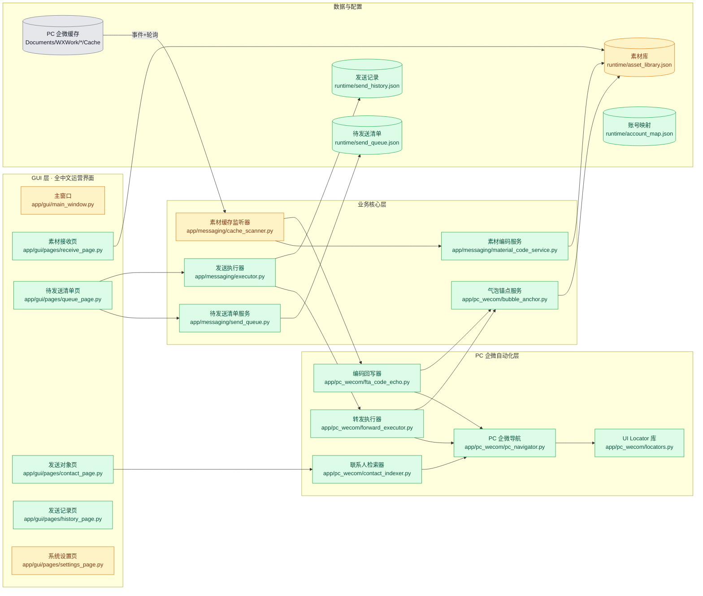
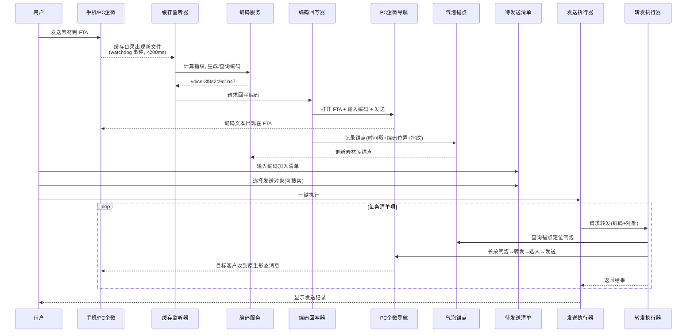

# 升级实施方案 · PC 企微 FTA 转发主链路

**总体进度：** `86%`

## 一句话概述（TLDR）

把项目从"Android 模拟器 + 虚拟麦克风"的重型链路，**彻底重构**为"**PC 企业微信文件传输助手（FTA）作为素材统一接收器与统一发送器**"的轻量链路：

- 素材（文本/图片/视频/文件/语音/小程序/卡片/位置）**都先发到 PC 企微 FTA**。
- 程序**近实时**捕捉每条素材，生成稳定的**素材编码**（跨用户同素材同编码）。
- 程序**紧跟着**在 FTA 里回一条编码文本，同时**在气泡上做锚点绑定**（时间戳 + 编码文本相邻位置 + 类型指纹三重定位）。
- 用户在 GUI 里通过编码选素材、通过搜索选对象，**加入待发送清单**后一键执行。
- 执行时程序**在 PC 企微里长按该气泡 → 转发 → 选对象 → 发送**，客户收到的形态与原素材完全一致（语音气泡就是语音气泡，小程序卡片就是原卡片）。

**彻底不再依赖：** Android 模拟器、uiautomator2、ADB、VB-CABLE 虚拟麦克风、按住说话录音链路。

---

## 关键决策（基于第一性原理）

> 每条决策都从"问题本质"倒推，取最少活动部件、最贴合运营用户的方案。

| # | 决策 | 第一性原理依据 |
| --- | --- | --- |
| 1 | **主链路 = PC 企微 FTA 转发**，全类型统一 | 语音/卡片/位置/小程序在企微里天然支持"长按 → 转发"且保留原形态；转发比"重新生成"稳定得多、无损、反检测更好、部署更轻。 |
| 2 | **完全下线 Android + VB-CABLE 链路** | 保留双通道 = 双份 UI 定位、双份测试、双份 bug；一次性砍掉换来长期维护成本降低。旧模块保留但从主流程解绑，作为归档。 |
| 3 | **素材编码 = `<类型前缀>-<12位哈希>`**（如 `voice-3f8a2c9d1b47`） | 需求要求"同素材跨用户同编码"，只有内容/结构指纹能做到；12 位十六进制冲突率 < 1e-14，足够终身使用；前缀让运营一眼看懂类型。 |
| 4 | **气泡锚点采用"三重定位"**：内容指纹 + 编码文本相邻锚 + 消息时间戳 | 单靠"最新一条"会被后续消息挤掉；单靠时间戳有秒级误差；单靠内容指纹在图片压缩后可能失效。三重合一才能在实际会话中稳定命中。 |
| 5 | **PC 自动化技术选型 = `uiautomation`（微软 UIA）为主 + `pywinauto` 为辅** | 企微 PC 用 QT/自绘控件较多，UIA 能穿透绝大多数控件树；`pywinauto` 在窗口层面（找主窗口、发键盘/鼠标事件）更成熟。二者组合互补。 |
| 6 | **缓存监听 = `watchdog` 事件驱动 + 2 秒轮询兜底** | 近实时是硬指标；`watchdog` 在 Windows 上基于 ReadDirectoryChangesW，延迟 <200ms；轮询兜底防止事件丢失（企微写文件有原子重命名操作，个别版本会漏事件）。 |
| 7 | **待发送清单 = 独立 JSON 持久化模型**，与素材库解耦 | 清单是"用户临时购物车"，生命周期短；素材库是"长期资产"。用不同存储避免污染，也便于清单跨会话恢复。 |
| 8 | **联系人索引 = PC 企微会话列表 + 按需搜索**，不做全量导出 | 需求明确"至少能搜到"；PC 企微搜索框已经很强，直接自动化调用最快最稳；避免抓取全量通讯录带来的合规风险和实现复杂度。 |
| 9 | **多账号映射 = 首次登录自动识别 + 本地绑定表**，微信A→企微A 一一对应 | 需求要求跨用户可用；企微登录时会写入 `Documents/WXWork/<accountId>/`，天然可识别当前活动账号，无需用户手动配置。 |
| 10 | **GUI 全中文白话，工程术语只保留在代码内部** | 用户是运营，不该看到 `plan/tag/dry-run/locator`；只改展示层，底层模型命名保持稳定以减少改动面。 |
| 11 | **执行顺序 = 数据层 → 自动化动作 → 用户交互** | 数据层可离线单测；自动化动作是最高风险且最耗时；GUI 依赖前两者。这个顺序做到"风险前置 + 每步可独立验收"。 |

---

## 架构总览

### 模块关系图



- **绿色 = 新增，黄色 = 修改，灰色 = 复用**。
- 所有 UI 自动化操作最终收敛到 `pc_navigator.py` + `locators.py`，避免定位规则散落。

### 端到端时序（捕捉 → 编码 → 回写 → 执行）



---

## 分类型的"编码 + 定位"技术方案

> 这是本次重构最核心的技术难点。每种类型都必须回答两个问题：**指纹怎么算才稳定？气泡在 FTA 里怎么找才准？**

### 1. 图片（image）

- **来源文件：** `Documents/WXWork/<acct>/Cache/Image/YYYY-MM/*.{jpg,png,gif}`
- **指纹：** 文件内容 SHA1（企微收到时不再压缩，字节稳定）
- **编码：** `img-<hash12>`
- **气泡定位：**
  - 主：**编码文本相邻锚**——回写的编码文本气泡上方的最近一条 Image 气泡
  - 副：**时间戳**（文件 mtime ± 3s 内的图片气泡）
  - 校验：图片的 `content-desc` 通常包含缩略信息可用作二次校验

### 2. 视频（video）

- **来源文件：** `Cache/Video/YYYY-MM/*.mp4`
- **指纹：** SHA1（同图片）
- **编码：** `vid-<hash12>`
- **气泡定位：** 同图片；额外用视频时长做校验（企微气泡上会显示时长）

### 3. 文件（file）

- **来源文件：** `Cache/File/YYYY-MM/*`
- **指纹：** SHA1
- **编码：** `file-<hash12>`
- **气泡定位：**
  - 主：**文件名 + 大小组合命中**（文件气泡上直接显示文件名与大小）
  - 副：编码文本相邻锚

### 4. 语音（voice）· 重构主战场

- **来源文件：** `Cache/Voice/YYYY-MM/*.silk`（手机端发到 FTA 的语音）
- **注意：** PC 企微本身没有录音按钮，语音只能来自"手机端 → FTA"或"用户提前录好的 mp3 通过外部工具发进 FTA"
- **指纹：**
  - 手机语音：SILK 原始字节 SHA1（同一条语音跨用户会一致）
  - mp3 语音：文件内容 SHA1
- **编码：** `voice-<hash12>`
- **气泡定位：**
  - 主：编码文本相邻锚（因为语音气泡本身无可读文本，最可靠的锚就是"我们回写的编码"）
  - 副：**语音时长匹配**（企微语音气泡显示"XX''"秒数，可从 UI 树读出）
- **发送形态：** **原生语音气泡**，通过"长按语音气泡 → 转发"直接下发，客户端收到就是语音气泡。**不再走虚拟麦克风。**

### 5. 小程序卡片（miniprogram）

- **来源：** 无独立缓存文件，卡片作为消息存在于聊天记录里
- **指纹：**
  - 由卡片可读字段组合规范化：`标题 + 描述 + 小程序名 + AppID尾6位`
  - 规范化后取 SHA1
- **编码：** `mp-<hash12>`
- **气泡定位：**
  - 主：编码文本相邻锚
  - 副：**卡片标题文本命中**（企微 UI 树里卡片标题可读）
- **发送形态：** 长按 → 转发，保留完整卡片形态

### 6. 视频号（channel_video）

- **来源：** 无独立缓存文件
- **指纹：** `视频号名称 + 视频标题 + 发布者ID后6位` → SHA1
- **编码：** `cv-<hash12>`
- **气泡定位：** 同小程序卡片
- **发送形态：** 长按 → 转发

### 7. 位置（location）

- **来源：** 无独立缓存文件
- **指纹：** `POI 名称 + 详细地址 + 经纬度取小数点后4位` → SHA1
- **编码：** `loc-<hash12>`
- **气泡定位：**
  - 主：编码文本相邻锚
  - 副：POI 名称文本命中
- **发送形态：** 长按 → 转发

### 8. 名片（contact_card）

- **来源：** 无独立缓存文件
- **指纹：** `被分享好友的 名字 + 企微ID后6位` → SHA1
- **编码：** `card-<hash12>`
- **气泡定位：** 编码文本相邻锚 + 名片主标题文本命中
- **发送形态：** 长按 → 转发

### 9. 文本（text）

- **特殊：** 文本类不需要"转发"，用户可以在 GUI 直接编辑发送
- **编码：** 不做长期编码；如果用户想复用，允许收藏成"文本模板"，编码 `txt-<hash12>`
- **发送形态：** PC 企微导航直接输入并发送

### 10. 表情/贴纸（sticker）

- **来源：** 收藏表情面板，PC 端可用（企微 PC 支持收藏表情）
- **指纹：** 收藏表情缩略图 SHA1
- **编码：** `stk-<hash12>`
- **气泡定位：** 编码文本相邻锚 + 表情面板 index
- **发送形态：** 长按已发表情 → 转发；或从收藏面板重新点击

### 统一约束

- **回写编码消息必须紧跟素材气泡**（同一条 FTA 会话里，紧邻其后一条），否则"相邻锚"失效。
- **编码是短哈希，不是自增号**——所以任何机器、任何账号、任何时间对同一素材都得到相同编码。
- **锚点信息存到 `AssetEntry.anchor` 字段**，包含：`bubble_timestamp / echo_message_id / fingerprint_snippet`。

---

## 技术选型

| 领域 | 选型 | 理由 |
| --- | --- | --- |
| PC UI 自动化（主） | `uiautomation`（微软 UIA Python 绑定） | 能穿透 QT/自绘控件，企微 PC 大部分控件树可读；开箱即用，无需注入 |
| PC UI 自动化（辅） | `pywinauto` | 窗口级操作稳定（找主窗口、发送快捷键、菜单弹出等），与 UIA 互补 |
| 文件系统事件 | `watchdog` | 跨平台事件监听，Windows 下基于 ReadDirectoryChangesW，低延迟 |
| SILK 解码 | 复用现有 `vendor/silk/silk_v3_decoder.exe` | 已经验证过，不重复造轮子；仅用于"指纹计算 + 试听"，不再用于发送 |
| 哈希 | `hashlib.sha1` | 12 位十六进制截断，冲突率可接受；与现有 `AssetLibrary` 一致 |
| GUI 框架 | 继续 `PySide6` | 无必要替换；只改内容不改框架 |
| 数据持久化 | JSON（`asset_library.json` / `send_queue.json` / `send_history.json` / `account_map.json`） | 与现有风格一致，无需引入 DB；文件级备份/迁移简单 |
| 日志 | 继续 `loguru` | 已在用，无需替换 |
| 打包 | 继续 `PyInstaller` | 现有 `packaging/` 脚本可继续使用，只需去掉 vendor 里 ffmpeg/silk 之外的依赖 |
| 移除 | `uiautomator2`、`adbutils`、`sounddevice`、`soundfile`、VB-CABLE | 不再需要 |

---

## 目录结构（重构后）

```
app/
├── config.py                         # (改) 移除 device/locators/audio，新增 pc_wecom/account_map
├── messaging/
│   ├── asset_library.py              # (改) AssetEntry 加 material_code/fingerprint/anchor/source_account
│   ├── cache_scanner.py              # (改) watchdog + 轮询兜底，输出事件流
│   ├── material_code_service.py      # (新) 编码生成与查询
│   ├── send_queue.py                 # (新) 待发送清单
│   ├── executor.py                   # (新) 清单执行器（调度/节流/记录）
│   └── types.py                      # (改) 保留 MessageType 定义
├── pc_wecom/
│   ├── __init__.py                   # (新)
│   ├── pc_navigator.py               # (新) PC 企微 UI 操作封装
│   ├── locators.py                   # (新) PC 企微控件定位规则库
│   ├── fta_code_echo.py              # (新) 编码回写器
│   ├── forward_executor.py           # (新) 长按→转发→选人→发送 组合链路
│   ├── bubble_anchor.py              # (新) 气泡锚点计算与查询
│   └── contact_indexer.py            # (新) 联系人搜索
├── gui/
│   ├── main_window.py                # (改) 换成运营视角的 5 个页
│   ├── pages/
│   │   ├── receive_page.py           # (新) 素材接收 & 编码列表
│   │   ├── queue_page.py             # (新) 待发送清单
│   │   ├── contact_page.py           # (新) 发送对象搜索
│   │   ├── history_page.py           # (新) 发送记录
│   │   └── settings_page.py          # (改) 中文化的系统设置
│   └── widgets/                      # (改) 复用/中文化现有 widget
└── audio/                            # (归档) 保留 silk_decoder.py 供指纹计算，其余标注 @deprecated
```

**归档（保留但从主流程解绑）：**

```
app/automation/                       # (归档) Android 端 navigator/sender
app/device/                           # (归档) ADB 会话与 gestures
app/messaging/senders/                # (归档) 老的 Sender 家族
app/messaging/runner.py               # (归档) PlanRunner
```

> 归档模块暂不删除，标注 `# DEPRECATED: 由 PC 链路取代`，保证旧测试可跑通、未来若需回滚可快速恢复。第7阶段确认稳定后可删除。

---

## 执行任务分解

**执行顺序依据：** 先做**离线可测的数据层**（编码 + 锚点 + 清单），中间做**高风险自动化层**（PC UI 操作），最后做**依赖前两者的 GUI 层**。这样每一步都能独立验收，风险最先暴露。

- [x] 🟩 **第 1 步 · 素材库模型 & 编码服务**
  - [x] 🟩 `AssetEntry` 增加字段：`material_code`、`fingerprint`、`anchor`、`source_account`
  - [x] 🟩 新增 `material_code_service.py`：`generate(fingerprint, type) → code` / `lookup(code) → entry`
  - [x] 🟩 定义每类素材的规范化指纹函数（image/video/file/voice/mp/cv/loc/card/stk）
  - [x] 🟩 兼容旧库：读到无编码字段时，按类型自动补齐一次
  - [x] 🟩 单元测试：跨用户同素材同编码、不同素材编码不冲突

- [x] 🟩 **第 2 步 · 缓存监听升级为近实时**
  - [x] 🟩 引入 `watchdog`，监听 `WXWork/<acct>/Cache/{Image,Video,File,Voice}`
  - [x] 🟩 保留 2 秒轮询作为兜底
  - [x] 🟩 事件去重窗口（同一路径 5 秒内不重复触发）
  - [x] 🟩 输出统一事件：`MaterialCaptured(entry, source_file, captured_at)`
  - [ ] 🟨 单元测试：模拟事件丢失时轮询兜底命中

- [ ] 🟨 **第 3 步 · PC 企微导航层**
  - [x] 🟩 新增 `pc_navigator.py`：`ensure_running()` / `open_fta()` / `focus_chat(name)` / `send_text(text)` / `long_press_bubble(anchor)` / `pick_forward_menu()` / `search_and_pick_contact(kw)` / `confirm_send()`
  - [x] 🟩 新增 `locators.py`：所有控件定位（AutomationId / Name / ClassName）集中管理
  - [x] 🟩 首次实现基于当前企微 PC 版本，抓一次 UI 树 dump 到 `spikes/pc_wecom_ui_dump/`
  - [x] 🟩 稳健化：每一步操作前后校验 UI 状态，超时 dump 现场
  - [ ] 🟨 集成测试（半自动）：已补 `spikes/spike_pc_wecom_integration.py`，待真机逐动作验收

- [x] 🟩 **第 4 步 · 编码回写 + 气泡锚点**
  - [x] 🟩 新增 `fta_code_echo.py`：订阅 `MaterialCaptured` 事件 → 打开 FTA → 发送编码文本
  - [x] 🟩 新增 `bubble_anchor.py`：回写完成后立即读 UI 树，抓取"编码气泡"上方最近的目标类型气泡，记录 `(时间戳, 相对位置, 指纹片段)`
  - [x] 🟩 锚点持久化到 `AssetEntry.anchor`
  - [x] 🟩 重试与去重：短时间内重复素材只回写一次编码，但锚点保持最新
  - [x] 🟩 单元测试（mock UI 树）：锚点命中正确气泡

- [x] 🟩 **第 5 步 · 转发执行器**
  - [x] 🟩 新增 `forward_executor.py`：`forward(code, target) → Result`
  - [x] 🟩 内部流程：查锚点 → 定位气泡 → 长按 → 转发菜单 → 选人 → 确认
  - [x] 🟩 目标失败重试策略（弹窗被打断 / 选人搜索无结果）
  - [x] 🟩 单元测试（mock navigator）：全链路调用序列正确

- [x] 🟩 **第 6 步 · 联系人检索**
  - [x] 🟩 新增 `contact_indexer.py`：通过 PC 企微搜索框搜"名字/备注/ID"
  - [x] 🟩 结果缓存到 `runtime/contact_index.json`（增量更新）
  - [x] 🟩 提供 `search(keyword) → [ContactHit]` API
  - [x] 🟩 单元测试：模糊搜索命中

- [x] 🟩 **第 7 步 · 待发送清单与执行器**
  - [x] 🟩 新增 `send_queue.py`：清单模型（编码+对象+备注+状态），JSON 持久化
  - [x] 🟩 新增 `executor.py`：串行执行，接入节流（复用现有 `Scheduler`）
  - [x] 🟩 执行结果写 `send_history.json`
  - [x] 🟩 支持中途暂停 / 恢复 / 单条重试
  - [x] 🟩 单元测试：状态机、断点恢复

- [x] 🟩 **第 8 步 · 多账号映射**
  - [x] 🟩 新增 `account_map.json`：自动识别当前活动企微账号目录
  - [x] 🟩 素材库 / 清单 / 记录按 `source_account` 隔离
  - [x] 🟩 GUI 顶部显示当前账号，切换后自动切换所有数据

- [x] 🟩 **第 9 步 · GUI 全中文白话重构**
  - [x] 🟩 重构主窗口为 5 个页：素材接收 / 待发送清单 / 发送对象 / 发送记录 / 系统设置
  - [x] 🟩 全量文案审阅（见"文案对照表"）
  - [x] 🟩 错误提示改为"你可以这样做"式引导
  - [x] 🟩 UI 测试：文案不含英文技术词

- [ ] 🟨 **第 10 步 · 归档旧链路 & 打包瘦身**
  - [x] 🟩 `app/automation/` `app/device/` `app/messaging/senders/` `app/messaging/runner.py` 标注 DEPRECATED 并从主流程解绑
  - [x] 🟩 `requirements.txt` 移除 `uiautomator2` / `adbutils` / `sounddevice` / `soundfile`
  - [ ] 🟥 `packaging/build.py` 移除 VB-CABLE / ffmpeg 相关（保留 silk_decoder 用于指纹）
  - [x] 🟩 更新 `README.md` 与 `packaging/使用说明.txt` 为中文运营版

- [ ] 🟥 **第 11 步 · 回归 & 端到端联调**
  - [ ] 🟥 全类型手动测试（见"手动测试清单"）
  - [ ] 🟥 多账号切换稳定性验证
  - [ ] 🟥 UI 版本升级预案（locators 版本管理）

---

## 详细改动清单

### 1. 素材编码与素材库

| 位置 | 改前 | 改后 | 文件 |
| --- | --- | --- | --- |
| `AssetEntry` 字段 | tag/semantic_type/source_path/sha1/fta_locator 等 | 新增 `material_code`/`fingerprint`/`anchor`/`source_account` | `app/messaging/asset_library.py` |
| 入库逻辑 | 仅算 sha1 起 tag | 入库时算规范化指纹 → 调 `MaterialCodeService` 拿编码 | `app/messaging/asset_library.py` |
| 编码服务 | 无 | 全新模块，负责生成 / 查询 / 兼容旧库 | `app/messaging/material_code_service.py`（新） |

### 2. 缓存监听（近实时）

| 位置 | 改前 | 改后 | 文件 |
| --- | --- | --- | --- |
| 监听方式 | 5 秒轮询 | watchdog 事件 + 2 秒兜底轮询 | `app/messaging/cache_scanner.py` |
| 输出 | 直接调 lib.register_local | 发布 `MaterialCaptured` 事件供订阅 | 同上 |
| CLI | 无 | 保留 `scan-cache` 兼容，新增 `--watch` 常驻模式 | `main.py` |

### 3. PC 企微自动化

| 位置 | 改动 | 文件 |
| --- | --- | --- |
| UI 操作封装 | 全新，基于 `uiautomation` + `pywinauto` | `app/pc_wecom/pc_navigator.py`（新） |
| Locator 集中管理 | 新增；便于版本升级替换 | `app/pc_wecom/locators.py`（新） |
| 编码回写 | 订阅事件，向 FTA 发送编码文本 | `app/pc_wecom/fta_code_echo.py`（新） |
| 气泡锚点 | 三重定位（指纹/相邻锚/时间戳） | `app/pc_wecom/bubble_anchor.py`（新） |
| 转发执行 | 长按→转发→选人→发送 组合 | `app/pc_wecom/forward_executor.py`（新） |
| 联系人检索 | 搜索框驱动 + 缓存 | `app/pc_wecom/contact_indexer.py`（新） |

### 4. 待发送清单与执行

| 位置 | 改动 | 文件 |
| --- | --- | --- |
| 清单模型 | 全新 JSON 持久化 | `app/messaging/send_queue.py`（新） |
| 执行器 | 全新，接入节流与记录 | `app/messaging/executor.py`（新） |
| 发送记录 | 全新 JSON 追加式 | `runtime/send_history.json` |

### 5. GUI 中文化重构

| 位置 | 改前 | 改后 | 文件 |
| --- | --- | --- | --- |
| 顶层页签 | `Plan 浏览 / Plan 编辑 / 执行监控 / 素材库 / 设置` | `素材接收 / 待发送清单 / 发送对象 / 发送记录 / 系统设置` | `app/gui/main_window.py` |
| 素材接收页 | 无 | 编码列表 + 类型筛选 + 试听/预览 | `app/gui/pages/receive_page.py`（新） |
| 待发送清单页 | 无 | 编码输入/粘贴 + 对象选择 + 批量执行 | `app/gui/pages/queue_page.py`（新） |
| 发送对象页 | 无 | 搜索框 + 结果列表 + 加入清单按钮 | `app/gui/pages/contact_page.py`（新） |
| 发送记录页 | 无 | 时间/对象/编码/结果 表格 | `app/gui/pages/history_page.py`（新） |
| 系统设置页 | 混合中英参数 | 中文化：账号信息、节流、日志 | `app/gui/pages/settings_page.py`（改） |

### 6. 文案对照表（GUI 白话化）

| 位置 | 改前 | 改后 |
| --- | --- | --- |
| 主页签 | Plan 浏览 | 素材接收 |
| 主页签 | Plan 编辑 | 待发送清单 |
| 主页签 | 执行监控 | 发送记录 |
| 主页签 | 素材库 | （合并进"素材接收"） |
| 字段 | tag | 素材编码 |
| 字段 | source_path | 素材文件 |
| 字段 | fta_locator | 定位提示词 |
| 字段 | contacts | 发送对象 |
| 字段 | messages | 消息内容 |
| 按钮 | 执行 plan-run | 开始发送 |
| 按钮 | dry-run | 演练一次（不真发） |
| 按钮 | resume | 从上次断点继续 |
| 提示 | limit_contacts | 每批最多发多少人 |
| 提示 | working_hours | 只在这个时间段内发送 |

### 7. 配置与账号映射

| 位置 | 改动 | 文件 |
| --- | --- | --- |
| `AppConfig` | 移除 device/locators/audio；新增 pc_wecom/account_map | `app/config.py` |
| 账号映射样例 | 新增 | `account_map.example.json` |
| PC UI Locator 版本 | 新增，独立文件便于版本升级 | `app/pc_wecom/locators.py` |

### 8. 依赖清理

| 位置 | 改前 | 改后 | 文件 |
| --- | --- | --- | --- |
| 依赖 | uiautomator2 / adbutils / sounddevice / soundfile | 新增 uiautomation / pywinauto / watchdog；移除上述 | `requirements.txt` / `pyproject.toml` |
| 打包 | 带 VB-CABLE 依赖提示 | 只需 PC 企微 + Python 运行时 | `packaging/build.py` / `packaging/使用说明.txt` |

### 9. 自动化测试（新增 / 修改）

| 测试文件 | 断言覆盖 |
| --- | --- |
| `tests/test_material_code_service.py` | 跨用户同素材同编码；不同素材编码不冲突；旧库自动补编码 |
| `tests/test_cache_scanner_watchdog.py` | 事件触发、去重、丢事件后轮询兜底 |
| `tests/test_bubble_anchor.py` | 相邻锚 / 时间戳 / 指纹三重命中优先级正确 |
| `tests/test_pc_navigator_mock.py` | 每个 UI 操作调用参数正确（mock UIA） |
| `tests/test_forward_executor.py` | 长按→转发→选人→确认 调用序列 |
| `tests/test_contact_indexer.py` | 名字/备注/ID 命中 |
| `tests/test_send_queue.py` | 清单增删改、执行、断点恢复 |
| `tests/test_account_map.py` | 多账号数据隔离 |
| `tests/test_gui_copywriting_cn.py` | GUI 关键文案不含英文技术词 |
| （删除） | 原 `test_navigator_*.py`、`test_forward_sender.py` 等 Android 相关测试转归档 |

---

## 手动测试清单

> 按用户视角分组，每条独立勾选。

### A · 素材接收与编码

- [ ] **A1** 手机端向 PC 企微 FTA 发一张图片 → 1 秒内 FTA 里出现 `img-xxxxxxxxxxxx` 编码文本
- [ ] **A2** 从另一个企微账号发同一图片 → 编码完全一致
- [ ] **A3** 依次快发 5 条不同素材 → 每条都被编码、顺序正确、不串号
- [ ] **A4** 发一段手机语音 → 编码文本紧跟语音气泡出现
- [ ] **A5** 发一个小程序卡片 → 编码为 `mp-xxxx`
- [ ] **A6** 发一个位置 → 编码为 `loc-xxxx`
- [ ] **A7** 发一个视频号卡片 → 编码为 `cv-xxxx`
- [ ] **A8** 发一张个人名片 → 编码为 `card-xxxx`
- [ ] **A9** 重复同一素材 → 编码不变、锚点更新为最新气泡

### B · 待发送清单

- [ ] **B1** 复制编码到清单页 → 自动识别素材类型与内容
- [ ] **B2** 一次加入多条编码 → 都能正确显示
- [ ] **B3** 支持删除、上下调整顺序
- [ ] **B4** 清单可保存并在下次打开程序时恢复

### C · 发送对象检索

- [ ] **C1** 搜索"张三"（昵称）→ 命中
- [ ] **C2** 搜索备注关键字 → 命中
- [ ] **C3** 搜索企微 ID 片段 → 命中
- [ ] **C4** 同时选择多个对象 → 加入清单执行

### D · 执行发送（严格还原）

- [ ] **D1** 发送图片 → 目标收到原图（非文件形态）
- [ ] **D2** 发送视频 → 目标收到视频气泡（可播放）
- [ ] **D3** 发送文件 → 目标收到原文件（文件名保留）
- [ ] **D4** 发送语音 → 目标收到**语音气泡**（不是文件）
- [ ] **D5** 发送小程序 → 目标收到原生小程序卡片
- [ ] **D6** 发送位置 → 目标收到原生位置卡片
- [ ] **D7** 发送视频号 → 目标收到原生视频号卡片
- [ ] **D8** 发送名片 → 目标收到原生名片
- [ ] **D9** 一次给多个对象群发 → 每个对象都成功、发送记录完整

### E · 多账号隔离

- [ ] **E1** 用户 A 登录 → 只看到 A 的素材编码与清单
- [ ] **E2** 切换到用户 B → 数据自动隔离，不污染 A

### F · GUI 白话度

- [ ] **F1** 全部页面无 `plan / tag / dry-run / locator / resume` 等英文术语
- [ ] **F2** 错误提示形如"网络暂时不通，稍后重试"而不是异常堆栈
- [ ] **F3** 首次打开有 5 步内的中文引导（可跳过）

### G · 稳定性 & 边界

- [ ] **G1** 发送过程中人为切走 PC 企微窗口 → 程序自动切回并继续
- [ ] **G2** 中途关闭 PC 企微 → 程序检测到并提示"请先登录 PC 企微"
- [ ] **G3** 单条发送失败 → 清单页可看到失败原因、可一键重试
- [ ] **G4** 断点恢复：重启程序后清单和进度都还在

---

## 范围边界（本计划不做）

- 不做 Android 端任何新增功能，也不再维护 Android 链路
- 不做企微开放 API 集成（能力有限，且对企业管理员依赖过重）
- 不做云端服务或数据库
- 不做微信个人版（WeChat）缓存扫描
- 不做企业管理员级功能（消息审计、群发通知等）

---

## 风险与预案

| 风险 | 影响 | 预案 |
| --- | --- | --- |
| PC 企微版本升级导致 UI 变化 | Locator 失效 | `locators.py` 集中管理 + 每次启动自检；提供"UI dump"命令给运营快速反馈 |
| 长按气泡菜单不出现（企微偶发） | 转发失败 | 重试 2 次 + 失败自动截图存证 |
| 选人搜索无结果 | 单条失败 | 提示用户改用备注/ID 搜索 |
| 短时间大量转发触发风控 | 账号被限流 | 复用 `schedule` 节流；默认保守区间 |
| 编码哈希碰撞 | 编码冲突 | 12 位哈希碰撞率极低，若真发生 → `MaterialCodeService` 追加序号后缀（如 `img-xxxxxxxxxxxx-1`） |
| 用户误发编码给客户 | 客户收到无意义字符串 | 回写目标限定在"文件传输助手"会话，转发时明确不带编码文本 |

---

## 附录 · 编码格式速查

```
img-<12hex>    图片
vid-<12hex>    视频
file-<12hex>   文件
voice-<12hex>  语音
mp-<12hex>     小程序
cv-<12hex>     视频号
loc-<12hex>    位置
card-<12hex>   名片
stk-<12hex>    表情
txt-<12hex>    文本模板（可选）
```

示例：`voice-3f8a2c9d1b47`
