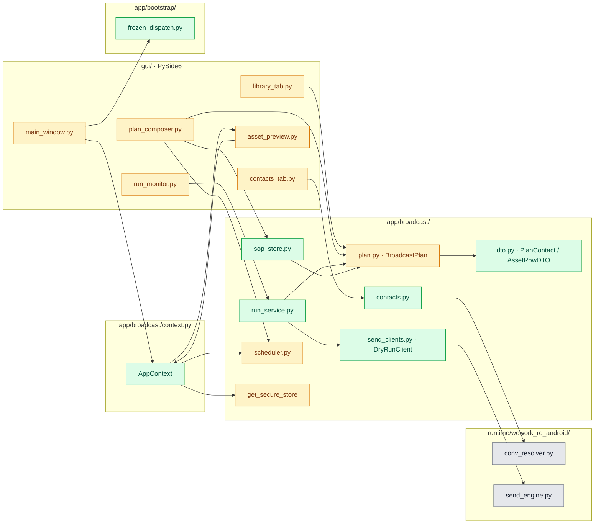
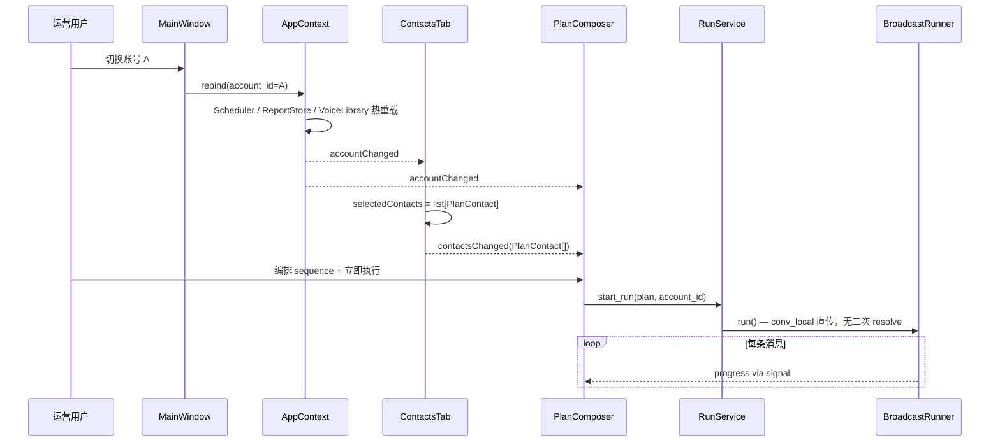
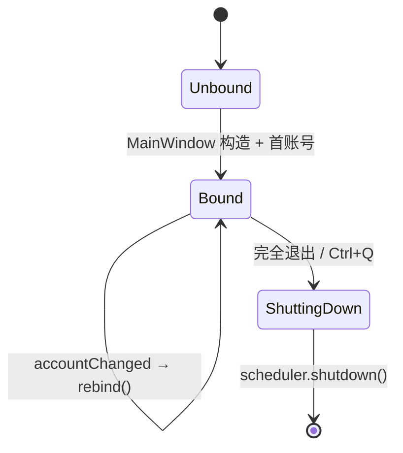

# 架构迭代实施计划（GUI ↔ Broadcast 接缝优化）

**Overall Progress:** `100%`

**文档版本**：2026-09-17 v1.4  
**上游依据**：[`PLAN_GUI_DESIGN.md`](PLAN_GUI_DESIGN.md) G13、[`PLAN_VOICE_LIBRARY_AND_BROADCAST.md`](PLAN_VOICE_LIBRARY_AND_BROADCAST.md) Phase C C12  
**姊妹文档**：本文只写**架构接缝 / 可维护性 / 精简性**迭代；功能验收仍以 GUI / Broadcast 两文档为准。  
**触发条件**：Phase A/B/C 主链已代码完成；本迭代**不改发送引擎 / 逆向面**，只收敛 GUI 与 `app/broadcast/` 边界。

---

## TLDR

上一轮架构评审指出：当前 GUI 与后端衔接总体方向正确（G13「GUI 只做编排 + 展示」），但存在 **Plan 主键用备注名而非 conv_local**、**GUI 直调 runtime**、**SOP/调度/加密等后端逻辑散落在 GUI Panel**、**遗留双 GUI 目录并存** 等结构性问题。本计划用 **3 轮、8 Step** 最小 diff 修复：先统一 `PlanContact` 主键与 `AppContext` 生命周期，再下沉 facade / SOP / run service，最后做 legacy 归档与死码清理。每步可独立验收，不引入新功能 scope。

---

## Critical Decisions

> **范式（必须遵循）：** 从第一性原理出发——GUI 是**最薄展示层**，业务状态与 I/O 必须在 `app/broadcast/` 可 CLI 复用；跨层契约用 **typed model** 而非裸 dict；后端单例资源（Scheduler / SecureStore / Preview）**一处持有、多处注入**。

| # | 决策 | 第一性原理依据 |
| --- | --- | --- |
| 1 | **Plan 联系人主键 = `conv_local`，`display_name` 仅展示** | 发送引擎只认 conv_local；用备注名做 key 会随用户改备注断链、同名冲突、Runner 多一次 resolve。主键与展示分离 = 最少失败点。 |
| 2 | **新增 `AppContext` 统一管理 account 切换下的后端实例** | Scheduler 在 Panel 里 shutdown/rebuild 会污染首启判定、与 RunMonitor 双轨持有账号态。单进程工具 = 单处持有有状态后端资源，Tab 只订阅。 |
| 3 | **`gui/` 禁止 `import runtime.*`，联系人/运行/ SOP 经 `app/broadcast/` facade** | G13 已决策；runtime 是 Frida/ADB 实现细节，GUI 耦合它则 CLI/Web 无法复用同一 facade，测试也无法 mock。 |
| 4 | **SOP 与 Plan 共用 schema，存储下沉 `app/broadcast/sop_store.py`** | SOP = 未绑联系人的 Plan 模板（G2）；两套 dataclass + GUI 内 EncryptedJsonStore = 重复模型，定时/CLI 无法消费。 |
| 5 | **`ScheduleSpec` pydantic 模型替代 GUI 中文 label 分派 + 自造 cron 字符串** | 调度语义属于业务层；GUI 文案变动不应影响 APScheduler 注册；typed spec 便于持久化与扩展。 |
| 6 | **`EncryptedJsonStore` 单例 / 注入，不散落 7 处 `_SECURE_STORE = ...`** | 加密策略变更（调试开关、非 Windows fallback）应改一处；符合 DIP，不增加抽象层数量。 |
| 7 | **Legacy 代码物理归档，不删兼容入口直到回归通过** | `app/gui/` 与 `gui/tagger_window.py` 并存 = 认知负担；归档到 `legacy/` 保留 git 历史，新读者只有一条路径。 |
| 8 | **执行顺序：P0 契约 → P1 facade → P2 精简** | 主键与 AppContext 是后续所有改动的依赖；facade 依赖稳定 DTO；归档/死码最后做，避免搬 twice。 |

---

## Architecture

### 模块关系图（改后目标态）

- **绿色**：本迭代新增；**黄色**：修改接口/职责；**灰色**：实现不动，仅被 facade 调用。
- **关键箭头**：GUI Tab → `app/broadcast/*` facade →（必要时）`runtime/*`；GUI **不再**直连 `runtime`。

### 账号切换 + Plan 执行时序图

### AppContext 生命周期状态图

---

## Tasks

**执行顺序依据**：Step 1–2 修 Plan 契约（所有下游依赖）→ Step 3 AppContext（消除 Scheduler 双轨与首启污染）→ Step 4–6 facade 下沉（GUI 变薄）→ Step 7 legacy 归档（防搬两次）→ Step 8 精简与 lint（收尾）。每 Step 完成后跑对应 pytest + 手动清单子集。

- [x] 🟩 **Step 1: PlanContact 主键统一（P0）**
  - [x] 🟩 1.1 新增 `app/broadcast/dto.py`：`PlanContact { conv_local, display_name }`、`AssetRowDTO`、`ContactRowDTO`
  - [x] 🟩 1.2 扩展 `app/broadcast/plan.py`：`BroadcastPlan.contacts: list[PlanContact]`；保留旧 `list[str]` JSON 反序列化兼容（仅 name → 走 resolver 兜底）
  - [x] 🟩 1.3 `BroadcastRunner`：Plan 内已有 conv_local 则跳过 `resolver(name)`；resolver 仅 legacy / SOP 标签命中场景
  - [x] 🟩 1.4 `gui/tabs/contacts_tab.py`：`selectedContactsChanged` 发 `list[PlanContact]`，不再 emit 纯 name
  - [x] 🟩 1.5 `gui/tabs/plan_composer.py`：`build_plan()` 写入 PlanContact；SOP 标签确认面板仍用 display_name 展示
  - [x] 🟩 1.6 单测：`tests/test_plan_schema.py` 增 PlanContact 往返；`tests/test_broadcast_runner.py` 增 conv_local 直传无 resolve

- [x] 🟩 **Step 2: ScheduleSpec  typed 调度契约（P0）**
  - [x] 🟩 2.1 新增 `app/broadcast/schedule_spec.py`：`ImmediateSpec | AfterSpec | AtSpec | CronSpec` Union
  - [x] 🟩 2.2 `BroadcastScheduler` 增 `submit(spec, payload)` 入口；保留旧 `schedule_after/at/cron` 为薄 wrapper
  - [x] 🟩 2.3 `gui/tabs/plan_composer.py`：`_on_submit` 构造 ScheduleSpec，删除以中文 ComboBox 文本分派的逻辑
  - [x] 🟩 2.4 单测：`tests/test_scheduler.py` 增 ScheduleSpec 序列化往返

- [x] 🟩 **Step 3: AppContext 与 MainWindow 集成（P0）**
  - [x] 🟩 3.1 新增 `app/broadcast/context.py`：`AppContext(account_id)` 持有 Scheduler / ReportStore / PreviewService / VoiceLibrary loader
  - [x] 🟩 3.2 `AppContext.rebind(account_id)`：切换账号、lazy-init 目录（**不在 Tab 构造时 mkdir**）
  - [x] 🟩 3.3 `gui/main_window.py`：构造 AppContext；`_on_account_changed` 调 `rebind`；移除 PlanComposer 内 `_rebuild_scheduler`
  - [x] 🟩 3.4 首启引导：依赖 AppContext 是否已有 voice_lib / contacts_cache，删除 `_pending_first_run` 快照 hack（验证后）
  - [x] 🟩 3.5 `AccountBar`：切换账号时持久化 `data/last_active_account.json`，启动时读回
  - [x] 🟩 3.6 单测：`tests/test_app_context.py`（新建）覆盖 rebind 路径隔离

- [x] 🟩 **Step 4: Broadcast facade — contacts / run（P1）**
  - [x] 🟩 4.1 新增 `app/broadcast/contacts.py`：`refresh_contacts(account_id, refresh) -> list[ContactRowDTO]`；内含 `_infer_category`（从 GUI 迁出）
  - [x] 🟩 4.2 新增 `app/broadcast/run_service.py`：`RunService.start(plan, *, resume_uuid, only_failed, progress_cb)`；封装 Runner + resolver + SendClient
  - [x] 🟩 4.3 新增 `app/broadcast/send_clients.py`：迁 `_DryRunClient`；`SubprocessSendClient` re-export
  - [x] 🟩 4.4 `gui/tabs/contacts_tab.py`：改调 `contacts.refresh_contacts`；删除 `from runtime...conv_resolver`
  - [x] 🟩 4.5 `gui/tabs/run_monitor.py`：改调 `RunService`；删除 `_RunnerWorker` 内直接构造 `ConversationResolver`
  - [x] 🟩 4.6 CI / lint：`gui/` 目录禁止 `from runtime`（`scripts/check_gui_imports.py` 或 ruff per-file-ignores 反向约束）

- [x] 🟩 **Step 5: SOP 存储下沉（P1）**
  - [x] 🟩 5.1 新增 `app/broadcast/sop_store.py`：`SopTemplate` + `list/save/load/delete`
  - [x] 🟩 5.2 `resolve_contacts_by_labels(labels, contact_rows) -> list[PlanContact]`，合并 α 快照 + β LocalLabelStore
  - [x] 🟩 5.3 `gui/tabs/plan_composer.py`：删除内联 `SopTemplate` / `_SECURE_STORE` / `_load_sops`，改调 `sop_store`
  - [x] 🟩 5.4 更新 [`PLAN_VOICE_LIBRARY_AND_BROADCAST.md`](PLAN_VOICE_LIBRARY_AND_BROADCAST.md) C.2 业务层清单补 `sop_store.py`
  - [x] 🟩 5.5 单测：`tests/test_sop_store.py` 增 CRUD + 标签命中

- [x] 🟩 **Step 6: 安全层与 Bootstrap 收敛（P1）**
  - [x] 🟩 6.1 `app/security/__init__.py` 暴露 `get_secure_store()` 单例；7 处 `_SECURE_STORE = EncryptedJsonStore()` 改引用单例
  - [x] 🟩 6.2 新增 `app/bootstrap/frozen_dispatch.py`：`maybe_dispatch_frozen_subcommand(argv)` 处理 `__send_engine__`
  - [x] 🟩 6.3 `gui/main.py`：入口只调 `frozen_dispatch` 一行；删除内联 `_dispatch_internal_send_engine`
  - [x] 🟩 6.4 `gui/widgets/asset_preview.py`：`PreviewService` 改由 AppContext 注入，删除 Panel 内 `PreviewService()`

- [x] 🟩 **Step 7: Legacy 归档（P2）**
  - [x] 🟩 7.1 归档 `app/gui/ → legacy/app_gui_pc/`（PC 老 GUI，整目录）
  - [x] 🟩 7.2 归档 `gui/tagger_window.py → legacy/gui/tagger_window.py`
  - [x] 🟩 7.3 保留 `gui/plan_composer.py`、`gui/run_monitor.py` 兼容 re-export，新增 `DeprecationWarning`（1 版本周期）
  - [x] 🟩 7.4 根 README / `docs/PLAN_GUI_DESIGN.md` 补一句「唯一 GUI 入口 = `python -m gui.main`」

- [x] 🟩 **Step 8: 精简与收尾（P2）**
  - [x] 🟩 8.1 `plan_composer._bind_events`：按控件类型分桶 connect，删除 `if hasattr ... else None` 反模式
  - [x] 🟩 8.2 删除 `asset_preview._extract_path` 死码；`_open_link` 改存 plain URL 成员
  - [x] 🟩 8.3 `library_tab` / `contacts_tab` Signal payload 改 typed DTO（内部仍 Qt Signal(list)，函数签名强类型）
  - [x] 🟩 8.4 全量 pytest + GUI 手动清单回归；更新本文 Overall Progress

---

## 详细改动清单

### 1. 新增 — DTO 与 Plan 契约

| 位置 | 改前 | 改后 | 文件 |
| --- | --- | --- | --- |
| 跨层契约 | 无统一 DTO，Signal 传裸 dict | `PlanContact` / `ContactRowDTO` / `AssetRowDTO` | `app/broadcast/dto.py`（新建） |
| Plan schema | `contacts: list[str]` | `contacts: list[PlanContact]` + legacy 兼容 loader | `app/broadcast/plan.py` |
| Runner resolve | 始终 `resolver(contact_name)` | 有 conv_local 直用；无则 resolver 兜底 | `app/broadcast/runner.py` |

### 2. 新增 — AppContext

| 位置 | 改前 | 改后 | 文件 |
| --- | --- | --- | --- |
| 后端资源 | 各 Tab / Panel 各自 new Scheduler、ReportStore、PreviewService | `AppContext` 单例持有，`rebind(account_id)` 热切换 | `app/broadcast/context.py`（新建） |
| 主窗口 | PlanComposer 内 `_rebuild_scheduler` | MainWindow 持有 AppContext，Composer 只 submit | `gui/main_window.py` |
| 首启判定 | `_pending_first_run` 快照 hack | AppContext lazy-init，Tab 构造不 mkdir | `gui/main_window.py` |

### 3. 新增 — Facade 层

| 位置 | 改前 | 改后 | 文件 |
| --- | --- | --- | --- |
| 联系人刷新 | GUI 直调 `runtime.conv_resolver.list_conversations` | `contacts.refresh_contacts()` | `app/broadcast/contacts.py`（新建） |
| 分类推断 | `ContactsTab._infer_category` 硬编码中文 | 下沉 contacts.py，基于 ConversationHit 字段 | `app/broadcast/contacts.py` |
| Plan 执行 | `RunMonitor._RunnerWorker` 内组装 Runner | `RunService.start(...)` | `app/broadcast/run_service.py`（新建） |
| Dry-run 客户端 | 定义在 `gui/tabs/run_monitor.py` | 迁至 send_clients | `app/broadcast/send_clients.py`（新建） |
| 调度 spec | GUI 中文 mode + cron 字符串 | `ScheduleSpec` pydantic Union | `app/broadcast/schedule_spec.py`（新建） |

### 4. 新增 — SOP 存储

| 位置 | 改前 | 改后 | 文件 |
| --- | --- | --- | --- |
| SOP 模型 | `SopTemplate` dataclass 在 plan_composer.py | `sop_store.py` CRUD + 标签解析 | `app/broadcast/sop_store.py`（新建） |
| 加密 IO | GUI 内 `_SECURE_STORE.save_json` | sop_store 内调 `get_secure_store()` | `app/broadcast/sop_store.py` |
| Composer | 内联 load/save SOP | 调 `sop_store.list/save` | `gui/tabs/plan_composer.py` |

### 5. 修改 — GUI Tab

| 位置 | 改前 | 改后 | 文件 |
| --- | --- | --- | --- |
| 联系人选中 | emit `list[str]` 备注名 | emit `list[PlanContact]` | `gui/tabs/contacts_tab.py` |
| runtime import | `from runtime.wework_re_android.conv_resolver import ...` | `from app.broadcast.contacts import ...` | `gui/tabs/contacts_tab.py` |
| 执行监控 | 内联 `_RunnerWorker` + ConversationResolver | 调 `RunService` + progress signal | `gui/tabs/run_monitor.py` |
| 调度提交 | `_schedule_mode.currentText()` 中文分派 | 构造 `ScheduleSpec` → `scheduler.submit` | `gui/tabs/plan_composer.py` |
| 素材 Signal | 裸 dict list | 内部构造 `AssetRowDTO` | `gui/tabs/library_tab.py` |
| 预览服务 | Panel 内 `PreviewService()` | 构造函数注入 / AppContext | `gui/widgets/asset_preview.py` |

### 6. 修改 — 安全 / Bootstrap

| 位置 | 改前 | 改后 | 文件 |
| --- | --- | --- | --- |
| SecureStore | 7 文件各自 `EncryptedJsonStore()` | `get_secure_store()` 单例 | `app/security/__init__.py` + 7 消费方 |
| 冻结分发 | `gui/main.py` 内联 `__send_engine__` | `frozen_dispatch.maybe_dispatch` | `app/bootstrap/frozen_dispatch.py`（新建） |
| 账号记忆 | 无 | `data/last_active_account.json` | `app/broadcast/account.py` |

### 7. 归档 — Legacy

| 位置 | 改前 | 改后 | 文件 |
| --- | --- | --- | --- |
| PC 老 GUI | `app/gui/` 活跃 | `legacy/app_gui_pc/` | 整目录 git mv |
| 旧素材库 Tab | `gui/tagger_window.py` | `legacy/gui/tagger_window.py` | git mv |
| 兼容 re-export | `gui/plan_composer.py` 4 行 | 删除或 DeprecationWarning | `gui/plan_composer.py` |

### 8. 文档同步

| 位置 | 改前 | 改后 | 文件 |
| --- | --- | --- | --- |
| Broadcast plan C.2 | 无 sop_store | 补 `sop_store.py` 行 | `docs/PLAN_VOICE_LIBRARY_AND_BROADCAST.md` |
| GUI plan Architecture | Scheduler 在 Composer 内 | 更新 mermaid：MainWindow → AppContext | `docs/PLAN_GUI_DESIGN.md` |
| G13 lint | 无 enforcement | 补「gui 禁止 import runtime」说明 | `docs/PLAN_GUI_DESIGN.md` |

### 9. 自动化测试

| 测试文件 | 断言/覆盖 |
| --- | --- |
| `tests/test_plan_schema.py` | PlanContact 序列化；legacy `contacts: ["name"]` 仍可读 |
| `tests/test_broadcast_runner.py` | conv_local 直传跳过 resolve；legacy name 仍 resolve |
| `tests/test_scheduler.py` | ScheduleSpec → APScheduler job 注册 |
| `tests/test_app_context.py`（新建） | rebind 后 ReportStore 路径切换 |
| `tests/test_sop_store.py`（新建） | SOP CRUD + 标签命中 PlanContact |
| `tests/test_contacts_facade.py`（新建） | refresh_contacts mock conv_resolver |
| `scripts/check_gui_imports.py`（新建） | `gui/` 无 `from runtime` / `import runtime` |

---

## 手动测试清单（供你逐项勾选）

### A. PlanContact 主键（Step 1）

- [ ] **A1** 联系人页勾选「海鸟与鱼」→ 编 Plan → JSON 预览中 `contacts` 含 `conv_local` + `display_name`
- [ ] **A2** 执行 Plan → 报告 jsonl 中 `conv_local` 字段非空，无 `resolve_failed`（联系人存在场景）
- [ ] **A3** 加载旧 Plan JSON（仅 name 数组）→ 仍能执行，Runner 走 resolver 兜底

### B. AppContext 与账号（Step 3）

- [ ] **B1** 切换账号 → 素材库 / 联系人 / 执行结果三 Tab 数据同步切换，Scheduler 不 crash
- [ ] **B2** 首启无 `data/<account>/` → 仍弹初始化引导（Scheduler 未提前 mkdir）
- [ ] **B3** 选账号 A → 完全退出 → 重启 → 默认仍为 A（last_active_account）

### C. 调度（Step 2）

- [ ] **C1** 「5 分钟后」提交 → `schedules.json` 存 ScheduleSpec JSON，非中文 label
- [ ] **C2** 到点弹 60s 确认 → 立即开始 → RunMonitor 正常执行
- [ ] **C3** 循环「每天 09:00」→ 重启 GUI → 调度任务仍恢复

### D. Facade 边界（Step 4–5）

- [ ] **D1** `grep -r "from runtime" gui/` 无命中（归档后）
- [ ] **D2** 另存为 SOP → 重启 → 使用 SOP → 标签命中确认面板人数正确
- [ ] **D3** 重试失败项 → 仅失败 step 重跑（RunService 路径）

### E. Legacy 与打包（Step 6–7）

- [ ] **E1** `python -m gui.main` 正常启动
- [ ] **E2** 打包 exe（若 vendor 就绪）→ `__send_engine__` 子进程仍可用
- [ ] **E3** `legacy/` 内旧 GUI 文件存在但不在 import 路径

### F. 精简回归（Step 8）

- [ ] **F1** 素材库预览 voice/image/video 仍正常（PreviewService 注入后）
- [ ] **F2** DPAPI 加密文件仍可读（get_secure_store 单例后）
- [ ] **F3** 现有 pytest 全绿：`pytest tests/ -q`

### G. 未改项确认

- [ ] **G1** CLI `python -m runtime.wework_re_android.send_engine text ...` 不受影响
- [ ] **G2** Frida hook / adapter_manifest 拉取逻辑不变
- [ ] **G3** Phase A/B 发送链（voice/text/image/video/oa）手动抽测 1 条仍成功

---

## Open Questions

| # | 问题 | 回填时机 |
| --- | --- | --- |
| R-Q1 | Legacy Plan JSON（纯 name）兼容保留几个版本？ | Step 1 完成后定 deprecate 时间表 |
| R-Q2 | `BroadcastPlan` 是否 Step 5 直接把 SOP 合并为 `labels` 非空 Plan？ | Step 5 设计评审 |
| R-Q3 | `gui/` import lint 放 pre-commit 还是 CI only？ | Step 4.6 |
| R-Q4 | 删除 `gui/plan_composer.py` re-export 是否本迭代做？ | Step 7.3 回归后 |

---

## 进度回填说明

每完成一个 Step，将对应 checkbox 改为 🟩，并更新顶部 **Overall Progress**（8 Step 各 12.5%）。本文档即为迭代唯一进度源，不另开 scope。
