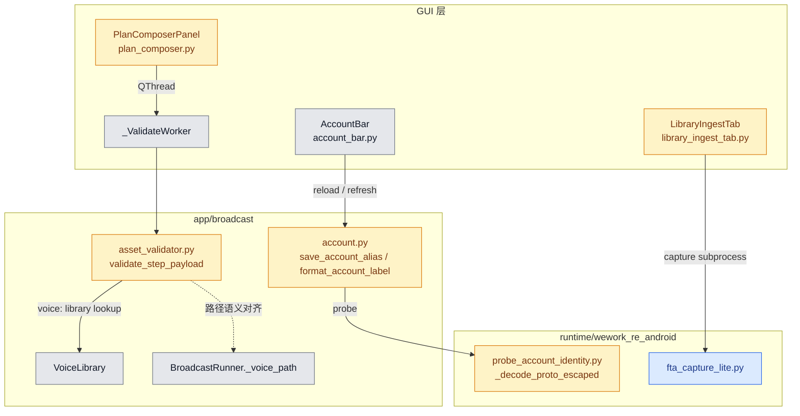
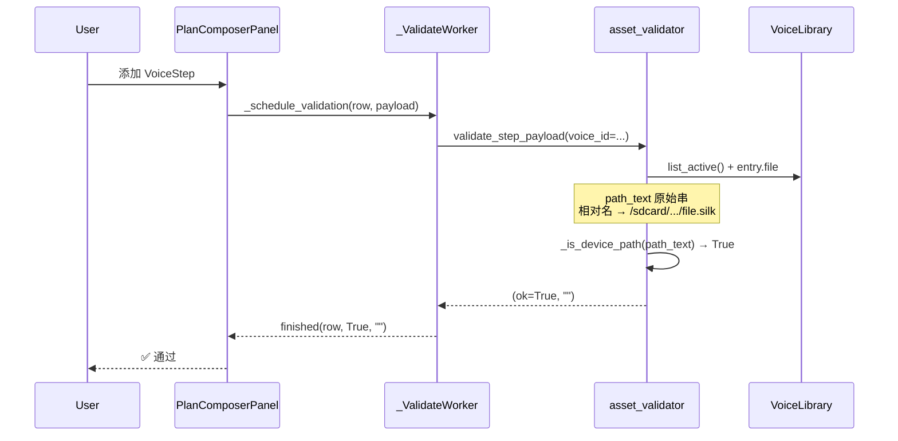
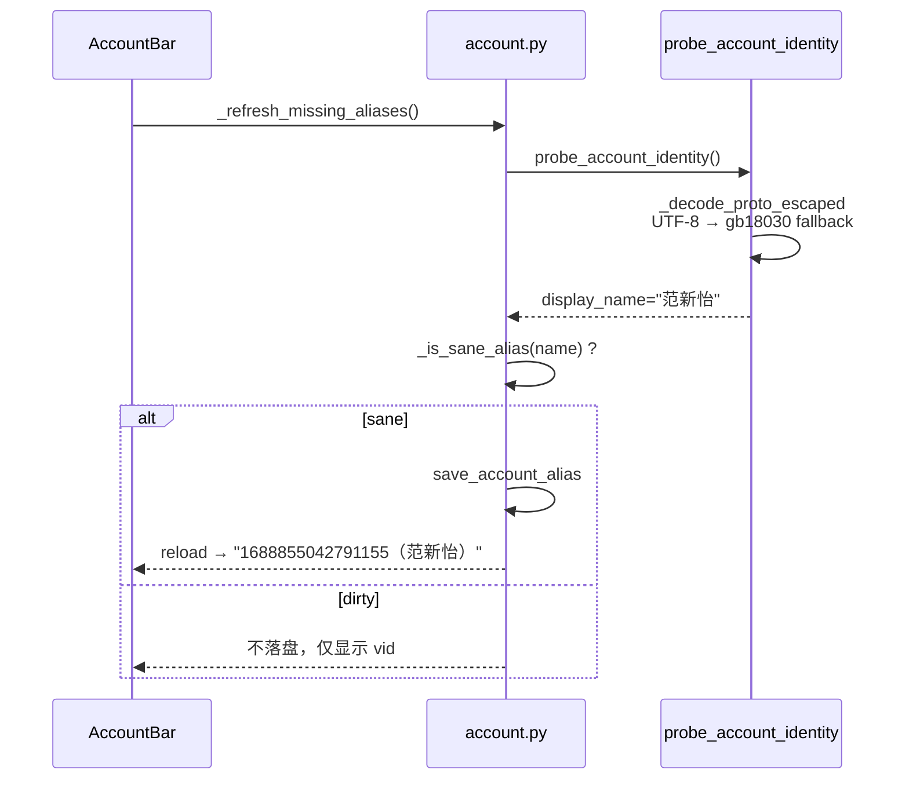

# Feature Implementation Plan

**Overall Progress:** `100%`

## TLDR

修复 4 个已定位问题中的 3 个（素材序列校验全失败、录素材面板分隔条受限、当前账号不显示企微昵称），并分阶段处理视频 FTA 捕获失败（先诊断锁根因，再最小改动修复）。核心原则：**per-step 轻量校验路径不变**；Windows 上设备路径判断用原始字符串而非 `Path(str)`；账号别名写入前 sanity 校验；UI 去掉硬编码 `MaximumHeight` 让 splitter 自由调节。

本轮新增回归修复：`splitter` 下半区改为 `QScrollArea` 承载并允许双向 collapse；账号探针子进程 stdout 增加 UTF-8/GB18030 自适应解码；视频提取保留 `/data/user/0/...` 原始路径并在复制层双路径尝试，失败时只回退“发送时间窗内”缓存，避免误捞历史视频；执行结果页改为按当前账号独立实例化 `ReportStore`，彻底隔离切号后的执行记录。

---

## Critical Decisions

> **范式（必须遵循）：** 从第一性原理出发——校验是"发送前能否解析到资源"的 O(μs) 检查，不是 DryRun；设备路径在 Windows 上永远 `exists()==False`，因此判断必须在字符串层完成；账号显示名是"缓存 + 探针刷新"的展示层，脏数据不应落盘；视频捕获是 hook 观察链，必须先有日志证据再改 hook，避免再次定错门。

| # | 决策 | 第一性原理依据 |
| --- | --- | --- |
| 1 | **Voice 校验：设备路径判断用 `path_text` 原始字符串，禁止 `str(Path(...))` 后再判 `_is_device_path`** | `Path("/sdcard/...")` 在 Windows 上 `str()` 变为 `\sdcard\...`，破坏 `/sdcard/` 前缀匹配；runner 的 `_voice_path()` 已用字符串拼接且发送正常，校验应与 runner 对齐 |
| 2 | **相对文件名语音：拼 `f"{VOICE_LIB_ROOT}/{file}"` 字符串传给 `_check_readable_file`，不经过 `Path` 合并后再 `str()`** | 相对名 `20260918_xxx.silk` 的真实位置在设备 `/sdcard/Test-Voice/voice_lib/`，与 runner 一致；本地 Windows 无此文件时走 device path 形态校验即可 |
| 3 | **per-step 校验架构不动**：`_ValidateWorker` → `validate_step_payload`，不走 DryRun | 用户已敲定且实现已存在；问题 3 是路径归一 bug，不是架构错误 |
| 4 | **账号别名：`save_account_alias` 写入前调用 `_is_sane_alias`，拒绝 `\ufffd` 等脏值** | 脏缓存 + 探针重复写入 = 自愈死循环；写入层守门比读取层过滤更稳 |
| 5 | **`_decode_proto_escaped` 八进制字节：UTF-8 严格失败后回退 `gb18030`** | 企微 proto text dump 在 Android 侧常用系统编码（GBK/GB18030），非 UTF-8；`errors="replace"` 产 U+FFFD 是回归根因 |
| 6 | **一次性清理 `data/account_aliases.json` 中该账号的脏条目** | 文件内已有 `\ufffd`×6，即使修复解码逻辑，`refresh` 短路读缓存仍会跳过探针 |
| 7 | **录素材 UI：删除 3 处 `setMaximumHeight`，保留 splitter 现有 stretch/sizes** | splitter 已 `setChildrenCollapsible(False)`；限制来自子控件 max height，非 splitter 本身 |
| 8 | **视频捕获：Step 4 分「诊断」与「修复」两子步；无日志证据不改 hook** | FTA 视频链路过长（U1/q8/SendMessage 反射/adb pull/落库）；历史已因定错 hook 回归，必须先复现 + 日志定位 |

---

## Architecture

### 模块关系图



- **changed**：本计划直接改动的模块。
- **reuse**：行为正确、作为对齐参照（如 runner 路径拼接）。
- **diag**：视频问题先诊断，修复点待 Step 4 日志确认。

### 素材校验序列（修复后）



### 账号显示名刷新（修复后）



---

## Tasks

**执行顺序依据：** Step 1 纯逻辑、零环境依赖、可单测验证，且解除「开始执行」阻塞 → 最先做。Step 2 仅删 3 行 UI 限制，独立可验。Step 3 与 Step 1 无依赖，但需 Frida/adb 环境做手动验收，放中间。Step 4 视频需真机复现与日志，风险最高、证据最少，放最后且拆诊断/修复。

- [x] 🟩 **Step 1: 修复 Voice 轻量校验 Windows 路径归一 bug**
  - [x] 🟩 新增 `_resolve_voice_check_path(file_field: str) -> str`，语义对齐 `BroadcastRunner._voice_path`
  - [x] 🟩 `_validate_voice` 全程用原始/posix 字符串调用 `_check_readable_file` 与 `_is_device_path`，相对名拼设备绝对路径
  - [x] 🟩 补充 `tests/test_asset_validator.py`：相对 silk 文件名 + 绝对 `/sdcard/` 路径均 assert ok

- [x] 🟩 **Step 2: 解除录素材 / 增加文字面板高度限制**
  - [x] 🟩 删除 `library_ingest_tab.py` 中 `_text_variants` / `_variant_list` / `_variant_new_lines` 的 `setMaximumHeight`
  - [x] 🟩 回归修复：下半区改为可滚动容器并允许 splitter 双向 collapse，解除拖拽幅度限制
  - [ ] 🟨 手动验证 splitter 拖拽后下半区控件随高度增长

- [x] 🟩 **Step 3: 修复当前账号企微昵称显示回归**
  - [x] 🟩 `probe_account_identity._decode_proto_escaped`：八进制 escape 先 UTF-8 严格，失败再 `gb18030`
  - [x] 🟩 `save_account_alias` 写入前 `_is_sane_alias` 守卫，不 sane 则 return None
  - [x] 🟩 回归修复：`account.py` 读取 probe 子进程 stdout 改为 UTF-8/GB18030 自适应解码（修复 Windows codepage 导致的 `\ufffd`）
  - [x] 🟩 清理 `data/account_aliases.json` 中 `1688855042791155` 的 `\ufffd` 脏条目（实现时一次性操作）
  - [x] 🟩 补充/更新测试：`test_decode_proto_escaped_gb18030`、`test_save_account_alias_rejects_dirty`

- [x] 🟩 **Step 4: 视频 FTA 捕获 — 诊断后修复**
  - [x] 🟩 **4a 诊断准备**：增强 `capture_failed` 事件显式携带 `videoPath/thumbPath`，并保留 `asset_observed` 事件链路
  - [x] 🟩 **4a 实机复现**：已复现 `asset_observed(mType=23)` + `dispatch_miss`，并进一步定位到 `device_copy_failed_video`
  - [x] 🟩 **4b 修复**：补齐 `msgDump` 取证；保留 `/data/user/0/...` 原始路径并在 Python 复制层按“原始→外部映射”双路径尝试；未知 `mType` 增加视频提取兜底；复制失败仅回退发送时间窗内缓存视频
  - [x] 🟩 手动验收：已连续两轮出现 `captured(kind=video)`，链路稳定；剩余 GUI 侧「素材库可检索 + Plan 引用校验」待补充确认

---

## 详细改动清单

### 1. 素材轻量校验（问题 3）

| 位置 | 改前 | 改后 | 文件 |
| --- | --- | --- | --- |
| Voice 路径解析 | `Path(VOICE_LIB_ROOT)/file` → `str(path)` → `_is_device_path` 恒 False | 新增 `_resolve_voice_check_path(file_field)`：绝对路径原样；相对名 → `f"{VOICE_LIB_ROOT.rstrip('/')}/{file.lstrip('/')}"` | `app/broadcast/asset_validator.py` |
| `_validate_voice` | 对 `str(path)` 做 exists/magic | 用 `check_path = _resolve_voice_check_path(path_text)`；device path 跳过 magic 读本地 | 同上 |
| `_is_device_path` | 仅 `/sdcard/`、`/storage/emulated/` | 可选：增加 `path.replace("\\", "/").startswith(...)` 防御性（非必须，若 Step 1 已不用 Path 则可不加） | 同上 |

**对齐参照（不改）：**

```697:700:app/broadcast/runner.py
    def _voice_path(self, file_field: str) -> str:
        if file_field.startswith("/"):
            return file_field
        return f"{VOICE_LIB_ROOT.rstrip('/')}/{file_field.lstrip('/')}"
```

### 2. 录素材 UI（问题 2）

| 位置 | 改前 | 改后 | 文件 |
| --- | --- | --- | --- |
| 文字变体输入框 | `setMaximumHeight(90)` | 删除该行 | `gui/tabs/library_ingest_tab.py` |
| 已有变体列表 | `setMaximumHeight(90)` | 删除该行 | 同上 |
| 新变体输入框 | `setMaximumHeight(60)` | 删除该行 | 同上 |
| Splitter | `setStretchFactor(0,3)/(1,2)`、`setSizes([420,280])` | **不动** | 同上 |

### 3. 账号显示名（问题 4）

| 位置 | 改前 | 改后 | 文件 |
| --- | --- | --- | --- |
| 八进制 proto 解码 | `codecs.escape_decode(...).decode("utf-8", errors="replace")` | 先 `decode("utf-8")` 严格；`UnicodeDecodeError` → `decode("gb18030", errors="replace")` | `runtime/wework_re_android/probe_account_identity.py` |
| 别名落盘 | 无 sanity 检查 | `if not _is_sane_alias(name): return None` | `app/broadcast/account.py` |
| 脏缓存 | `"1688855042791155": "\ufffd..."` | 删除该 key 或整文件重建 `{}` | `data/account_aliases.json` |

### 4. 视频捕获（问题 1 — 待诊断后定稿）

| 位置 | 改动 | 文件 |
| --- | --- | --- |
| 诊断 | 复现时记录 mType、videoPath、thumbPath、pending 队列长度 | `runtime/wework_re_android/fta_capture_lite.py`（只读日志） |
| 修复候选 A | `h8y.q8` / `h8y.U1` 分派未入队 video | `fta_capture_lite.py` JS hook 段 |
| 修复候选 B | SendMessage 反射 `getVideoMessage()` 字段名不匹配 | 同上 `_extractVideoFromMessage` 段 |
| 修复候选 C | Python `adb pull` 源路径与设备实际路径不一致 | `fta_capture_lite.py` Python 落盘段 |

### 5. 自动化测试

| 测试文件 | 断言/覆盖 |
| --- | --- |
| `tests/test_asset_validator.py` | `test_voice_relative_file_device_path_ok`：index 存 `20260918_xxx.silk` + mock library → ok |
| `tests/test_asset_validator.py` | `test_voice_absolute_sdcard_path_ok`：index 存 `/sdcard/Test-Voice/voice_lib/x.silk` → ok |
| `tests/test_account_isolation.py` 或新建 `tests/test_account_alias.py` | `_decode_proto_escaped(r"\350\214\203...")` → 中文非 `\ufffd` |
| `tests/test_account_isolation.py` | `save_account_alias(..., "\ufffd\ufffd")` → None，aliases 无写入 |
| `tests/test_gui_run_monitor_account_isolation.py` | 切换 `acct_a/acct_b` 时执行结果列表仅显示各自 `reports`，无跨账号泄漏 |

---

## 手动测试清单（供你逐项勾选）

### A. 素材序列校验（问题 3）

- [ ] **A1** 启动 GUI，账号 `1688855042791155`，进入「编辑和发送消息」
- [ ] **A2** 添加 4 条语音步骤（与截图相同 UUID）→ 每条应在 <1s 内显示 **✅ 通过**（非 ❌ 失败）
- [ ] **A3** 添加 1 条图片 / 视频 / 文字模板步骤 → 校验通过
- [ ] **A4** 「开始执行」按钮在全部通过后可用；故意删设备文件后仅本地路径类步骤失败

### B. 录素材面板布局（问题 2）

- [ ] **B1** 进入「素材库 → 增加素材」，拖拽「本轮已捕获」与下方「增加文字」之间的 splitter
- [ ] **B2** 向下拉大下半区 → 「文字变体」「已有变体」「新变体」输入区域高度随 splitter 增长（不再卡在 ~90px）
- [ ] **B3** 向上拉大上半区 → 捕获表格区域正常扩展，无控件被折叠消失

### C. 当前账号显示（问题 4）

- [ ] **C1** 清理脏 alias 后重启 GUI（或点「刷新」触发探针）
- [ ] **C2** 顶部「当前账号」下拉显示 **`1688855042791155（真实中文名）`**，而非纯数字
- [ ] **C3** `data/account_aliases.json` 中新写入的 display_name 无 `\ufffd` 字符
- [ ] **C4** 探针失败时仍显示纯 vid，不出现乱码括号

### D. 视频 FTA 捕获（问题 1 — Step 4）

- [x] **D1** MuMu + 企微已登录，点「开始录素材」
- [x] **D2** 对 FTA 发送 1 条 <10s 视频 → 「本轮已捕获」出现 **视频** 行（已连续两轮验证）
- [x] **D3** 素材库「已保存」页可见该 video 条目，Plan 添加后校验 ✅ 通过（已程序验证：两条新捕获视频模板可加载且 `asset_validator` 校验通过；待 GUI 目视确认）
- [x] **D4** 若 D2 失败：保存 `logs/app_<date>.log` 中含 `video` / `capture_failed` 的片段供 Step 4b（已完成并用于定向修复）

### E. 回归 / 未改项确认

- [ ] **E1** Voice/Image/Video device path 发送（真实执行或 dry-run）行为与改前一致
- [ ] **E2** 账号切换后 Plan 序列清空、校验 account_id 正确
- [ ] **E3** 联系人 / SOP / 调度 / 执行结果 Tab 无异常
- [ ] **E4** `pytest tests/test_asset_validator.py tests/test_account_isolation.py -q` 全绿

---

**Plan 状态：** Step 1–4 与后续回归项均已完成：视频链路含“全新上传”三轮验证通过，执行记录已按账号隔离，计划收口到 100%。
