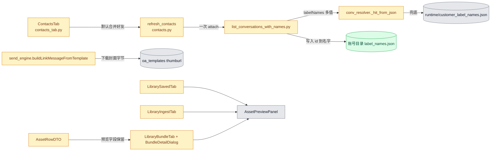
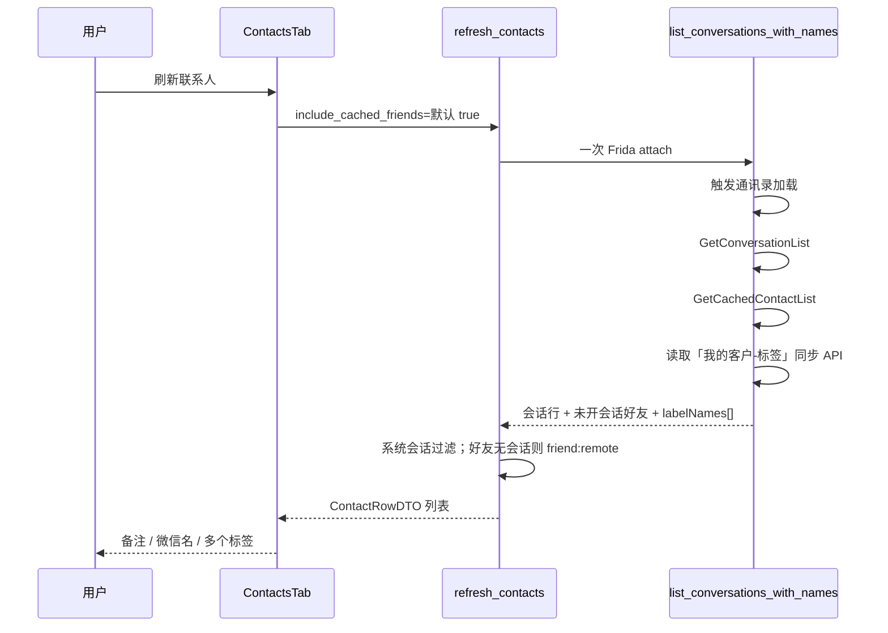
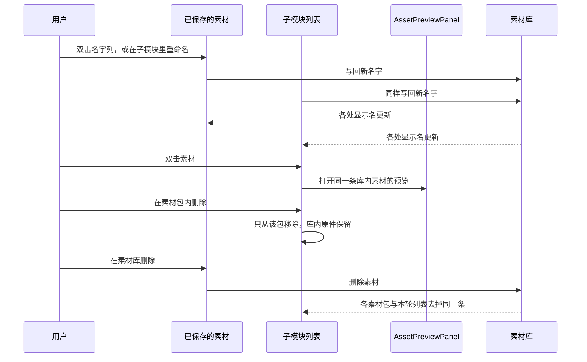

# Feature Implementation Plan

**Overall Progress:** `100%` (Step 1-4 全部完成)

## TLDR

另一台电脑上的四个缺口，按已确认方案修，不另开产品面：

1. **联系人数量**：代码里没有条数上限。实际只拉到「企微消息列表里看得到的会话」（`GetConversationList`）。默认再合并 `GetCachedContactList()`，并在同一次 Frida attach 里先触发通讯录加载，把缓存填上。目标是拉到企微里已添加的好友/客户，而不是只拉消息列表。
2. **标签全空 + 一人多标签**：界面已经能显示多个标签（顿号拼接）。另一台电脑全空，是因为标签名依赖本机手写的 `runtime/customer_label_names.json`，纯数字 id 会被丢掉。改为在刷新时用 Frida 走「企微 → 我的客户 → 标签」那条页面 API，直接拿到标签名，并挂到对应联系人上（一人多标签原样保留）。
3. **公众号卡片没有封面**：采集侧已经存了封面 URL（`thumburl`）。发送时 `h8y.f2` 的第 5 个参数是空字节数组，企微原生分享这里要的是封面图的 JPEG 字节。发送前在设备进程里把 URL 下成字节再传入。
4. **素材手势 + 素材包预览**：素材库（「已保存的素材」）是主模块，素材包和本轮已捕获是子模块。删除不是全局操作：子模块里的删除只在该子模块内生效（素材包里删除＝只从该包移除）；主模块里的删除同步到所有子模块。重命名、多选、预览在任何模块都能做，并且全局生效（改名写回素材库，各处名字一起变）。素材包打不开预览，先修跨 Tab 传递时预览字段被丢掉的问题。

## Critical Decisions

> **范式（必须遵循）：** 本板块须基于第一性原理深度思考，论证出**可维护性最强、最精简、最佳的代码架构**与**最佳执行顺序**。每条决策从问题本质出发推导，而非沿用习惯或过度设计——优先选最简单且正确的方案、最少的活动部件、与现有代码模式最契合的设计；执行顺序须说明为何如此排序（依赖关系 / 风险前置 / 可独立验证）。

| # | 决策 | 第一性原理依据 |
| --- | --- | --- |
| 1 | **联系人仍走现有一次 `list_conversations_with_names` attach，在里面预热缓存并默认合并好友；不默认再拉起 `list_all_contacts` 第二个进程** | 数量不够是缓存没加载，不是缺一个新列表服务。该脚本已经调用 `GetCachedContactList()` 做备注。再开一个子进程等于第二次 attach，另一台电脑更容易超时。预热和合并放进同一次 attach，活动部件最少。 |
| 2 | **「包含未开过对话的好友」默认勾选，复选框保留** | 用户确认要拉已添加好友/客户，不只消息列表。默认勾选改变行为；留下开关，避免把内部会话噪声永久焊死。 |
| 3 | **对不上会话的好友继续用已有 `friend:<remote>` 前缀入表；发送前若 `conv_local` 不是纯数字，刷新/加入发送对象时提示需先在企微打开一次该会话。本计划不新做「自动建会话」** | `friend:` 已是代码里的标记，全仓库只有 `contacts.py` 写入，`runner` 会把任意非空 `conv_local` 原样交给发送引擎。静默当成可发送会话会把群发打到非法 id。提示是最小安全边界，不扩展发送链。 |
| 4 | **标签以「我的客户 → 标签」页面使用的同步读取为准，在同一次刷新 attach 里调用；结果写成每条联系人的 `labelNames: string[]`。废弃把 `GetCacheLabelFullInfoById` 异步回调当主路径** | 现有主路径在标签页未加载时 `GetAllLabelIdsHasContact` 为空；名字又依赖不随工程走的手写 JSON；异步回调在既有 SOP 里会 `TransportError`。页面 API 在每台已登录企微上都能读到同一份客户标签，迁移性来自「读企微当前数据」而不是「拷贝上一台电脑的 JSON」。一人多标签不新做 UI：`ConversationHit.labels` 已是元组，表格用 `、` 拼接。 |
| 5 | **id→中文名缓存写到账号目录，刷新成功后覆盖；`runtime/customer_label_names.json` 只作只读兜底，不再当换机必需文件** | 全局手写文件是「另一台完全没标签」的直接原因。账号目录跟现有 `LocalLabelStore` 隔离方式一致。β 本地标签仅在实时结果未返回（`label_ids is None`）时合并；实时返回空列表时不把旧 β 标签填回去（保持 `contacts._merge_labels` 现有语义）。 |
| 6 | **公众号只改发送侧 `buildLinkMessageFromTemplate`：用企微进程内 HTTP 把 `thumburl` 下成 `byte[]`，作为 `h8y.f2` 第 5 参；第 4 参仍传 URL。采集 JSON 字段不动** | 用户确认缺的是对方气泡上的封面，不是素材库没存图。采集已经把 `imgUrl` 写入 `thumburl`。空字节才是发送契约错误。在设备内下载与企微自身联网一致，不在电脑上再加一条下载管线。下载失败时仍发卡片，并在 stderr 打明 `oa thumb download failed`，避免一张图失败导致整次群发中断。 |
| 7 | **素材交互不抽公共框架。各列表继续用自己的存储函数，只统一手势。预览复用 `AssetPreviewPanel`** | 四块列表的数据源不同（已保存行、本轮捕获、素材包条目）。抽一套动作框架会把删除路径缠在一起。重复绑定选择模式和菜单项更小、也跟现有 PySide 写法一致。 |
| 8 | **素材库（「已保存的素材」）是主模块；素材出现在其他地方都是子模块。删除不跨模块一刀切：子模块删除只改该子模块自己的成员；主模块删除从库里去掉，并同步清掉所有子模块里的同一条。重命名在任一模块发起，都写回素材库（沿用 `rename_underlying_asset`），各处显示名一起变。多选和预览每个模块都有，作用在当前列表的选区上，预览读的是同一条库内素材** | 用户明确：删除不是全局操作，重命名才是。素材包里删掉一条，只表示这个包不再包含它，库里的原件还在。若子模块删除也去删库，组包时会误伤其他包和已保存列表。反过来，库是唯一数据源，主模块删除必须跟着摘掉各包成员和本轮列表里的引用，否则子模块会留下指向已删素材的空条目。 |
| 9 | **双击分列：表格双击「名字」列 = 就地重命名；双击该行其他列 = 打开预览。单列 `QListWidget` 没有名字列：双击条目 = 预览，重命名只走右键** | 用户已确认：双击名字列重命名，双击行的其他位置打开预览。单列列表无法区分「名字」和「素材本体」，强行做两段热区会改控件结构。单列因此把双击交给预览，重命名留在右键，与确认过的表格规则对齐。 |
| 10 | **执行顺序：联系人补全 → 标签 → 公众号封面 → 素材手势** | 标签要挂在联系人 `remote` 上，所以联系人行先稳定。标签读取是唯一要在真机上先探 API 的不确定点，放在第二步，探明再接线，失败不影响封面和素材。公众号与联系人无依赖，放在标签之后是为了真机 attach 不和标签探针抢同一个企微进程。素材是纯 GUI，最后做，diff 与 Frida 脚本分开，便于单独回归。 |

## Architecture

### 模块关系

- 绿：账号级标签名缓存（换机后由刷新自己生成）。
- 黄：本次要改的脚本和界面。
- 灰：继续复用的预览面板、旧标签名文件、已采集的公众号 URL。

### 刷新联系人与标签

### 素材手势

- 主模块：`LibrarySavedTab`（已保存的素材）。
- 子模块：制作素材包的当前包内容、已保存素材包详情、本轮已捕获。左侧「可选素材」是主库在制作页的投影，不是某个包的成员列表：这里可以多选、重命名、预览；不提供删除（没有可单独移出的子容器，删库只在主模块做）。

## Tasks

**执行顺序依据：** 联系人行是标签的挂载点，先补全列表再读标签。标签 API 要在真机上先探明，探明前不改 GUI 文案。公众号与素材不依赖前两步，但公众号要 attach 企微，排在标签探针之后，避免两个 Frida 脚本同时挂同一进程。素材纯 GUI，放最后，方便单独点选验收。

- [x] 🟩 **Step 1: 联系人拉取补全**
  - [x] 🟩 在计划与代码注释中写明：没有 Python 侧条数上限；现状上限等于 `GetConversationList()` 的消息列表缓存长度
  - [x] 🟩 在 `list_conversations_with_names.py` 的同一次 attach 里，于 `GetCachedContactList()` 之前触发通讯录加载（先对照通讯录页实际调用的同步方法，调用已存在的同步接口，不新造协议）
  - [x] 🟩 `ContactsTab` 的「包含未开过对话的好友」默认勾选；`refresh_contacts` 把缓存好友并入结果。remote 已在会话列表中的，以会话那条为准
  - [x] 🟩 `friend:<remote>` 入表逻辑保持；加入发送对象或刷新后若选中项的 `conv_local` 不是纯数字，提示先在企微打开一次该会话
  - [x] 🟩 系统会话过滤（remote &lt; 100000、conv_type=3、「企业微信团队」、无备注且显示名为长数字）保持不动

- [x] 🟩 **Step 2: 从「我的客户 → 标签」读标签，并显示多个标签**
  - [x] 🟩 用一次 attach-only 探针，在打开「企微 → 我的客户 → 标签」时记录返回「标签名 + 其下联系人」的同步方法。不把 `GetCacheLabelFullInfoById` 异步回调当作主路径
  - [x] 🟩 把探明的同步读取放进 `list_conversations_with_names.py` 的刷新流程，按 remote 填 `labelIds` 与 `labelNames`（数组，不去掉第二个及以后的标签）
  - [x] 🟩 将 id→名字写入该账号数据目录；`_hit_from_json` 继续优先用实时 `labelNames`，其次账号缓存，最后才读 `runtime/customer_label_names.json`。纯数字 id 在没有任何名字时仍不展示成标签文案
  - [x] 🟩 确认 GUI 仍用 `、`.join 展示；不改 `LabelMultiSelect` 的「命中任一标签」筛选
  - [x] 🟩 为「一条联系人两个标签名都进入 `ContactRowDTO.labels`」补测试

- [x] 🟩 **Step 3: 公众号发送带上封面图**
  - [x] 🟩 核对已保存 OA 模板：封面在 `thumburl`（采集字段 `imgUrl`）。URL 为空的模板不在本步猜封面
  - [x] 🟩 在 `send_engine.py` 的 `buildLinkMessageFromTemplate` 中，当 `thumburl` / `imageUrl` 为 http(s) 时，用企微进程内请求读成 `byte[]`，传入 `h8y.f2(link, title, desc, imageUrl, imgBytes)`
  - [x] 🟩 下载失败：第 5 参保持空字节并打 stderr `oa thumb download failed`，卡片仍发送
  - [x] 🟩 不改 `fta_capture_lite` 的 OA 落库字段

- [x] 🟩 **Step 4: 素材手势与素材包预览**
  - [x] 🟩 修预览字段丢失：`AssetRowDTO` / `active_assets()` 传到制作素材包时保留 `variants`、`url`、`oa_title`、`oa_desc`、`oa_source`、`oa_url`、`path`、`thumb_path`、`file`（放进现有 `extra` 或等价的不丢字段通道）。任一模块双击素材时把这些字段交给 `AssetPreviewPanel.set_asset`
  - [x] 🟩 主模块 `LibrarySavedTab`：`ExtendedSelection`；双击名字列就地重命名（全局写回）；双击其他列打开预览；右键「重命名」「删除」作用于当前多选。这里的删除从素材库去掉，并同步从所有素材包成员和本轮已捕获列表移除同一 `item_id`。语音/文字行上的「归档 / 取消归档」保留
  - [x] 🟩 子模块 `LibraryIngestTab` 本轮已捕获：双击名字列重命名（写回素材库）；双击其他列打开预览；右键「重命名」+「删除」；多选。这里的删除只从本轮列表去掉，不删素材库
  - [x] 🟩 子模块素材包（中间「当前素材包内容」、`BundleDetailDialog` 成员列表）：多选；右键「重命名」「删除」；单列双击打开预览。删除只从该素材包移除。重命名走 `rename_underlying_asset`，素材库和其他包里的同一条一起改名
  - [x] 🟩 制作素材包左侧「可选素材」：多选、右键重命名、双击预览。不提供删除
  - [x] 🟩 右键落在未选中行时，先把该行设为选区再弹菜单；右键落在已有多选内则对整个选区操作。多选删除按该列表所属模块的删除范围批量执行；多选时重命名只改当前行，改完全局生效

### N. 自动化测试（随各步落地）

| 测试文件 | 断言/覆盖 |
| --- | --- |
| `tests/test_conv_resolver_android.py` 或相邻解析测试 | 两个 `labelNames` 都进入 `ConversationHit.labels`；无名字的纯数字 id 不展示 |
| `tests/test_contacts_facade.py` | 会话行与缓存好友按 remote 去重；系统会话仍被过滤；`friend:` 只出现在没有会话 local id 的好友上 |
| 标签合并现有测试（`_merge_labels`） | `label_ids is None` 时才合并 β；实时空列表不回填旧标签 |
| 发送引擎相关测试（若已有 OA 模板夹具） | 模板同时带 `thumburl` 时，生成脚本里 f2 第 5 参不是写死的空数组常量路径（下载函数存在且 URL 会走它） |

## 详细改动清单

### 1. 联系人数量

现状：`refresh_contacts` 默认 `include_cached_friends=False`。主列表来自 `ConversationService.GetConversationList()`，只含消息列表里已有会话。好友缓存是另一个进程 `list_all_contacts.py`，且依赖用户事先点开过通讯录。代码中没有 `LIMIT` / 分页截断。

| 位置 | 改前 | 改后 | 文件 |
| --- | --- | --- | --- |
| 刷新入口默认值 | 不合并未开会话好友 | 默认合并；复选框默认勾选 | `gui/tabs/contacts_tab.py` |
| 合并实现 | 勾选后另起 `list_all_contacts` 子进程 | 同一次会话枚举脚本返回会话 + 缓存好友，facade 合并 | `runtime/wework_re_android/list_conversations_with_names.py`、`app/broadcast/contacts.py` |
| 通讯录缓存 | 注释要求用户手动点开通讯录 | attach 后先调用通讯录页那条同步加载，再 `GetCachedContactList()` | `list_conversations_with_names.py` |
| 未开会话好友 | `conv_local=friend:<remote>` | 保持该前缀；选入发送对象时若不是纯数字 conv_local，提示先打开会话 | `contacts.py`、`contacts_tab.py` |
| 过滤 | remote&lt;100000、type=3、企业微信团队、长数字脏行 | 不改 | `contacts.py` |

### 2. 标签（含多个标签）

现状：`list_conversations_with_names.py` 用 `GetAllLabelIdsHasContact(1)` + `GetLabelContactsByLabelId` 收集 id，再用 `UserLabelService.GetCacheLabelFullInfoById` 异步转名（1.2s 超时）。Python `_hit_from_json` 把没有中文映射的纯数字 id 丢掉。名字文件是仓库里的 `runtime/customer_label_names.json`。GUI `contacts_tab._fill_table_row` 已 `、`.join 全部 `row.labels`。

| 位置 | 改前 | 改后 | 文件 |
| --- | --- | --- | --- |
| 标签读取 | 缓存 id + 异步转名 + 全局 JSON | 「我的客户 → 标签」同步读取，直接得到名字数组 | `list_conversations_with_names.py`（探针结论写进同文件，不长期保留临时脚本） |
| 名字缓存 | 只读仓库 JSON | 账号数据目录一份，由本次读取结果覆盖；仓库 JSON 仅兜底 | 账号目录新文件，读写放在现有账号路径旁（`app/broadcast/paths.py` 已有账号根时直接用，不新造路径体系） |
| 解析 | 实时名 → 仓库 JSON → 丢掉纯数字 id | 实时名 → 账号缓存 → 仓库 JSON → 仍丢掉没有名字的纯数字 id | `runtime/wework_re_android/conv_resolver.py` |
| 多标签 | 结构支持，数据源经常为空 | 同一 remote 下所有标签名都进入 `labels` | 同上 + `app/broadcast/contacts.py` 的 `_merge_labels` 语义不改 |
| 展示 | `、` 拼接、标签筛选「命中任一」 | 不改控件 | `gui/tabs/contacts_tab.py`、`gui/widgets/label_multiselect.py` |

### 3. 公众号封面

现状：`fta_capture_lite._handle_oa_seen` 把 `imgUrl` 存成模板 `thumburl`。`send_engine.buildLinkMessageFromTemplate` 调用 `h8y.f2(linkUrl, title, desc, imageUrl, emptyBytes)`，`emptyBytes` 长度为 0。

| 位置 | 改前 | 改后 | 文件 |
| --- | --- | --- | --- |
| f2 第 5 参 | 空 `byte[]` | `thumburl`/`imageUrl` 下载后的图片字节 | `runtime/wework_re_android/send_engine.py` |
| 第 4 参 | 封面 URL | 仍传 URL | 同上 |
| 失败 | 无封面且无日志区分 | stderr：`oa thumb download failed`，卡片仍发 | 同上 |
| 采集落库 | `thumburl` | 不改 | `runtime/wework_re_android/fta_capture_lite.py` |

### 4. 素材手势与素材包预览

现状差异：

| 区域 | 双击名字 | 双击预览 | 右键删除 | 右键重命名 | 多选 |
| --- | --- | --- | --- | --- | --- |
| 已保存的素材 | 双击任意列开浮层，改名靠 F2/右键 | 有浮层 | 有 | 有 | 无 |
| 本轮已捕获 | 双击名字进入编辑 | 无 | 有，多选 | 无 | 有 |
| 制作素材包左侧/中间 | 无 | 无 | 无 | 无 | 有 |
| 素材包详情 | 双击整行开预览 | 预览字段常被丢掉所以像空白 | 无（只有「移除」按钮） | 有 | 需核对后与其他列表对齐为多选 |

字段丢失原因：`LibrarySavedTab.active_assets()` 建成 `AssetRowDTO` 时，`oa_title`、`variants`、`url`、`file` 等不在模型字段里，Pydantic 会丢掉；`LibraryTab` 再把 DTO 交给制作素材包。`BundleDetailDialog` 因此经常拿到没有路径和正文的行。

主从关系：

| 角色 | 界面 | 删除 | 重命名 / 多选 / 预览 |
| --- | --- | --- | --- |
| 主模块 | 已保存的素材 | 从素材库删除，并同步去掉所有素材包成员和本轮已捕获里的同一条 | 全局生效 |
| 子模块 | 素材包成员（制作中的当前包、素材包详情） | 只从该素材包移除，库内原件保留 | 全局生效 |
| 子模块 | 本轮已捕获 | 只从本轮列表移除，不删素材库 | 全局生效 |
| 主库投影 | 制作素材包左侧「可选素材」 | 不提供删除 | 重命名、多选、预览可用；重命名写回素材库 |

| 位置 | 改前 | 改后 | 文件 |
| --- | --- | --- | --- |
| 传到素材包的行 | 预览用字段被模型丢掉 | 预览字段保留在 DTO 的 `extra`（或模型已有的 path/thumb_path）里，任一模块打开预览时原样交给 `set_asset` | `app/broadcast/dto.py`、`gui/tabs/library_saved_tab.py`、`gui/tabs/library_tab.py`、`gui/tabs/library_bundle_tab.py` |
| 已保存表格（主模块） | 单击选择、双击一律预览浮层；删除只删本条文件 | 多选；双击名字列重命名；双击其他列预览。删除素材库条目后，按 `item_id` 同步摘掉各素材包成员和本轮列表中的同一条 | `gui/tabs/library_saved_tab.py`，同步通知 `library_bundle_tab.py`、`library_ingest_tab.py` |
| 本轮已捕获（子模块） | 右键删除会删掉素材库里的文件 | 删除只从本轮表移除。补右键重命名（写回素材库）。双击非名字列打开预览 | `gui/tabs/library_ingest_tab.py` |
| 当前包 / 包详情（子模块） | 详情里只有「移除」，且不能稳定预览 | 多选；右键重命名（全局）和删除（只移出该包）；单列双击预览 | `gui/tabs/library_bundle_tab.py` |
| 左侧可选素材 | 无重命名、无预览 | 多选、右键重命名、双击预览；不提供删除 | `gui/tabs/library_bundle_tab.py` |
| 预览面板 | 已按类型分派 | 不改面板内部，只保证入参字段完整 | `gui/widgets/asset_preview.py` |

### 5. 明确不改

- 不新增「自动创建会话再发送」的链路。
- 不改 β `LocalLabelStore` 的文件格式和 CLI。
- 不改公众号采集的 mType / 落库字段。
- 不改发送计划、调度、风控。
- 不把素材列表改成一套新的通用控件。

---

## 手动测试清单（供你逐项勾选）

> 另一台电脑：MuMu 已登录企微，adb `127.0.0.1:16384`，frida `127.0.0.1:27042`。测试前不要为了「凑数量」先手动翻遍通讯录；第一步就是验证工具自己能把缓存拉起来。

### A. 联系人数量

- [ ] **A1** 不手动点通讯录，打开工具点「刷新联系人」→ 列表人数多于「只含消息列表里的会话」；日志里能看到缓存好友条数
- [ ] **A2** 消息列表里已有的人只出现一行，备注名仍优先于微信名
- [ ] **A3** 取消勾选「包含未开过对话的好友」再刷新 → 未开过对话的好友消失，消息列表里的人不消失
- [ ] **A4** 重新勾选再刷新 → 这些好友回到列表
- [ ] **A5** 企业微信团队、审批/公告类系统会话不在四个分类里
- [ ] **A6** 选一个从未开过会话、`conv_local` 为 `friend:` 开头的人，点「添加至发送对象」→ 有明确提示，且不会拿 `friend:` 字符串去发送

### B. 标签与多标签

- [ ] **B1** 企微「我的客户 → 标签」里能看到的标签，刷新后出现在联系人「标签」列和顶部标签筛选
- [ ] **B2** 选一个至少有两个标签的客户 → 单元格里两个名字都在，中间是顿号
- [ ] **B3** 用其中一个标签做筛选 → 该客户仍出现；换另一个标签筛选 → 该客户仍出现
- [ ] **B4** 在企微里去掉其中一个标签后再刷新 → 列表只剩剩下的那个，不会把旧标签补回来
- [ ] **B5** 换到没有 `runtime/customer_label_names.json` 的环境（或临时移走该文件）再刷新 → 标签名仍然来自企微，而不是空白

### C. 公众号封面

- [ ] **C1** 用一条 `thumburl` 非空的公众号素材，发给一个测试会话 → 对方气泡上有封面缩略图
- [ ] **C2** 标题、摘要、点开链接与改之前一致
- [ ] **C3** 用一条故意无效的图片 URL（仅此条）发送 → 卡片仍发出，日志有 `oa thumb download failed`，界面不崩

### D. 素材手势与素材包预览

- [ ] **D1** 已保存的素材：双击名字列 → 可改名；双击同一行的类型/次数/时间 → 打开预览，不进入改名。改完后素材包和本轮列表里的同一条名字一起变
- [ ] **D2** 已保存的素材：Ctrl/Shift 多选后右键删除 → 选中条从素材库消失，并且已放入素材包、本轮已捕获里的同一条也消失。多选时右键重命名只改当前行，改完全局生效
- [ ] **D3** 本轮已捕获：双击名字改名后，已保存的素材里同一条名字变了；右键删除只从本轮列表消失，已保存的素材里那条还在。双击「类型/详情/时间」打开预览。多选删除同样只作用于本轮列表
- [ ] **D4** 制作素材包中间列表和素材包详情：可多选；右键重命名后素材库名字一起变；右键删除只从当前这个包移除，已保存的素材里那条还在。双击条目打开预览
- [ ] **D5** 制作素材包左侧可选素材：可多选、可重命名、双击可预览；没有删除。重命名后已保存列表里的名字一起变
- [ ] **D6** 保存素材包后，在右侧双击打开该包 → 能看到成员；双击其中一条图片/视频/文字/公众号/语音 → 预览里有图、正文或可播放文件，而不是只有空元数据
- [ ] **D7** 语音/文字在「已保存」右键仍可归档、取消归档

### E. 回归

- [ ] **E1** 按标签筛选后的群发对象仍是勾选的那些人，不会把 `friend:` 未解析联系人悄悄发走
- [ ] **E2** 文字、图片、视频、语音发送与改之前一致
- [ ] **E3** 制作素材包的拖拽排序、保存、加载到中间栏仍可用
