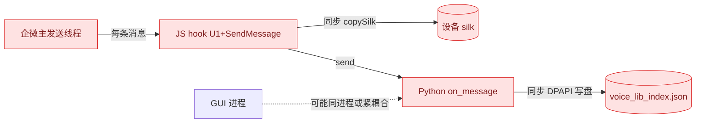
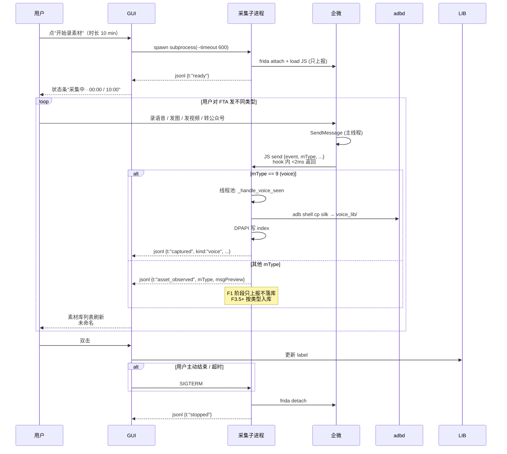

# FTA 采集重构实施计划（Hook 极简化 + 全类型采集 + 进程隔离）

**Overall Progress:** `99%`（Phase F1 / F2 / F3 全部完成；F3.5 image/video/oa 合并落地 + probe 脚本下线；F3.5 GUI 联测修 hook 根因 v0.10；wxa 保留 legacy 独立入口待补 mType 证据后单独归并）

**文档版本**：2026-09-19 v0.17（F3.5 图片 GUI 回归第四轮：补回 ConversationRef SendMessage 成功入口）  
**上游依据**：[`PLAN_VOICE_LIBRARY_AND_BROADCAST.md`](PLAN_VOICE_LIBRARY_AND_BROADCAST.md) Phase A Step 2 / Phase B / Phase C Step 19；[`PLAN_ARCHITECTURE_REFACTOR_ITERATION.md`](PLAN_ARCHITECTURE_REFACTOR_ITERATION.md) Step 2（AppContext）  
**姊妹文档**：本文只写 **FTA 采集链的稳定性 / 全素材类型 / 进程结构** 重构；发送引擎、Plan/Runner、素材库 CRUD、GUI 大结构不动。  
**触发条件**：用户实测反馈"FTA 采集导致企微反复退出重启 + 程序自身不稳定 + 单进程影响体验"，且要求"任意素材类型都能被接收"。

---

## TLDR

现状 `runtime/wework_re_android/fta_capture.py` 有三条同步阻塞链共同作用导致企微被 kill：

1. **hook 落点在企微主发送线程**（`h8y.U1` + `ConversationService.SendMessage`）；
2. **hook 内同步做文件 I/O**（`copySilk` 用 Java FIS/FOS 复制整段 silk，几十–几百 ms 阻塞主线程）；
3. **Python 端 message handler 同步走 DPAPI 写盘**，反压 frida 消息队列，进一步阻塞 JS 侧。

叠加"长期驻留 attach"和"GUI 与采集耦合"，产生用户观察到的现象。同时业务需求升级为：**用户对 FTA 发任意类型的素材都要能入库**（voice / image / video / oa 卡片，未来再补 wxa / file）。

本计划用 **3 个 Phase、8 Step** 最小改动修复：

- **Phase F1（P0）**：hook 极简化 —— JS 零 I/O、Python 异步 `adb shell cp`、观察面扩到全类型（voice 立即入库，其他类型先 observe）。**F1.1–F1.3 已实测跑通**，见 §已跑通资源速查。
- **Phase F2（P1）**：进程隔离 —— 采集拆独立 subprocess，GUI 通过 stdout jsonl 尾读。
- **Phase F3（P2）**：按需采集 + GUI 双击命名 + 心跳重连 + 全类型入库补齐（image / video / oa）。

**关键指标**：非采集时段企微 hook 数 = 0；采集时段单条 SendMessage hook 内耗时 < 2ms；一次完整采集会话（10 分钟 / 20 条）内企微被 kill 概率 → 0。

---

## Critical Decisions

> **范式（必须遵循）：** 从第一性原理出发——**hook 是观察面，不是工作面**；采集是**低频、用户显式驱动**的动作；备注命名是**数据管理动作**，属于 GUI，不该塞回企微聊天里做。

| # | 决策 | 第一性原理依据 |
| --- | --- | --- |
| F1 | **hook 内零 I/O，只 `send` 元数据事件** | 企微 SendMessage 在主线程执行；任何 hook 内同步 I/O 都会抬高 wework ANR 概率。JS 只做"感知+上报" = 最符合"hook = 观察面"的第一性原理。 |
| F2 | **文件复制由 Python 侧 `adb shell cp` 异步完成** | 走 adbd 进程，与 wework 主线程完全解耦，wework 挂了 cp 也能跑完。多 100–500ms 延迟对入库场景可忽略。 |
| F3 | **Python `on_message` 只做路由，落库/加密丢 `ThreadPoolExecutor`** | frida message 队列反压会传导回 JS → wework 主线程；handler 必须 O(μs) 返回。 |
| F4 | **采集进程与 GUI 进程物理隔离**，通过 stdout jsonl + 信号通信 | 崩溃域隔离是最强的稳定性保障；stdout jsonl 复用 `runner.py` 已跑通的 subprocess 模式，零新协议。 |
| F5 | **采集默认关闭，用户在 GUI 显式开启（"录素材模式"）** | 采集是低频行为，常驻挂 hook 收益低成本高。显式开关 = 用户对企微状态可预期 + 攻击面最小。 |
| F6 | **采集会话有明确超时**（默认 10 分钟，可配置） | 防用户忘记关；防孤儿进程持续 attach。 |
| F7 | **接入 `frida_session` 心跳**（Phase C Step 19 已建），掉线自动重连 3 次 | 复用已有基础设施；**绝不 `am force-stop` 企微**（§14.10 教训）。 |
| F8 | **取消"FTA 发文字作为备注"关联，改为 GUI 里双击命名** | 备注命名属于数据管理动作，跑到企微里发一堆备注文字很别扭且需要回头清理；GUI 双击更符合素材库直觉。收益：hook 面进一步收敛（去掉 `mType===1` 分支），非采集内容不再触发 `extractText`。 |
| F9 | **采集端入库时 `label` / `note` 都留空**；GUI 展示层用 `未命名 #NNN` 占位（按未命名条目时间倒序动态编号） | 占位编码是**展示逻辑**，不落数据 —— 落数据会在设备重启后编号错乱、多端不一致。 |
| F10 | **全素材类型采集分两步走：先"观察模式"扩全类型，再"按类型入库"补齐** | 一次到位改动面太大：需要 hook 4–5 个上游方法 + 决定统一 schema + 4 种落库函数。先观察能收集"每种类型在 Message 对象里长啥样"的第一手样本，再决定 schema/hook；每步都可独立验证，风险可控。 |
| F11 | **观察阶段 hook 位置仍只 `h8y.U1` + `ConversationService.SendMessage`**（现有 2 个 hook） | 不新增 hook 面 = 不新增稳定性风险；SendMessage 已是所有类型的通用出口，观察阶段只需在 JS 里加分支判断 mType。 |
| F12 | **未来按类型入库时新增上游 hook 采用"attach-only + 只记录参数"** | 每个新 hook（`iqy.w8` / `h8y.D8` / `h8y.f2`）都只做参数快照 send，不做 I/O，仍符合 F1 原则。 |
| F13 | **入库 schema 决策推迟到 F3.5**：观察阶段用 stdout `asset_observed` 事件，不写库 | 现有 `VoiceLibrary` / `oa_templates/*.json` / `AssetBundle` 三套并存，是否合并成统一 `asset_lib_index.json` 需要看观察数据再决定，此时决策证据不足。 |
| F14 | **风控：hook 广度扩展零新增风险** | 服务端只看"用户是否真人对 FTA 发消息"，我们只观察不构造，且 cp 走 adbd 不走企微网络栈。已用旧 fta_capture 20+ 条实测无问题作为基线。 |
| F15 | **旧脚本 `fta_capture.py` 直接删除**（不做 A/B 保留） | 用户明确要求；F1 主链已在真机跑通（见"已跑通资源速查"），A/B 对照证据充分。 |
| F16 | **执行顺序 F1 → F2 → F3** | F1 是稳定性根因修复，独立可验收；F2 依赖 F1 稳定后再拆进程；F3 GUI/心跳/按类型入库依赖 F2 的子进程契约。每步都能实测感知效果。 |

---

## Architecture

### 现状（问题态）



### 目标态（改后 · 含全素材类型 + GUI 双击命名）

```mermaid
flowchart LR
    subgraph MuMu["MuMu · Android"]
      WW[企微 com.tencent.wework]:::reuse
      SILK[(silk cache)]:::reuse
      IMG[(tempimagecache)]:::reuse
      VID[(filecache mp4 + video_thumb)]:::reuse
    end

    subgraph Windows["Windows"]
      subgraph GUIProc["GUI 进程 A"]
        Main[main_window]:::reuse
        Panel[录素材面板<br/>开始/结束/倒计时]:::new
        LibTab[素材库 Tab<br/>未命名 #NNN + 双击命名]:::changed
      end

      subgraph CapProc["采集子进程 B（按需启停）"]
        JS[JS hook · 极简<br/>U1 + SendMessage<br/>全 mType 观察]:::new
        Router[on_message 路由<br/>O μs 返回]:::new
        Pool[ThreadPoolExecutor<br/>voice: adb cp+入库<br/>其他: asset_observed 事件]:::new
        Session[frida_session<br/>心跳/重连]:::changed
      end

      subgraph RunProc["Runner 子进程 C（已有）"]
        Runner[runner.py]:::reuse
      end

      LIB[(voice_lib/ + index)]:::reuse
      OA[(oa_templates/*.json)]:::reuse
    end

    Panel -- start/stop --> CapProc
    Panel -- 尾读 stdout jsonl --> CapProc
    JS -- 只在采集模式 attach --> WW
    Session --> JS
    Router --> Pool
    Pool -- adb shell cp --> SILK
    Pool --> LIB
    Pool -. F3.5+ 按类型入库 .-> IMG
    Pool -. F3.5+ .-> VID
    Pool -. F3.5+ dump JSON .-> OA
    LibTab --> LIB
    Main --> RunProc
    Runner --> WW

    classDef new fill:#DCFCE7,stroke:#16A34A,color:#064E3B;
    classDef changed fill:#FEF3C7,stroke:#D97706,color:#78350F;
    classDef reuse fill:#E5E7EB,stroke:#6B7280,color:#111827;
```

### 采集时序（改后 · voice 立即入库 · 其他类型观察）



---

## Phases & Steps

**执行顺序依据**：F1 是稳定性根因修复，与业务能力扩展在同一层（都是 fta_capture_lite.py 内），一起做；F2 依赖 F1 稳定后再拆进程契约；F3 GUI/心跳/按类型入库依赖 F2 的子进程契约与观察数据。每步都能实测感知效果。

### Phase F1（P0）：Hook 极简化 + 全类型观察 + voice 入库

- [x] 🟩 **F1.1 新建 `runtime/wework_re_android/fta_capture_lite.py`（JS 零 I/O）**
  - JS 层删除 `copySilk` 与 `dumpHead`，只保留 hook + `send({event, ...})`
  - 每个事件带 `hookElapsedMs` 埋点
  - **已跑通**：见"已跑通资源速查" §1

- [x] 🟩 **F1.2 Python 侧异步 pull + 落库**
  - `ThreadPoolExecutor(max_workers=2)`：一个 worker 复制文件、一个 worker 写索引
  - `on_message` 路径：`收事件 → executor.submit(...) → 立即 return`
  - 关键决策：silk 复制走 `adb shell cp`（不是 `adb pull`）—— silk 依然存设备端 `/sdcard/Test-Voice/voice_lib/`，符合架构决策 #3，索引 `file` 字段语义与旧脚本完全一致
  - **已跑通**：见"已跑通资源速查" §1

- [x] 🟩 **F1.3 stdout jsonl / print 双模式 + metrics 收集**
  - `--emit-jsonl` (默认) / `--no-emit-jsonl`（人类可读）
  - `--dry-copy`（对比 hook 纯开销）
  - `--metrics-out`（退出时 dump p50/p95/p99 hook 耗时到 json）
  - **已跑通**：见"已跑通资源速查" §1

- [x] 🟩 **F1.4 去掉 note 关联逻辑（决策 F8）**
  - JS 层：已删掉 `awaitingNotes` / `extractText` / `mType===1` 分支
  - Python 层：已删掉 `_handle_note_seen` / `update_note` / `key_to_entry_id`
  - CLI 参数 `--note-window-seconds` 保留兼容位（内部已忽略），不破坏外部调用者

- [x] 🟩 **F1.5 观察模式扩全类型（决策 F10/F11）**
  - JS 层：`ConversationService.SendMessage` 命中 `remote===FTA` 时，**任意 mType** 都上报 `fta_asset_seen`（携带 mType、msg 字符串前 500 字节、convLocal、convRemote、tsMs、hookElapsedMs）
  - `mType===9` 依然额外走 `fta_voice_seen`（保持现有 voice 完整入库分支）
  - Python 层：`_handle_asset_observed` → 写 stdout jsonl 事件 `{t:"asset_observed", mType, msgPreview, ...}`，**不落库**
  - 使用方法：`--emit-jsonl` 采集一批样本 → 供 F3.5 各类型落库函数设计参考

- [x] 🟩 **F1.6 删除旧脚本 `runtime/wework_re_android/fta_capture.py`（决策 F15）**
  - 已删除 `runtime/wework_re_android/fta_capture.py`
  - GUI 引用已迁移：`gui/tabs/library_ingest_tab.py` 的 voice 分支指向 `fta_capture_lite`
  - `docs/PLAN_VOICE_LIBRARY_AND_BROADCAST.md` Phase A Step 2 已加注脚 + 2.3 状态改为废弃

- [x] 🟩 **F1.7 补一次带 metrics 的实测**
  - 已在 2026-09-18 11:30 完成 10 min 实测（`runtime/reports/fta_lite_experiment_20260918_1130_r1_*`）
  - 覆盖：voice 2 / image 2 / video 2 / oa 2；`asset_observed` 事件 mType 9/7/23/13 各 2 条
  - **实测指标（远超预期）**：`count=10, p50=0ms, p95=1ms, p99=1ms, max=1ms, avg=0.3ms`
  - voice 入库成功率 **2/2 = 100%**（silk size 5803/2778 完整，索引解密回读 OK）
  - 企微零 kill（`logcat -b crash` 观察窗口 10 min 全程空白，PID 保持 2828）
  - **附带收获**：确认 4 种类型 mType 映射（voice=9 / image=7 / video=23 / oa=13）与 send_engine 现有实现一致；`msgPreview` 前 500 字节只到 `|e2ee|0`，本地文件路径不在其中——F3.5 必须靠上游 hook（`iqy.w8` / `h8y.D8` / `h8y.f2`）参数拿路径，与既定设计一致

---

### Phase F2（P1）：采集子进程契约（stdout jsonl → GUI）

> 触发条件：F1 验收通过。

- [x] 🟩 **F2.1 事件契约固化**
  - 事件类型：`ready` / `attached` / `index_loaded` / `captured`（含 `kind` 字段） / `asset_observed` / `capture_failed` / `stopped` / `heartbeat_lost` / `reconnected` / `script_error` / `js_error` / `detach_error` / `metrics`
  - 已落 `runtime/wework_re_android/notes/fta_capture_protocol.md`（含 mType 对照 + 示例 + 消费方约定）
  - 所有事件带 `sv:1`（`EVENT_SCHEMA_VERSION` 常量），后续破坏性变更 ++
- [x] 🟩 **F2.2 `fta_capture_lite` 参数补齐**
  - 已新增 `--account-id`：留空时用 `account_voice_index_path` 派生索引路径；`--index-path` 显式给出仍优先（保持兼容）
  - `_EventSink` 的人类可读分支 `print` 已改走 `sys.stderr`；stdout 只承载 jsonl
  - GUI `library_ingest_tab.py` voice 分支已透传 `--account-id`
- [x] 🟩 **F2.3 新增 `app/broadcast/capture_client.py`**
  - `CaptureClient.start(account_id, timeout_seconds, ...) -> subprocess.Popen`
  - 后台线程读 stdout，把 jsonl 事件转 `on_event(dict)` 回调；GUI 侧再转 Qt signal
  - stderr 独立线程尾读 + 尾巴限长（`stderr_tail_size`，默认 20 行）
  - `CaptureClient.stop(grace_seconds=3.0)`：`terminate()` → 宽限 → `kill()` 兜底
  - 复用 `runner.py` 一致的 `text=True + encoding=utf-8 + errors=replace` 处理
  - `popen_factory` 依赖注入位便于测试；生产走默认 `subprocess.Popen`
- [x] 🟩 **F2.4 单测 `tests/test_capture_client.py`**
  - `_FakePopen`（stdout/stderr StringIO + 可控 terminate/kill）驱动
  - 覆盖：合法 jsonl 顺序 dispatch / 无效 JSON 与非 dict 丢弃 / 半行拼接 / 空行 / stderr tail 截断 / SIGTERM 正常退出 / SIGTERM 挂起后 SIGKILL 兜底 / 重复 start 抛错 / `is_running` 状态
  - 已实测：**8 passed in 0.54s**（`.\.venv\Scripts\python.exe -m pytest tests/test_capture_client.py`）

---

### Phase F3（P2）：按需采集 UX + 全类型入库补齐 + 心跳重连

> 触发条件：F2 契约稳定 + F1.7 已收集到各类型 observation 样本。

- [x] 🟩 **F3.1 GUI "录素材模式" 面板**
  - `gui/tabs/library_ingest_tab.py`：voice 分支从裸 `QProcess` 迁到 `CaptureClient`
  - 顶部加"语音采集时长" ComboBox（5/10/30 分钟，默认 10）；`_dur_pick`
  - 采集中：状态标签实时刷新 `采集中 · MM:SS / 剩 MM:SS · 已捕获 N`（`_voice_status_timer`，1s tick）
  - 二次点击 toggle → `stop_all()` → 关闭当前采集
  - 事件路由：`_CaptureBridge(QObject)` 用 signal 把 CaptureClient 后台线程回调投递到 GUI 主线程
- [x] 🟩 **F3.2 GUI 未命名占位 + 双击命名（决策 F8/F9）**
  - `gui/tabs/library_saved_tab.py`：`_assign_unnamed_placeholders` 按 `captured_at` 倒序动态编号
  - 未命名 voice 行展示 `未命名 #NNN · Xs · MM-DD HH:MM`（内存计算，不落数据）
  - 现有的双击"名字"列 → `_update_voice_item` → `library.update_note()` 通道复用
  - 防呆：若用户没改直接回车，检测到 `text.startswith("未命名 #")` 直接 return，不误写 note
  - 命名后下次 reload `is_unnamed` 变 False → 自动脱离占位序列
- [x] 🟩 **F3.3 接入 `frida_session` 心跳**（Step 19 已建）
  - `fta_capture_lite` 用 `FridaSession.attach()` 替换裸 `dev.attach(pid)`
  - 主循环内每 `--heartbeat-seconds`（默认 15s）调 `session.heartbeat()`
  - 失败 → 发 `heartbeat_lost` → `session.reconnect(retries=3, retry_gap_seconds=5.0)` → 每次尝试都发 `heartbeat_lost{attempt:N+1}`
  - 重连成功 → `_install_script()` 重装 hook + on_message → 发 `reconnected{attempt:1}`
  - 重连失败 → 发 `stopped reason=reconnect_failed` → 退出 1
  - GUI 侧：`_on_voice_event` 分支 `heartbeat_lost → "重连中…"`、`reconnected → "已重连"`
- [x] 🟩 **F3.4 采集超时/异常兜底**
  - `atexit.register(_safe_detach)`：兜底 detach，防未捕获异常残留 script
  - SIGTERM handler → 转 `KeyboardInterrupt`，让 finally 走完 detach + metrics 落盘
  - GUI 侧 `_on_voice_exit(code)`：**非用户主动关闭** 且 `code != 0` 时弹窗附 `client.stats.stderr_tail` 最后 20 行
  - **真机联调修 2 个 bug**（2026-09-18 12:20–13:28）：
    1. **Bridge 生命周期**：`_stop_voice` 抹掉 `self._voice_bridge` 后，`CaptureClient` 后台 `_wait_and_notify` 线程仍会投递 `exited.emit(code)`，QObject 已被 GC → PySide 报 `Signal source has been deleted`。修：`_CaptureBridge(parent=self)` 让 Qt 接管生命周期；释放推迟到 `_on_voice_exit` 主线程里 `deleteLater()`
    2. **Windows terminate exit code**：`subprocess.Popen.terminate()` 在 Windows 上等价于 `TerminateProcess(handle, 1)`——**根本不会**触发子进程内的 SIGTERM handler，exit code 硬编码 1，与真异常无法从 code 区分。修：加 `_voice_user_stopped` 标记，用户主动关的场景抑制误报弹窗
- [x] 🟩 **F3.5 按类型入库补齐（决策 F10/F12/F13）** — 2026-09-18 落地
  - **F3.5.1 image**：JS 层新增 `h8y.f8` overload 全 hook；SendMessage `mType==7` 关联最新一条 pending image（默认 15s 窗）；Python 侧 `_handle_image_seen` → `adb shell cp` 到 `/sdcard/Test-Voice/image_lib/*.png` → `image_templates.save_template(pending=False)`；payload 带 `unnamed: True`
  - **F3.5.2 video**：JS 层新增 `h8y.T8` overload 全 hook；SendMessage `mType ∈ {23,43,62}` 关联；Python 侧同时 cp `video.mp4` + `thumb.wwdata` 到 `/sdcard/Test-Voice/video_lib/` → `video_templates.save_template`
  - **F3.5.3 oa**：JS 层新增 `h8y.f2(String,String,String,String,[B)` 显式 5 参 hook；SendMessage `mType ∈ {13,78}` 关联；Python 侧直接 dump `{title,desc,url,thumburl,link,hasImgData}` → `oa_templates.save_template`（oa 无本地文件）
  - **F3.5.4 schema 决策**：**保持分库**（每类型 payload 结构差异大，`asset_lib_index.json` 强合并成本高收益低）；未命名统一用 payload `unnamed: true` flag 标识（决策更新，覆盖原 F13）
  - **F3.5.5 GUI**：`library_saved_tab` 已有 kind filter（历史 Step 3.1）；`_assign_unnamed_placeholders` 扩到全 4 类型独立编号；`_update_template_item` 双击命名路径覆盖 image/video/oa/wxa
  - **决策超出原 PLAN 的部分**：GUI `library_ingest_tab` 全面重写——删除 kind picker 与"强制单路"逻辑，改为**一个"开始录素材"按钮统一收 voice/image/video/oa**；新增 **"本轮已捕获"面板**（QTableWidget，双击"名字"列即时命名 → 写回对应 store 并去 `unnamed` flag → 关闭采集时清面板但条目留在 saved tab）；hook 面按 F11/F12 原则精简到 5 个（`h8y.U1 + h8y.f8 + h8y.T8 + h8y.f2 + SendMessage`），砍掉 probe 时代 8 个观察类辅助 hook
  - **文件下线**（决策 q4 archive-now）：`probe_fta_image_pipeline{.py,_v2.py,_v3.py}` / `probe_fta_video_pipeline.py` / `probe_fta_oa_pipeline.py` 已删除；`probe_fta_wxa_pipeline.py` 保留独立入口（GUI 底部 "wxa 采集（legacy · 独立子进程）" 按钮）
  - **wxa 未合并**：F1.7 未测到 wxa 的 mType；现有 probe_wxa 无 mType 门控（会把发 FTA 的任意消息误当 wxa）。合并前提是先通过 GUI wxa 独立采集取一次真机样本，下一轮迭代补 hook + mType 门控后并入 lite
  - **回归**：`pytest tests/` **572 passed, 0 failed**（含 GUI 面板测试 5 项、CaptureClient 8 项、frida_session 2 项）
  - **F3.5.6 GUI 联测修 hook 根因（2026-09-19 v0.10）**：
    - **现象**：GUI 内点开"开始录素材"后，voice 能正常入库，image/video/oa 全部丢失。
    - **根因**：诊断日志 `runtime/artifacts/lite_diag3.log` 显示一次发图触发 300+ 条 `dispatch_miss pendingSize=0` —— image 的上游 hook `h8y.f8` 与 video 的 `h8y.T8` 在真机 GUI 主链上根本不触发（`f8` 是历史 fallback；`T8` 当前只剩 `T8(List)` 重载）。参考 `notes/image_send_chain.md §2/§4`、`notes/video_send_chain.md §9.2-A/§9.3`：**真正的 GUI 主链是 `h8y.V1(path,w,h,...)` (image/video 通用) 与 `h8y.D8(activity,convId,videoPath,?,thumbPath,...)` (video 优选)**。旧 hook 定错门。
    - **修复**：`fta_capture_lite.py` JS 层替换 `f8`/`T8` 为 `V1`/`D8`：V1 按路径后缀（`.mp4/.mov` → video / `.png/.jpg/...` → image）分派入队；video 消费时优先取 D8 条目（含 thumb），V1 兜底。
    - **顺手加固去重**：日志暴露单 lId 去重穿透（309 次同 lId 全通过 —— 早期重试的 Message 里 lId 未回填导致 parseLId 返回空）。改为 `lId + java.lang.System.identityHashCode(msg)` 双层，任一命中即早返回。
    - **契约不变**：`sv=1`；`captured.kind` 值不变；`fta_capture_protocol.md` 只更新 hook 表 + v1.2 变更日志。
  - **F3.5.8 GUI 联测第三轮（2026-09-19 v0.12 · video/oa 根本方案）**：
    - **诊断证据**：`runtime/artifacts/fta_lite_last.jsonl` 显示 video (mType=23) 与 OA (mType=13) 触发 SendMessage 时 **U1/V1/D8/f2/q8/s8 六个上游 hook 一个都没 fire**——GUI 走的是我们从未 hook 过的构造/分发路径。继续扩 hook 面是无底洞。
    - **根本方案**：既然 Message 对象在 SendMessage 时就持有全部信息（`probe_fta_wxa_pipeline.py` 用同样技术已抓到 OA），改为 **"上游 hook + Message 反射双源"**：SendMessage 时若 pending 缓冲为空，就 `dumpMessageFields(msg)` 反射顶层字段 + `getInfo()/getFileMessage()/getLinkMessage()/getVideoMessage()/getAppMessage()/getMiniProgramMessage()` 各 getter 的子对象；按 mType 从候选字段名列表里挑（video: `url/rawUrl/filePath/videoPath/localPath` + `previewImgUrl/thumbPath`；oa: `url/linkUrl` + `title/desc/previewImgUrl`；兼容 protobuf-java-lite 的 `_` 后缀）。**这条路径与 GUI 具体调用哪个 sender 完全解耦**。
    - **诊断增强**：反射也失败时，`dispatch_miss` 里 dump 所有字段名（不含 value，避免 PII）+ sub 子对象名，一份就能看到 Message 类的实际结构，下一轮无需再猜。
    - **事件契约**：`fta_video_seen`/`fta_oa_seen` 新增 `source` 字段（值 `pending:U1|V1|D8|q8` / `reflect` / 空）；`dispatch_miss` 可选 `msgFields` + `msgSub`。sv 保持 1。
    - **回归**：`pytest tests/` 通过。
  - **F3.5.9 GUI 联测第四轮（2026-09-19 v0.13 · 接回历史成功 probe 方法）**：
    - **纠偏**：上一轮只按 Java 字段名找 `url/title/filePath`，但最新 `dispatch_miss.msgSub` 已明确显示实际信息藏在 `Message.getInfo()` 的 `content/appinfo/extraContent/extras`。这些字段不是普通 String，而是 `byte[]`/protobuf bytes；直接 `String(v)` 只能得到 `[B@xxxx`，不会出现 URL/路径。
    - **接入已验证方法**：复用 `probe_fta_wxa_pipeline.py` 里已经验证过的 `bytesToUtf8 + dumpFlatObject` 思路，在 `fta_capture_lite.py` 的 `dumpMessageFields()` 中识别字段类型 `[B`，用 `new java.lang.String(bytes, "UTF-8")` 解码，再从解码文本里提取素材信息。
    - **video 解析**：从解码后的 `content/appinfo/extraContent/extras` 中正则提取 `/storage/emulated/0/.../*.mp4|mov|avi|mkv|m4v` 作为 `videoPath`，提取 `video_thumb|thumb` 下的 `*.wwdata|jpg|png` 作为 `thumbPath`。
    - **OA 解析**：从解码文本中提取首个 `http(s)://...` 作为 `link`，并兼容 XML 形态的 `<title><![CDATA[...]]></title>`、`<des>/<desc>/<digest>`、`<thumburl>`。
    - **防截断**：video/OA 反射字段长度从 400 提升到 3000，避免 protobuf/xml 长内容在 URL/路径前被截断。
    - **回归**：`pytest tests/` **572 passed**。
  - **F3.5.10 GUI 联测第五轮（2026-09-19 v0.14 · 图片 mType=14 回归修复）**：
    - **现象**：voice/OA/video 均已捕获，图片不入库；诊断日志只出现发给 FTA 的 `asset_observed mType=14`，没有 `mType=7`、`fta_image_seen`、`capture_failed image`。
    - **根因**：当前 GUI 发图链路的图片消息使用 `mType=14`，而采集器图片分支仍只接受 `mType=7`；因此 SendMessage 已被看见，但没有进入图片分派。
    - **修复**：图片分派扩展为 `mType=7|14`，并补齐和 video/OA 一致的 Message 反射兜底，从 `getInfo()` 解码文本或字段候选中提取本地图片路径。
    - **保护**：图片反射结果只接受 `/storage/emulated/0/...` 或 `/sdcard/...` 本地设备路径，避免误把 HTTP 缩略图 URL 交给 `adb cp`。
    - **回归**：`py_compile runtime/wework_re_android/fta_capture_lite.py` 通过；`pytest tests/test_capture_client.py -q` **8 passed**。
  - **F3.5.11 GUI 联测第六轮（2026-09-19 v0.15 · 图片路径深层提取）**：
    - **现象**：v0.14 后图片已进入 image 分支，但仍 `dispatch_miss kind=image mType=14 pendingSize=0`；`msgSub.getInfo` 显示 `mediaProgressList` 等字段存在，说明根因不止 mType，路径并不在顶层字段/UTF-8 文本里。
    - **二次修复**：补回历史图片 probe 里出现过的 `h8y.T1(String,int,int,int)` 与 `h8y.W1(List,String,boolean)` 上游 hook；W1 会展开 List 元素并从 FileMessage/Message 字段中提取本地图片路径。
    - **反射增强**：`dumpMessageFields()` 对 `mediaProgressList` 展开列表元素字段，并对 `byte[]` 同时尝试 UTF-8 与 UTF-16LE，覆盖图片路径藏在深层媒体进度对象或宽字符 bytes 的情况。
    - **回归**：`py_compile runtime/wework_re_android/fta_capture_lite.py` 通过；`pytest tests/test_capture_client.py -q` **8 passed**。
  - **F3.5.12 GUI 联测第七轮（2026-09-19 v0.16 · 恢复已成功图片文件时序路径）**：
    - **纠偏**：用户指出图片采集在 `FTA capture refactor progress` 轮已经成功过。复盘历史记录后确认：成功依据是 `V1` 参数与 `tempimagecache/*_compress.png` 文件时序；图片不应像 video/OA 一样主要依赖 `MessageInfo` 字段反射。
    - **当前证据**：最新 `fta_lite_last.jsonl` 仍只有 `asset_observed mType=14` + `dispatch_miss image pendingSize=0`，说明当前 GUI 图片形态没有命中 `V1/T1/W1/q8`，但 SendMessage 确认为图片类消息。
    - **修复**：在图片 SendMessage 分支中增加最终兜底：pending 与反射都失败时，扫描企微 `/storage/emulated/0/Android/data/com.tencent.wework/files/tempimagecache` 最近 90s 的本地图片缓存（优先 `_compress` / 图片后缀，排除 `video_thumb`），直接作为 `fta_image_seen source=tempimagecache` 入库。
    - **回归**：`py_compile runtime/wework_re_android/fta_capture_lite.py` 通过；`pytest tests/test_capture_client.py -q` **8 passed**。
  - **F3.5.13 GUI 联测第八轮（2026-09-19 v0.17 · 补回成功 probe 的 ConversationRef 入口）**：
    - **纠偏**：用户指定复盘 `3.5 plan execution documents`。该轮 `probe_fta_image_pipeline_v3.py` 的成功覆盖面同时包含 `ConversationService.SendMessage(Conversation, Message, Callback)` 与 `SendMessage(ConversationRef, Message, Callback)`；lite 合并版只 hook 了前者。
    - **根因**：图片真实成功路径的 `mType=7` 很可能走 `ConversationRef` overload；当前 lite 只能看到 `Conversation` overload 上的 `mType=14` 伴随事件，因此一直误判为 mType/反射问题。
    - **修复**：补回 `ConversationRef` overload；该入口优先消费 `V1/T1/W1/q8` 写入的 `pendingImages`，命中后发 `fta_image_seen source=pending:ConversationRef`。同时启动时把 `T1/V1/W1/SendMessage` hook 安装成功写入诊断日志，方便确认是否加载了新脚本。
    - **回归**：`py_compile runtime/wework_re_android/fta_capture_lite.py` 通过；`pytest tests/test_capture_client.py -q` **8 passed**。
  - **F3.5.7 GUI 联测第二轮（2026-09-19 v0.11 · image 通、video/oa 补齐）**：
    - **现象**：v0.10 后 image 已在 GUI 侧成功入库；但 video 与 OA 卡片仍全部 dispatch_miss。
    - **诊断增强**：GUI 侧 `CaptureClient` 只消费 `captured/capture_failed/heartbeat_lost/reconnected`，`upstream_seen/dispatch_miss` 事件被静默丢弃，导致用户无法自证问题。新增 `--diag-log-path`（默认 `runtime/artifacts/fta_lite_last.jsonl`，会话级覆盖），无论 GUI 走不走这些事件，采集侧都镜像写入，供离线复盘。
    - **hook 扩面（决策 F12 attach-only 原则未破）**：
      1. `h8y.U1` 按路径后缀分派 —— `.silk`→pendingVoices，`.mp4/.mov/...`→pendingVideos。此前把 U1 全推 voice buffer 是 video 失败的根因之一（`send_engine` 视频 fallback 就走 U1，GUI 手动发视频也会走 FileMessage 构造）。
      2. `h8y.f2` 从单 5 参 overload 改为 `.overloads` 全覆盖，覆盖 GUI 分享 OA/wxa 走的其它 overload。
      3. **新增 `h8y.q8` 全 overloads**：这是 image/video/file 的通用 FileMessage 分发入口，`argv[3]` 就是 int msgType，通过反射 `filePath/videoPath/url/thumbFilePath` 字段拿本地路径，直接按 msgType（7=image、23/43/62=video）分派入队 —— 是 video GUI 主链的最强命中候选。
      4. **新增 `h8y.s8` 全 overloads**：OA/wxa LinkMessage 的下发入口，仅诊断上报（结构化字段已在 f2 落入 pendingOas）。
    - **contract 扩展**：`upstream_seen.kind` 增加 `q8` 与 `oa_dispatch` 两个诊断值；sv 保持 1。
    - **回归**：`pytest tests/` **572 passed**。
- [x] 🟩 **F3.6 legacy 归档 + 文档更新**
  - `docs/PLAN_VOICE_LIBRARY_AND_BROADCAST.md` Phase A Step 2 状态注脚指向本文档（F1.6 已加）
  - `docs/PLAN_GUI_DESIGN.md` Step 3 补注脚：录素材面板 + 未命名 #NNN + 双击命名 UX 详见本文档 F3.1/F3.2

---

## 已跑通资源速查（下一个 agent 必读）

> **目的**：避免重复造轮子。本节记录截至 v0.2 已实测跑通的方法、命令、bug 修复、可复用文件路径。

### 1. F1 主链已实测跑通 · 证据

**脚本**：`runtime/wework_re_android/fta_capture_lite.py`（当前文件）  
**跑通命令**：

```powershell
# 前置环境（若未准备，见 §2）
.\.venv\Scripts\python.exe -u -m runtime.wework_re_android.fta_capture_lite `
  --timeout-seconds 600 `
  --index-path runtime/reports/exp_B_round1_index.json `
  --metrics-out runtime/reports/exp_B_round1_metrics.json `
  --no-emit-jsonl
```

**跑通证据**（终端 `1.txt` 已保存）：

```
[fta_lite] hooked h8y.U1
[fta_lite] hooked ConversationService.SendMessage
[fta_lite] ready {"attached_pid": 2828}
[fta_lite] attached {"pid": 2828, "dry_copy": false}
[fta_lite] captured {
  "id": "ae480039-18f4-4cd4-ae23-77ba06cc6463",
  "file": "20260918_105952_2s.silk",
  "duration": 2,
  "sourcePath": "/storage/emulated/0/Android/data/com.tencent.wework/files/voicemsg/1688855042791155/2026_09_18_10_59_49_071.silk",
  "dstPath": "/sdcard/Test-Voice/voice_lib/20260918_105952_2s.silk",
  "size": 3175,
  "convLocal": "7685582580447628882",
  "convRemote": "10006"
}
```

关键指标：企微未崩、`convRemote=10006` 正确、`size=3175` 完整、cp 成功。

### 2. 环境准备命令（每次重启电脑/MuMu 都要）

```powershell
# 1. adb 连 MuMu
adb connect 127.0.0.1:16384
adb devices   # 应看到 127.0.0.1:16384  device

# 2. frida-server 拉起 + 端口 forward
adb -s 127.0.0.1:16384 root
adb -s 127.0.0.1:16384 forward tcp:27042 tcp:27042
adb -s 127.0.0.1:16384 shell "chmod 755 /data/local/tmp/frida-server; killall -9 frida-server 2>/dev/null; nohup /data/local/tmp/frida-server >/data/local/tmp/frida.log 2>&1 &"

# 3. 验证
adb -s 127.0.0.1:16384 shell "ps -A -o PID,NAME | grep -E 'wework|frida'"
```

**注意**：项目已有 `app/bootstrap/runtime_bootstrap.py` 会做以上事情（GUI 启动时自动调用），未来 F2.3 `CaptureClient` 可复用。

### 3. 已知 bug 与修复（血泪清单）

| # | 症状 | 根因 | 修复位置 |
| --- | --- | --- | --- |
| 1 | `IndentationError: unexpected indent` on line 20 | Write 工具时把 `   18\|` 行号前缀当正文写入 | 已修，重写文件；下次写 py 文件严禁复制带 `\|` 的行号 |
| 2 | `ModuleNotFoundError: No module named 'frida'` | 用了系统 Python 3.14，frida 装在 `.venv` (3.11) 里 | 用 `.\.venv\Scripts\python.exe -u ...`；或激活 venv |
| 3 | `adb.exe: device '127.0.0.1:16384' not found` | MuMu 未 adb 连接 | 先 `adb connect 127.0.0.1:16384` |
| 4 | `frida.ServerNotRunningError` / attach 失败 | frida-server 没跑 | 见 §2 拉起命令 |
| 5 | 终端无任何输出但脚本正在跑 | PowerShell `Tee-Object` pipe 走 block-buffered stdout | 修：`print(..., flush=True)` + `sys.stdout.reconfigure(line_buffering=True)`；用 `python -u` 双保险 |
| 6 | 对 FTA 发消息但脚本无 `captured` 事件 | `FTA_REMOTE_ID` 默认写成 `10004`（旧脚本抄的）；**实测应为 `10006`** | 已修默认值为 `10006`；PLAN Step 2.5 有实测记录 |

### 4. 关键设备端路径（各素材类型的原始文件位置）

| 类型 | 设备端路径 | 命中方式 |
| --- | --- | --- |
| voice silk | `/storage/emulated/0/Android/data/com.tencent.wework/files/voicemsg/<uid>/*.silk` | `h8y.U1` 参数 |
| image | `/sdcard/Android/data/.../tempimagecache/<conv>/*_compress.png` + `uploadTempMidbimage/*.midimage` + `uploadTempThumbimage/*.thumbimage` | `iqy.w8(path,...)` 上游 |
| video mp4 | `.../filecache/<conv>/.../*.mp4` | `h8y.D8` 参数 |
| video thumb | `.../tempimagecache/<conv>/video_thumb/*_thumb.wwdata` | `h8y.D8` 参数 |
| oa appmsg | 结构化字段（无本地文件），thumb 通常远端 URL | `h8y.f2(link,title,desc,imgUrl,...)` 参数 |

**入库目录约定**（全部落 MuMu 设备端，与发送引擎路径参数对齐）：

- voice: `/sdcard/Test-Voice/voice_lib/` （已建 · 已用）
- image: `/sdcard/Test-Voice/image_lib/` （F3.5.1 新建）
- video: `/sdcard/Test-Voice/video_lib/` （F3.5.2 新建）
- oa 模板: `app/broadcast/oa_templates/*.json` （已建 · 已用）

### 5. 各类型发送引擎入口（已跑通 · 直接复用）

- `send_engine voice --conv-local <id> --path <silk> --duration <int>` ✅
- `send_engine text --conv-local <id> --body <str>` ✅
- `send_engine image --conv-local <id> --image-path <png>` ✅（Step 3.5 完成，`V1 → V8 → q8(msgtype=7)`）
- `send_engine video --conv-local <id> --video-path <mp4> --thumb-path <png> --duration <int>` ✅（Step 9 完成，`h8y.D8`）
- `send_engine oa --conv-local <id> --template <template_id>` ✅（Step 7 完成，`h8y.f2 → j2 → s8`）
- `send_engine wxa` ⏭️（Step 8 降级，用 text 链接替代）
- `send_engine channel` ❌（Phase C 搁置）

### 6. 相关文档索引

- 主计划：[`PLAN_VOICE_LIBRARY_AND_BROADCAST.md`](PLAN_VOICE_LIBRARY_AND_BROADCAST.md)
- GUI 设计：[`PLAN_GUI_DESIGN.md`](PLAN_GUI_DESIGN.md)
- 架构接缝：[`PLAN_ARCHITECTURE_REFACTOR_ITERATION.md`](PLAN_ARCHITECTURE_REFACTOR_ITERATION.md)
- 各素材链笔记：`runtime/wework_re_android/notes/image_send_chain.md` / `video_send_chain.md` / `oa_send_chain.md`
- Handoff：[`ANDROID_RE_HANDOFF.md`](ANDROID_RE_HANDOFF.md)（§14.7 图片假阳性、§14.10 崩溃 hook 死路清单）

### 7. 现有可复用组件

| 用途 | 位置 | 状态 |
| --- | --- | --- |
| 加密 JSON 存储 | `app/security/get_secure_store()` | ✅ 已用 |
| 语音索引 CRUD | `app/broadcast/library.VoiceLibrary` | ✅ 已用 |
| 公众号模板 CRUD | `app/broadcast/oa_templates` | ✅ 已用 |
| Frida 心跳/重连 | `runtime/wework_re_android/frida_session.py` | ✅ 待接入（F3.3） |
| 环境自检（adb+frida-server） | `app/bootstrap/runtime_bootstrap.py` | ✅ 待接入（F2.3） |
| subprocess 编码处理 | `app/broadcast/runner.py` 参考 | ✅ 待复用（F2.3） |
| 素材 Bundle 数据模型 | `app/broadcast/asset_bundles.py` | ⚠️ 是否统一到 `asset_lib_index` 待 F3.5.4 决策 |

---

## 详细改动清单

### 1. Runtime 层

| 位置 | 改前 | 改后 | 文件 | 关联 Step |
| --- | --- | --- | --- | --- |
| FTA 采集脚本 | JS hook 内 `copySilk` 阻塞主线程；Python 同步 DPAPI 写盘 | JS 零 I/O，Python `ThreadPoolExecutor` 异步 `adb shell cp` + 写盘 | `runtime/wework_re_android/fta_capture_lite.py`（已建） | F1.1–F1.3 ✅ |
| note 关联逻辑 | JS 监听 `mType===1` 30s 内文字 → note；Python `_handle_note_seen` | 全部删除 | 同上 | F1.4 |
| 全类型观察分支 | 只处理 voice/text | 命中 FTA 时任意 mType 都上报 `fta_asset_seen`（voice 额外走完整入库） | 同上 | F1.5 |
| 旧采集脚本 | 存在 | 删除 | `runtime/wework_re_android/fta_capture.py` | F1.6 |
| 事件契约文档 | 无 | 新建：事件 schema + 版本 | `runtime/wework_re_android/notes/fta_capture_protocol.md`（新建） | F2.1 |
| Frida 会话复用 | 裸 `frida.attach` | 走 `frida_session` | 同 lite + `runtime/wework_re_android/frida_session.py`（已有） | F3.3 |
| image 上游 hook | 无 | hook `iqy.w8` / `h8y.V1` | lite + `notes/image_send_chain.md`（已有笔记） | F3.5.1 |
| video 上游 hook | 无 | hook `h8y.D8` | lite + `notes/video_send_chain.md`（已有） | F3.5.2 |
| oa 上游 hook | 无 | hook `h8y.f2` | lite + `notes/oa_send_chain.md`（已有） | F3.5.3 |

### 2. 业务层

| 位置 | 改动 | 文件 | 关联 Step |
| --- | --- | --- | --- |
| 采集客户端 | subprocess 起停 + jsonl 尾读 + 事件路由 | `app/broadcast/capture_client.py`（新建） | F2.3 |
| Library 落库入口 | 允许从任意本地 silk/png/mp4 路径入库（现有 add 微扩） | `app/broadcast/library.py`（微改） | F3.5 |
| 素材统一 schema（可选） | 决定是否新增 `asset_lib_index.json` | `app/broadcast/asset_library.py`（可能新建） | F3.5.4 |

### 3. GUI 层

| 位置 | 改前 | 改后 | 文件 | 关联 Step |
| --- | --- | --- | --- | --- |
| 素材库 Tab 顶部 | 无采集入口 | 加"开始录素材"按钮 + 时长弹窗 + 状态条 | `gui/tabs/library_tab.py` | F3.1 |
| 素材列表行展示 | 只按 `label` 展示 | `label` 空 → `未命名 #NNN · Xs · MM-DD HH:MM`；双击就地编辑 label | 同上 | F3.2 |
| kind filter | 无 | voice / image / video / oa 过滤器 | 同上 | F3.5.5 |
| CaptureClient 单例 | 无 | 挂在 `AppContext` | `app/broadcast/context.py`（微改）+ `gui/main_window.py`（微改） | F3.1 |

### 4. 自动化测试

| 测试文件 | 断言/覆盖 | 关联 Step |
| --- | --- | --- |
| `tests/test_capture_client.py` | jsonl 事件路由 / stop 语义 / 异常退出 / 半行 JSON | F2.4 |
| `tests/test_fta_lite_pull.py`（可选） | mock adb shell cp → library.add 落库链路 | F1.7 |

### 5. 文档

| 位置 | 改动 |
| --- | --- |
| `docs/PLAN_VOICE_LIBRARY_AND_BROADCAST.md` Phase A Step 2 | 加注脚指向本文档；标注 note 关联逻辑已废弃 |
| `docs/PLAN_GUI_DESIGN.md` §3.7 | 加"录素材面板 + 未命名双击命名"设计 |

---

## 手动测试清单

### FA. F1 阶段（当前）

- [x] **FA1** `fta_capture_lite` 能正确 attach 企微，输出 `hooked / ready / attached / index_loaded`（已通过，见 §已跑通资源速查 §1）
- [x] **FA2** 对 FTA 录 1 条语音 → 5s 内看到 `captured` 事件，索引 +1，设备 `/sdcard/Test-Voice/voice_lib/` 出现同名 silk（已通过）
- [x] **FA3** F1.4 完成后：在企微对 FTA **发文字消息**不应触发任何 `noted`/`captured_note` 事件（20260918_1130 实测无匹配）
- [x] **FA4** F1.5 完成后：对 FTA 依次发 image / video / 公众号卡片 / wxa 分享，各触发一次 `asset_observed` 事件（实测 mType 9/7/23/13 各 2 条；wxa 未测，留 F3.5）
- [x] **FA5** F1.7 metrics：`p95_ms < 5`、`count > 0`、`max_ms < 20`（实测 p95=1、count=10、max=1）
- [x] **FA6** 10 分钟采集会话内企微零 kill（crash logcat 全程空白，PID 保持 2828）
- [x] **FA7** 采集脚本 timeout 退出时索引完整（`stopped reason=timeout` + `metrics` 落盘 + 索引解密回读 2 条 OK）

### FB. F2 阶段

- [ ] **FB1** `CaptureClient.start()` → stdout jsonl 每条事件都被解析到 Qt signal
- [ ] **FB2** `CaptureClient.stop()` → SIGTERM，子进程 3s 内退出并 detach；超时 SIGKILL 兜底
- [ ] **FB3** 子进程 `os._exit(1)` 模拟崩溃 → GUI 收到 exit code + 最后 stderr
- [ ] **FB4** 采集运行时 GUI 切 Tab / 编 Plan 无卡顿

### FC. F3 阶段（按需模式 + 双击命名 + 全类型入库）

- [x] **FC1** GUI 选"5 分钟"→ 点"开启当前类型采集"→ 状态标签 `采集中 · 00:0X / 剩 04:5X · 已捕获 N`（2026-09-18 13:27 实测）
- [x] **FC2** 3 分钟无交互 baseline：`stopped reason=timeout` 干净退出，企微 PID 2828 不变（`runtime/reports/fta_lite_f33_20260918_1215.jsonl`）
- [ ] **FC3** 采集中 `killall frida-server` → `heartbeat_lost` → 5s 内自动重连 → `reconnected`（待验）
- [ ] **FC4** 3 次重连失败 → `stopped reason=reconnect_failed` + GUI 弹提示（待验）
- [ ] **FC5** 非采集时段 `frida-ps -U` 无 attach 企微记录（待验）
- [x] **FC6** 录 2 条未命名语音 → 素材库 `未命名 #001/#002 · 3s / 2s · 09-18 12:XX`；双击命名后 `#NNN` 消失（2026-09-18 13:20 实测；silk 已进 `preview_cache/*.wav`）
- [ ] **FC7** image 入库：对 FTA 发一张图 → 素材库出现 image 类型条目 + kind 图标；Plan 引用后群发对端可见
- [ ] **FC8** video 入库：对 FTA 发一条 5s 视频 → 素材库出现 video 条目；Plan 引用群发对端可播
- [ ] **FC9** oa 入库：对 FTA 分享一篇公众号文章 → `oa_templates/` 出现新 JSON；Plan 引用群发对端可点
- [x] **FC10** 用户主动点"关闭当前采集" → 不弹"异常退出"弹窗（Windows terminate exit=1 抑制生效，2026-09-18 13:28 实测）

### FD. 回归 / 未改项确认

- [ ] **FD1** `send_engine voice/text/image/video/oa` CLI 独立跑仍成功
- [ ] **FD2** `runner` 群发 Plan 中的 voice + text 混合序列仍成功
- [ ] **FD3** GUI 语音库 CRUD（不经采集）：手动 push 一个 silk 后 add → list → update_label 正常
- [ ] **FD4** `voice_lib_index.json` 加密解密往返正常（换进程也能读）

---

## Open Questions

| # | 问题 | 回填时机 |
| --- | --- | --- |
| FQ1 | `adb shell cp` 会不会在企微还没 flush silk 时抓到不完整文件？是否需要延迟 200ms 或校验 SILK 头？ | F1.7 若出现 size < 预期 |
| FQ2 | image / video / oa 的上游 hook 是否与 send_engine 的 hook 冲突（同一方法被 attach 两次）？ | F3.5.1 首次接入 |
| FQ3 | 统一 `asset_lib_index.json` vs 分库？取决于 F1.7 观察数据的类型分布 | F3.5.4 |
| FQ4 | GUI `未命名 #NNN` 排序是"倒序编号"还是"顺序编号"？倒序意味着最新录的是 #001 | F3.2 落地时定 |
| FQ5 | 采集超时到期后是否自动 archive 未命名条目？还是无期限保留由用户手工整理？ | F3.2 |
| FQ6 | wxa / 文件 类型是否要在 F3.5 一起做，还是等业务要求再做？ | F3.5 完成后评估 |
| FQ7 | 长期看是否值得完全去掉 hook，改用 `FileObserver` + 会话列表比对？（会失去精确的 conv/type 关联） | F3 完成后 |

---

## 与其他文档的关系

- **[`PLAN_VOICE_LIBRARY_AND_BROADCAST.md`](PLAN_VOICE_LIBRARY_AND_BROADCAST.md)** Phase A Step 2：本文档取代其 `fta_capture.py` 实现；索引 schema 向后兼容，note 字段保留但不再由采集脚本写入
- **[`PLAN_GUI_DESIGN.md`](PLAN_GUI_DESIGN.md)** §3.7：素材库 Tab 加"录素材"按钮 + 双击命名 UI 在本文档 F3.1/F3.2 落地
- **[`PLAN_ARCHITECTURE_REFACTOR_ITERATION.md`](PLAN_ARCHITECTURE_REFACTOR_ITERATION.md)** Step 2：`CaptureClient` 挂 `AppContext`，遵循"后端单例、GUI 只订阅"
- **Phase C Step 19（frida_session）**：F3.3 复用
- **Phase C Step 17（bootstrap）**：F2.3 `CaptureClient` 起子进程前调用 `runtime_bootstrap` 确保 adb+frida-server 就绪
