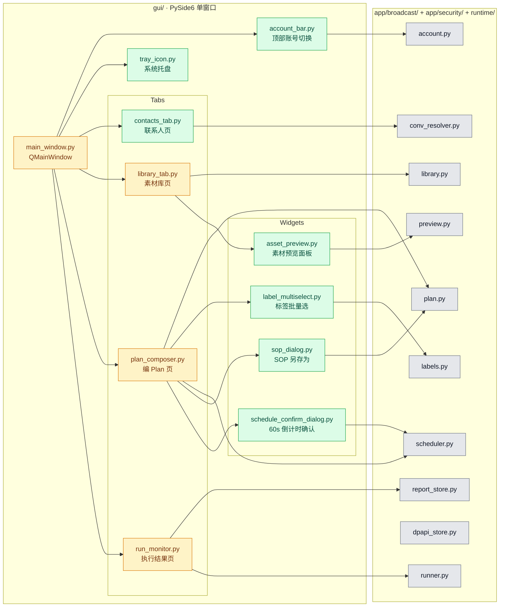
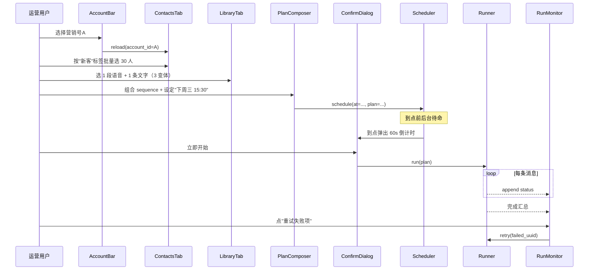
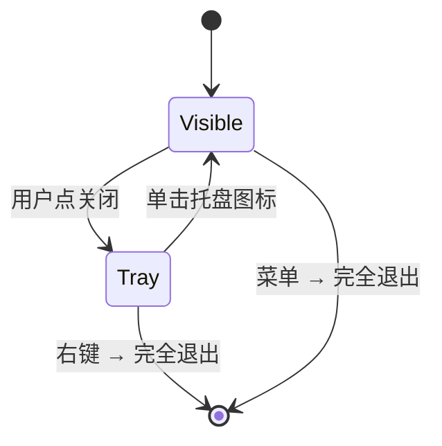

# GUI 设计与实施计划

**Overall Progress:** `100%`

**文档版本**：2026-09-16 v1.0
**姊妹文档**：[`PLAN_VOICE_LIBRARY_AND_BROADCAST.md`](PLAN_VOICE_LIBRARY_AND_BROADCAST.md)（程序/逆向/基础设施）。本文只写 **GUI 交互 & 前端** 相关计划；后端能力（发送引擎、标签逆向、加密、定时器、状态持久化）见姊妹文档 Phase C。
**技术栈**：PySide6（沿用现有 `gui/` 骨架，v0 已有 `main / tagger_window / plan_composer / run_monitor`）。
**目标读者**：GUI 实施 agent、UX 校准者。

---

## TLDR

在现有 3 tab GUI 骨架（素材库 / 编 Plan / 执行结果）之上，把 Phase A/B 已验证的发送能力**产品化为运营可日常使用的桌面工具**：加"账号切换栏"+"联系人页"两个新板块，扩展"素材库"（分类过滤/搜索/预览/文字变体/未命名 TTL/归档）、"编 Plan"（标签选人/定时/顺序拖拽）、"执行结果"（持久化/重试/CSV 导出）。全部界面用简体中文，风格追求"简洁易懂、少即是多"，避免多窗口/多层弹窗。

唯一 GUI 入口：`python -m gui.main`。

---

## Critical Decisions

> **范式**：从第一性原理出发选架构——**GUI 只做"编排 + 展示"，任何业务逻辑都下沉到 `app/broadcast/`**。GUI 不直接持有状态、不直接读写文件、不直接调 Frida，全部通过后端接口。这样 CLI/未来 Web/未来 CI 都能复用同一批后端能力，GUI 是最薄的一层。

| # | 决策 | 第一性原理依据 |
| --- | --- | --- |
| G1 | **顶部固定"账号切换栏"**（下拉 + "初始化新账号"按钮）；账号变更后所有 tab 数据热重载 | 单 MuMu 多账号切换是刚需（Q17）；账号是数据隔离的根轴（后端 Phase C Step 12），放最顶层符合信息架构层级 |
| G2 | **4 个主 tab**：联系人 / 素材库 / 编 Plan / 执行结果；**不新增第 5 个 SOP tab**，SOP 就是"没绑联系人的 Plan 模板"，在"编 Plan"里另存为 | 概念收敛：SOP = Plan 模板 = 保存的 sequence + 可选绑定标签；额外 tab 只会让用户迷惑"这两个都是 Plan 有啥区别" |
| G3 | **联系人页分子 Tab**：全部 / 外部客户 / 外部群 / 内部同事（Q F3）；每类下有搜索框 + 标签批量选择 | 类型混一起容易误发（群消息对多人可见），分开是安全底线；子 tab 比过滤器更直观 |
| G4 | **素材库用"类型过滤器 + 统一列表"**（不做 6 个 tab） | 6 tab 认知负担大；用户实际操作路径是"搜某个话术" > "浏览某类"，统一列表 + 过滤器最匹配 |
| G5 | **未命名素材 30 分钟自动删（可用户手动删）**（Q N5）；GUI 顶部有"待命名 N 条"红点提醒 | 用户可能误发，自动清理避免污染库；红点让"待处理"可见，不至于忘掉 |
| G6 | **素材预览必做**（点击行 → 右侧详情面板）：voice 内置播放器 / image 缩略 / video 内置播放 / text 全文 / oa 卡片渲染 / link URL | 仅命名不够识别；预览是"复用素材"的基础前提 |
| G7 | **SOP 绑定标签而非 ID**，触发时**弹出当前命中人数 + 勾选面板**让用户确认（Q-N8=b） | 标签成员会变，绑 id 会僵化；勾选面板给最后反悔机会，防误发 |
| G8 | **定时任务到点时弹 60s 倒计时确认框**（Q F2）；可"立即开始 / 取消" | 一次性定时通常离设置有几小时到几天间隔，人易忘/参数易过期，倒计时是最低成本的安全网 |
| G9 | **关窗最小化到系统托盘继续运行**（Q F1=b），托盘右键"完全退出" | 定时循环要求进程存活；关窗即退出会静默失约，托盘化是标准做法 |
| G10 | **文字变体 UI = 素材详情面板里"+ 添加变体"**（Q N6）；发送时随机抽 | 简单直接；不做 AI 改写（决策 C9） |
| G11 | **执行结果页 = 表格 + 进度条 + 失败重试按钮**；90 天后自动清理 + CSV 导出按钮（Q F6=c） | 表格是运营最熟悉的形态；CSV 导出兼容 Excel 交付合规审计 |
| G12 | **发送时间三种选择器**（立即 / N 时间后 / 具体时刻 / 每天 HH:MM 或 每周 DOW/HH:MM）（Q F4/N4） | 用下拉+日期选择器实现，不引入 cron 表达式（对运营不友好） |
| G13 | **GUI 只调 `app/broadcast/*` 与 `runtime/wework_re_android/*` 的封装函数，不直接 subprocess 或 Frida** | 后端能力可测试、可 CLI 复用；GUI 层零业务逻辑最好维护 |
| G14 | **首次账号初始化 = 显式"初始化新账号"按钮**（Q F7=a），一次性完成"拉会话 + 探标签 + 建目录" | 自动跑用户懵；显式按钮 + 进度条最清晰 |
| G15 | **执行顺序 Step 1 → 2 → 3 → 4 → 5 → 6 → 7 → 8**（见 Tasks），后端 Phase C 关键 Step 完成后立即接入对应 GUI | GUI 各页可独立开发；账号栏/联系人页/素材库预览等纯前端能力可早启动，Plan 编排/执行监控依赖后端 Phase C Step 12/14/15 完成 |

---

## Architecture

### 模块关系图

- **绿色**：本 plan 新增；**黄色**：现有骨架需扩展；**灰色**：后端能力（GUI 只调用，不实现）。
- GUI 严格不越过 `Backend` 边界直调 Frida / 文件系统。

### 主要用户流程时序图

### 关窗最小化状态图

---

## Tasks

**执行顺序依据**：账号栏是所有 tab 的数据根轴 → 联系人/素材库/预览是"输入"→ Plan 编排/定时是"编排"→ 执行结果是"输出"→ 托盘/更新提示/首启引导是"外壳"。每个 Step 内的子任务都可独立在 mock 后端下开发验收。

- [x] 🟩 **Step 1: 主窗口壳 + 账号切换栏**
  - [x] 🟩 1.1 `gui/main_window.py`：QMainWindow + 顶部 QToolBar 挂 `AccountBar`；4 个 QTabWidget（Contacts/Library/Composer/Monitor）
  - [x] 🟩 1.2 `gui/widgets/account_bar.py`：账号下拉 + "刷新" + "初始化新账号" 按钮；发 Qt Signal `accountChanged(account_id)`
  - [x] 🟩 1.3 所有 Tab 订阅 `accountChanged` 做数据热重载
  - [x] 🟩 1.4 入口 `python -m gui.main` 保留兼容

- [x] 🟩 **Step 2: 联系人页（Contacts Tab）**
  - [x] 🟩 2.1 `gui/tabs/contacts_tab.py`：子 tab = 全部 / 外部客户 / 外部群 / 内部同事
  - [x] 🟩 2.2 顶栏搜索框：按 id / 备注 / 标签（模糊匹配）
  - [x] 🟩 2.3 表格列：备注名 / 类型 / 标签（多标签用小色块）/ conv_local（可折叠）
  - [x] 🟩 2.4 `gui/widgets/label_multiselect.py`：点某标签一键选中所有该标签的联系人
  - [x] 🟩 2.5 "刷新联系人" 按钮 → 调 `list_conversations_with_names.py` 后端封装，显示进度
  - [x] 🟩 2.6 β 分支：单元格里可给联系人自打标签（若 α 失败时启用）
  - [x] 🟩 2.7 选择状态可跨 tab 保留（供 PlanComposer 消费）

> **FTA 采集面板补充**：`gui/tabs/library_ingest_tab.py` 的"录素材"面板（voice 走 CaptureClient、时长选择 5/10/30 min、状态条 MM:SS 倒计时）与"未命名 #NNN 双击命名"UX 详见 [`PLAN_FTA_CAPTURE_REFACTOR.md`](PLAN_FTA_CAPTURE_REFACTOR.md) F3.1 / F3.2（真机联调已通过）。

- [x] 🟩 **Step 3: 素材库页（Library Tab）扩展**
  - [x] 🟩 3.1 `gui/tabs/library_tab.py`：类型过滤器（voice / text / image / video / oa / link）+ 搜索框（按 name / tag / 编码）
  - [x] 🟩 3.2 顶部红点提醒："待命名 N 条" 点击跳过滤到未命名
  - [x] 🟩 3.3 表格列：类型图标 / 名字 / 标签 / 使用次数 / 归档态 / 更新时间
  - [x] 🟩 3.4 右侧详情面板 = `gui/widgets/asset_preview.py`（Step 5 实现）
  - [x] 🟩 3.5 行内编辑：name / 标签；右键菜单：归档 / 取消归档 / 删除
  - [x] 🟩 3.6 文字素材详情面板："+ 添加变体" / 变体列表可增删；显示"发送时随机抽 1 条"提示
  - [x] 🟩 3.7 未命名素材 30min TTL：GUI 每 5min 调 `library.gc_unnamed(1800)` + 启动时调一次
  - [x] 🟩 3.8 已归档不出现在 PlanComposer 素材选择器，但库列表勾"显示已归档"可见

- [x] 🟩 **Step 4: 编 Plan 页（Plan Composer）扩展**
  - [x] 🟩 4.1 `gui/tabs/plan_composer.py`：三栏 = 联系人（从 ContactsTab 传入 + 标签批量选） / 素材序列（拖拽排序） / 参数（间隔 / 发送时间 / voice 扰动开关）
  - [x] 🟩 4.2 素材选择器：从 LibraryTab 拖入或按类型下拉选
  - [x] 🟩 4.3 顺序拖拽：QListWidget setDragDropMode
  - [x] 🟩 4.4 间隔滑块：`msg_gap [min, max]` / `contact_gap [min, max]`，默认从 `plan.py DEFAULT_*`
  - [x] 🟩 4.5 发送时间选择器 = 4 种模式：
    - 立即执行
    - N 时间后（数值 + 分/时下拉）
    - 具体时刻（QDateTimeEdit）
    - 循环（每天 HH:MM / 每周 DOW/HH:MM）
  - [x] 🟩 4.6 "另存为 SOP" 按钮 → `gui/widgets/sop_dialog.py`：命名 + 可选绑定标签（不绑联系人）
  - [x] 🟩 4.7 "使用 SOP" 下拉：加载 SOP → 弹标签命中确认面板（G7）→ 用户勾选后填入联系人栏
  - [x] 🟩 4.8 底部"开始/调度" 按钮：立即模式直接跑；定时模式提交给 `scheduler.py`
  - [x] 🟩 4.9 JSON 预览折叠面板（调试用，可开关）

- [x] 🟩 **Step 5: 素材预览面板 & 通用 Widget**
  - [x] 🟩 5.1 `gui/widgets/asset_preview.py`：类型分派
    - voice：QMediaPlayer 播 wav（silk → wav 走后端 `preview.py`）；显示时长、波形（可选）、变体数（若 text）
    - image：QLabel + `preview.pull_preview()` 缓存
    - video：QMediaPlayer 播 mp4；显示时长、首帧 thumb
    - text：QTextEdit 只读展示所有变体
    - oa：QWidget 拟企微卡片样式（title / desc / thumb / sourcename / url）
    - link：URL + 用户备注
  - [x] 🟩 5.2 `gui/widgets/schedule_confirm_dialog.py`：60s QTimer 倒计时 + "立即开始 / 取消"
  - [x] 🟩 5.3 `gui/widgets/sop_dialog.py`：命名 + 标签绑定选择器
  - [x] 🟩 5.4 `gui/widgets/label_multiselect.py`：标签复选（Step 2 复用）

- [x] 🟩 **Step 6: 执行结果页（Run Monitor）扩展**
  - [x] 🟩 6.1 `gui/tabs/run_monitor.py`：顶部当前运行 Plan 卡片（进度条 / 已发/待发/失败计数）
  - [x] 🟩 6.2 主表格：联系人 × 消息序号 × 状态（✅/⏳/❌）× 时间戳 × 失败原因
  - [x] 🟩 6.3 "重试失败项" 按钮 → 调 `runner.resume(uuid, only_failed=True)`
  - [x] 🟩 6.4 历史 Plan 侧边栏：按时间倒序，点击加载对应 report
  - [x] 🟩 6.5 "导出 CSV" 按钮 → `report_store.export_csv`
  - [x] 🟩 6.6 底部说明文字："发送记录默认保留 90 天，超期自动清理，请及时导出"

- [x] 🟩 **Step 7: 系统托盘 & 关窗行为**
  - [x] 🟩 7.1 `gui/tray_icon.py`：QSystemTrayIcon + 右键菜单（显示主窗口 / 完全退出）
  - [x] 🟩 7.2 `main_window.closeEvent`：默认最小化到托盘，Ctrl+Q 或菜单"完全退出"才真退出
  - [x] 🟩 7.3 托盘提示："已最小化到托盘，定时任务将在后台执行"
  - [x] 🟩 7.4 定时任务到点触发弹窗时自动 raise 主窗口

- [x] 🟩 **Step 8: 首启引导 & 更新提示 & 使用文档**
  - [x] 🟩 8.1 首次启动检测：无 `data/<account_id>/` → 弹"初始化新账号"引导
  - [x] 🟩 8.2 更新提示弹窗：调 `app/updater/version_check.py`，有新版则提示 + 打开 Releases 页链接
  - [x] 🟩 8.3 菜单栏 → "帮助" → "使用手册"：打开本地 `docs/USER_MANUAL.md`（另建，最后一轮讨论）
  - [x] 🟩 8.4 菜单栏 → "帮助" → "关于"：显示版本号、企微适配版本、GitHub 链接

---

## 详细改动清单

### 1. 主窗口 & 全局壳

| 位置 | 改前 | 改后 | 文件 |
| --- | --- | --- | --- |
| 主入口 | `gui/main.py` 直接建单窗 | 改为薄壳，实例化 `MainWindow` | `gui/main.py` |
| 主窗口 | 无 | QMainWindow + 顶部账号栏 + 4 tab + 菜单栏 | `gui/main_window.py`（新建） |
| 账号切换栏 | 无 | 下拉 + 刷新 + 初始化新账号 | `gui/widgets/account_bar.py`（新建） |
| 系统托盘 | 无 | 关窗最小化 + 右键菜单 | `gui/tray_icon.py`（新建） |

### 2. Tab 页

| 位置 | 改前 | 改后 | 文件 |
| --- | --- | --- | --- |
| 联系人页 | 无 | 4 子 tab + 搜索 + 标签批量选 | `gui/tabs/contacts_tab.py`（新建） |
| 素材库页 | `gui/tagger_window.py` 单表 + 改名 | 类型过滤 + 搜索 + 预览面板 + 变体编辑 + 归档 + 未命名红点 | `gui/tabs/library_tab.py`（新建，取代 `tagger_window.py`；后者归档 `legacy/gui/`） |
| 编 Plan 页 | `gui/plan_composer.py` 基础版 | 三栏 + 拖拽 + 定时器 + SOP 另存/加载 | `gui/tabs/plan_composer.py`（重构 `gui/plan_composer.py`） |
| 执行结果页 | `gui/run_monitor.py` 基础版 | 表格 + 历史 + 重试 + CSV 导出 + 保留期说明 | `gui/tabs/run_monitor.py`（重构 `gui/run_monitor.py`） |

### 3. 通用 Widget

| 位置 | 改动 | 文件 |
| --- | --- | --- |
| 素材预览面板 | 6 种类型分派预览 | `gui/widgets/asset_preview.py`（新建） |
| 定时确认框 | 60s 倒计时 | `gui/widgets/schedule_confirm_dialog.py`（新建） |
| SOP 另存对话框 | 命名 + 绑定标签 | `gui/widgets/sop_dialog.py`（新建） |
| 标签多选 | 复选 + 一键全选 | `gui/widgets/label_multiselect.py`（新建） |
| 联系人命中确认 | SOP 触发时勾选面板 | `gui/widgets/contact_confirm_panel.py`（新建） |

### 4. 后端接口约定（GUI 侧要用的都放这里，避免直调）

| 位置 | 用途 | 文件 |
| --- | --- | --- |
| 账号列表 | `list_accounts()` / `switch_account()` | `app/broadcast/account.py`（Phase C Step 12） |
| 联系人枚举 | `refresh_contacts(account_id)` | `runtime/wework_re_android/conv_resolver.py`（Phase C Step 11） |
| 素材库 | ✅ `VoiceLibrary` + `TextTemplate`：`add/list/update/archive/gc_unnamed/list_text_templates` | `app/broadcast/library.py`（Step 13 ✅） |
| Plan 序列化 | `save_plan / load_plan`；text step 支持 `template_id + variant_pick` | `app/broadcast/plan.py`（Step 13 ✅） |
| 调度 | `submit / cancel / list_pending` | `app/broadcast/scheduler.py`（Phase C Step 15，待做） |
| 运行 | ✅ `run / resume` + 失败重试 + `variant_used` 报告字段 | `app/broadcast/runner.py`（Step 13/14 ✅） |
| 报告 | ✅ `load_report / export_csv / gc` | `app/broadcast/report_store.py`（Step 14 ✅） |
| 预览 | `pull_preview / decode_silk` | `app/broadcast/preview.py`（Phase C Step 20） |
| 更新 | `check_latest_version` | `app/updater/version_check.py`（Phase C Step 18） |

### 5. 文案 & 视觉规范

| 项 | 约定 |
| --- | --- |
| 语言 | 一律简体中文 |
| 字号 | 主字体 13pt，表格 12pt，标签 11pt |
| 颜色 | 主色 `#2563EB`；成功 `#16A34A`；失败 `#DC2626`；警告 `#F59E0B` |
| 图标 | Material Symbols（PySide6 QIcon 加载 SVG） |
| 空态 | 每个空列表都有中文引导语（如"暂无素材，请在企微里对文件传输助手发送一段语音"） |

### 6. 自动化测试

| 测试文件 | 断言/覆盖 |
| --- | --- |
| `tests/gui/test_account_bar.py` | 切换账号发信号 / 各 tab 收到 reload |
| `tests/gui/test_library_filter.py` | 类型过滤 / 搜索 / 未命名红点计数 |
| `tests/gui/test_plan_composer.py` | 拖拽排序 / 定时模式切换 / SOP 另存往返 |
| `tests/gui/test_schedule_confirm.py` | 60s 倒计时 / 立即开始 / 取消 |
| `tests/gui/test_tray_close.py` | closeEvent 走托盘 / 完全退出 |

> GUI 测试建议用 pytest-qt；纯视觉不做测试，仅逻辑层。

---

## 手动测试清单（供你逐项勾选）

### A. 账号切换 & 首启

- [x] **A1** 首次启动 → 无账号 → 引导弹"初始化新账号"，点击后进入向导（登录 MuMu 里企微 → 点"我登好了"→ 后台跑首启探针）✅ 2026-09-16 实机通过（快照化修复后复测）
- [x] **A2** 初始化完成 → 账号栏出现新账号 → 4 tab 数据加载完成 ✅ 2026-09-17 实机通过
- [~] **A3** 切换到另一个账号 → 素材库/联系人/报告 全部换成新账号的（跳过：当前仅单账号）
- [x] **A4** 关闭主窗口 → 缩到托盘 → 单击托盘图标恢复；右键"完全退出"程序结束 ✅ 2026-09-17 实机通过

### B. 联系人页

- [ ] **B1** 4 子 tab 分类正确（客户/群/同事不混）
- [ ] **B2** 搜索"海鸟" → 命中"海鸟与鱼"
- [ ] **B3** 点标签"新客" → 该标签所有客户被选中；再点一次取消
- [ ] **B4** α 分支：企微里新加"意向客户"标签 → 点"刷新" → 联系人页出现新标签
- [ ] **B5** β 分支：给"张三"手打"VIP" 标签 → 保存 → 重启后仍在

### C. 素材库

- [ ] **C1** 类型过滤器 = "语音" → 仅显示 voice
- [ ] **C2** 搜索"开场白" → 匹配 name / tag 命中
- [ ] **C3** 未命名 voice 在 30 分钟后自动消失；期间可手动"命名"或"删除"
- [ ] **C4** 顶部"待命名 3 条" 红点点击 → 过滤到未命名
- [ ] **C5** 归档某条 → 库列表默认不显示；勾"显示已归档"后可见；PlanComposer 素材选择器不出现
- [ ] **C6** 点 voice → 右侧详情面板可播放，能听到声音；显示时长
- [ ] **C7** 点 image → 右侧显示图片；点 video → 内置播放；点 text → 显示所有变体；点 oa → 卡片样式；点 link → URL + 备注
- [ ] **C8** 文字素材"+ 添加变体" → 添加 2 条 → 保存 → 重开仍在

### D. 编 Plan

- [ ] **D1** 从联系人页勾选 10 人 → 切到 PlanComposer → 联系人栏已填入
- [ ] **D2** 从素材库拖 3 条素材到序列区 → 拖拽调整顺序
- [ ] **D3** 间隔滑块调整后，"JSON 预览"更新
- [ ] **D4** 定时模式 = "5 分钟后" → 5 分钟后弹 60s 倒计时；点"立即开始"→ 执行；点"取消"→ 不执行
- [ ] **D5** 定时模式 = "每天 09:00" → 提交后调度列表可见；到点触发（可临时改系统时间验证）
- [ ] **D6** "另存为 SOP" → 命名"新客首触"→ 绑定标签"新客"→ 保存
- [ ] **D7** "使用 SOP" 选"新客首触" → 弹当前"新客"命中人数（例如 47 人）+ 勾选面板；确认后进入 Plan

### E. 执行结果

- [ ] **E1** 跑 10 人 × 3 条消息 → 表格实时更新（✅/⏳/❌）
- [ ] **E2** 中途 kill GUI → 重启 → 报告仍在 → 可续跑
- [ ] **E3** 有 2 条失败 → 点"重试失败项"→ 只这 2 条重跑
- [ ] **E4** "导出 CSV" → 打开是完整表格
- [ ] **E5** 底部保留期说明可见
- [ ] **E6** 侧边栏历史 Plan 按时间倒序 → 点击加载历史 report

### F. 关键 UX

- [ ] **F1** 全部界面中文，无英文遗漏
- [ ] **F2** 空态引导语存在（无素材/无联系人/无历史 Plan 三处）
- [x] **F3** 帮助菜单 → 使用手册可打开 ✅ 2026-09-16 实机通过
- [x] **F4** 帮助菜单 → 关于显示版本号 + 企微适配版本 ✅ 2026-09-16 实机通过

### G. 回归

- [ ] **G1** 旧 `python -m gui.main` 入口仍能启动新版
- [ ] **G2** Phase A/B 的 CLI 命令（`send_engine voice/text/image/video/oa`）不受 GUI 改动影响

### Step 8 验收进展（自动化，2026-09-16）

- [x] **AUTO-8.1** 首启引导触发逻辑：当 `data/<account_id>/` 不存在时会弹引导，并可进入“初始化新账号”
- [x] **AUTO-8.1b** 首启引导触发逻辑补强：当 `data/<account_id>/` 目录为空时，也视为未初始化并弹引导
- [x] **AUTO-8.1c** 首启判断快照化：在任何 Tab 构造前记录状态，避免 `BroadcastScheduler` 提前 `mkdir` 导致引导被吞
- [x] **AUTO-8.2** 更新提示逻辑：手动“检查更新”在“已是最新版本”场景会给出提示
- [x] **AUTO-8.3** 帮助菜单“使用手册”：可打开本地 `docs/USER_MANUAL.md`
- [x] **AUTO-8.4** 帮助菜单“关于”：可显示版本号 / 企微适配版本 / GitHub 链接文本
- [x] **MANUAL-A1** 首启引导实机通过（2026-09-16）
- [x] **MANUAL-F3** 使用手册实机通过（2026-09-16）
- [x] **MANUAL-F4** 关于对话框实机通过（2026-09-16）
- [x] **MANUAL-检查更新** 手动触发可弹窗、不崩溃；404 因占位 GitHub 仓库尚无 Release（预期，已优化中文提示）
- [x] **MANUAL-A2** 4 Tab 加载实机通过（2026-09-17）
- [x] **MANUAL-A4** 托盘最小化/恢复/完全退出实机通过（2026-09-17）
- [~] **MANUAL-A3** 跳过（当前仅单账号，无法切换）

---

## Open Questions（GUI 侧）

| # | 问题 | 回填时机 |
| --- | --- | --- |
| G-Q1 | 波形显示是否 v1 就做？（silk 波形绘制需额外库） | Step 5.1（若耗时>0.5 天则推 v1.1） |
| G-Q2 | 首次登录营销号后企微在 MuMu 里的登录扫码流程是否要 GUI 内嵌截屏引导 | Step 8.1（可先文字步骤） |
| G-Q3 | oa 卡片预览的 thumbUrl 走远端加载还是本地缓存 | Step 5.1（远端加载最简，境内网络若慢再改本地） |
| G-Q4 | 联系人页表格在 500+ 联系人时的分页/虚拟滚动 | Step 2.3（500 内 QTableWidget 够用，更多用 QAbstractItemModel） |
| G-Q5 | 用户手册（`docs/USER_MANUAL.md`）内容详细度 | 最后一轮讨论（按你的建议单独出方案） |
