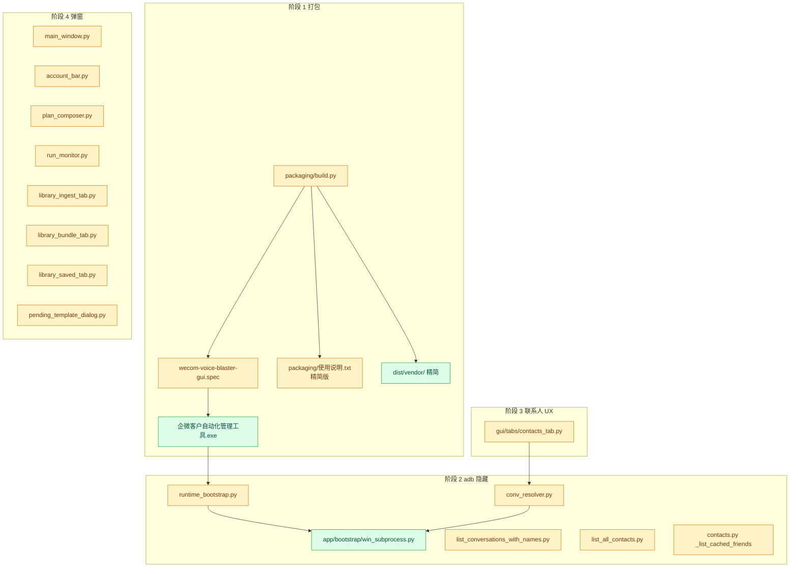
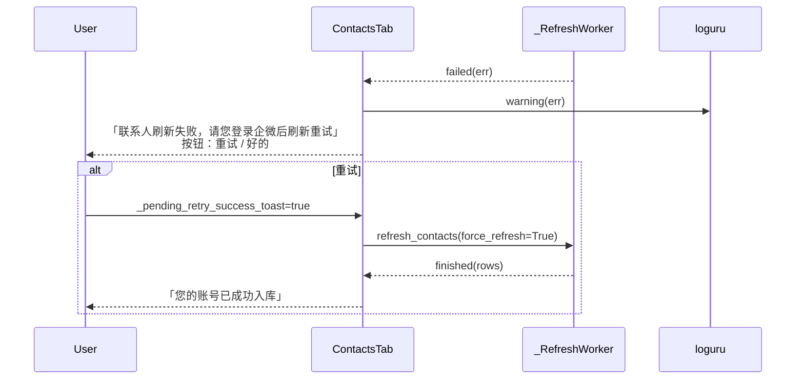

# Feature Implementation Plan

**Overall Progress:** `94%`

## TLDR

按 **五个阶段** 交付：① **方案 B 加强版打包**（onefile `企微客户自动化管理工具.exe` ≈150MB + 外置精简 `vendor/` ≈207MB + 精简《使用说明》）→ ② **消除 adb 黑窗**（`win_subprocess`）→ ③ **联系人刷新弹窗**（重试/好的 + 重试成功后入库提示）→ ④ **全 GUI 弹窗精简**（先 40+ 条对照表二次确认，再改代码）→ ⑤ **打包与手动验收**。

启动时 `bootstrap_android_runtime` 失败 **静默**（不弹窗）。已做临时止血：关闭 30s 被动 adb 探测；清理僵尸 `pythonw -m gui.main` 进程。

**执行口径更新（2026-09-22）：** 以开发态 `\.venv\Scripts\python.exe -m gui.main` 作为主验收对象；打包产物链路保留为次级验收。当前已完成阶段 1~4 代码落地，阶段 5 需按新口径继续回归。

---

## Critical Decisions

> **范式（必须遵循）：** 交付物是「exe + 同目录 vendor」而非开发机 `.venv`；Windows console 子进程默认可见 → adb 必须 `CREATE_NO_WINDOW`；UI 只展示人话，技术细节进 `loguru`；打包 datas 只含运行时只读小资源，大二进制放外置 vendor。

| #   | 决策                                                                                                                                         | 第一性原理依据                                                                                                             |
| --- | -------------------------------------------------------------------------------------------------------------------------------------------- | -------------------------------------------------------------------------------------------------------------------------- |
| 1   | **阶段 1：onefile + `console=False` + `name=企微客户自动化管理工具`；datas 仅 `config.yaml`、`samples/`、`contacts.example.csv`**            | 去掉 `vendor/`（~869MB）与 `testdata/`（开发用），避免 onefile 近 1GB 且每次解压 `%TEMP%`                                  |
| 2   | **阶段 1：`build.py` 后处理生成 `dist/vendor/`（仅 `ffmpeg/ffmpeg.exe` + `frida-server-16.7.19-android-x86_64`）并拷贝精简《使用说明.txt》** | `project_root()` 在 frozen 下为 exe 目录，`resolve_path("vendor/...")` 读 exe 旁 vendor；用户只需「exe + vendor 同文件夹」 |
| 3   | **弃用 `packaging/new_gui_desktop_launcher.py` 与 `dist/desktop-launcher/`**                                                                 | 硬编码 `.venv`、无单例，曾导致多实例 + 后台 adb 闪任务栏                                                                   |
| 4   | **阶段 2：新建 `win_subprocess.py`，仅替换「启动路径上」列出的 5 处模块中的 adb/子进程调用**                                                 | 与用户敲定范围一致；先打通 bootstrap + 联系人刷新链，避免 scope 漂移                                                       |
| 5   | **阶段 3：联系人失败固定文案；成功「您的账号已成功入库」仅「失败弹窗 → 点重试 → 成功」**                                                     | `_pending_retry_success_toast` 单标志，无额外状态机                                                                        |
| 6   | **阶段 4：8 个文件内全部 `QMessageBox` 先对照表、用户确认后再改**                                                                            | 约 45 处调用；原则：去 traceback、`str(exc)`→人话、按钮用明确动词                                                          |
| 7   | **bootstrap 失败静默**                                                                                                                       | 连接/登录问题在用户主动刷新时再提示（阶段 3/4 弹窗）                                                                       |
| 8   | **窗口标题与 exe 名一致**                                                                                                                    | 改 `gui/i18n.py` 的 `APP_TITLE` →「企微客户自动化管理工具」                                                                |

**执行顺序（本计划锁定）：** 阶段 1 → 2 → 3 → 4 → 5。阶段 2 在阶段 1 之后仍可在开发态用 `python -m gui.main` 验证 hidden subprocess；阶段 5 必须 `--gui-only --clean` 全量验收。

---

## Architecture

### 交付目录结构（阶段 1 完成后 `dist/`）

```text
dist/
  企微客户自动化管理工具.exe    # onefile, console=False, ~150MB
  使用说明.txt                  # 精简版：exe + vendor 同目录
  vendor/
    ffmpeg/ffmpeg.exe
    frida-server-16.7.19-android-x86_64
    adb.exe                             # Google 官方 platform-tools（补丁 2026-09-22）
    AdbWinApi.dll                       # adb.exe 运行时依赖，必须同目录
    AdbWinUsbApi.dll                    # adb.exe 运行时依赖，必须同目录
```

> **补丁记录（2026-09-22）：** 精简 vendor 追加 adb 三件套。原因：
> `app/bootstrap/runtime_bootstrap.resolve_adb_binary` 优先读 `vendor/adb.exe`，
> 缺失时回退到 PATH `"adb"`；销售机器上多数没有把 `adb.exe` 加入 PATH，
> 导致 `bootstrap_android_runtime` 与账号栏「刷新」全部失败，
> 表现为「首次打开 exe 无法自动识别企微 ID」+「刷新按钮点了也没反应」。

### 模块关系图



### 阶段 3：联系人刷新失败 → 重试 → 入库



---

## Tasks

- [x] 🟩 **预备（已完成）**
  - [x] 🟩 `account_bar.py`：不再 `start()` 30s `_passive_probe_timer`
  - [x] 🟩 清理残留 `pythonw -m gui.main`（用户确认任务栏不再闪）

---

### 阶段 1：打包与启动瘦身（方案 B 加强版：方案 B 的加强版 —— exe 单文件 ≈ 150 MB，旁边放一个 vendor/ 精简目录（只留 ffmpeg/ffmpeg.exe 和 frida-server-16.7.19-android-x86_64 两项，合计约 207 MB）。）

- [x] 🟩 **1.1 修改 `packaging/wecom-voice-blaster-gui.spec`**
  - [x] 🟩 **onefile**：`EXE(..., exclude_binaries=False)` 合并 `a.binaries, a.zipfiles, a.datas`；**删除** `COLLECT` onedir 段
  - [x] 🟩 **`console=False`**（保持无控制台窗口）
  - [x] 🟩 **`name="企微客户自动化管理工具"`**
  - [x] 🟩 **`datas` 仅保留**：
    - `config.yaml` → `.`
    - `samples/` → `samples`
    - `contacts.example.csv` → `.`
  - [x] 🟩 **明确不包含**：`vendor/`、`testdata/`
  - [x] 🟩 入口仍为 `packaging/gui_launcher.py`；`runtime_hooks` 仍为 `runtime_hook_frozen.py`

- [x] 🟩 **1.2 修改 `packaging/build.py`（`--gui-only`）**
  - [x] 🟩 PyInstaller 产物：**`dist/企微客户自动化管理工具.exe`**（≈150MB）
  - [x] 🟩 打包成功后 **自动生成 `dist/vendor/`**，仅复制：
    - `vendor/ffmpeg/ffmpeg.exe` → `dist/vendor/ffmpeg/ffmpeg.exe`
    - `vendor/frida-server-16.7.19-android-x86_64` → `dist/vendor/frida-server-16.7.19-android-x86_64`
  - [x] 🟩 将 **精简版** `使用说明.txt` 写入 **`dist/使用说明.txt`**（源稿维护在 `packaging/使用说明-gui-desktop.txt` 或覆盖策略见附录 B）
  - [x] 🟩 **不再**向 GUI 产物复制 `启动.bat`、不再依赖 onedir 文件夹 `wecom-voice-blaster-gui/`
  - [x] 🟩 控制台打印最终交付提示：「请将 exe、`vendor` 文件夹、`使用说明.txt` 放在同一目录后双击 exe」

- [x] 🟩 **1.3 弃用旧桌面启动器**
  - [x] 🟩 `packaging/new_gui_desktop_launcher.py`：文件头 **DEPRECATED**，说明改用 PyInstaller 产物
  - [x] 🟩 文档与 build 脚本 **不再生成/推荐** `dist/desktop-launcher/`、`Test-Voice-NewGUI.exe`
  - [ ] 🟥 （可选）在 `.gitignore` 或 README 中注明 `dist/desktop-launcher/` 为历史产物

- [x] 🟩 **1.4 标题对齐**
  - [x] 🟩 `gui/i18n.py`：`APP_TITLE = "企微客户自动化管理工具"`

---

### 阶段 2：消除 adb 黑窗

- [x] 🟩 **2.1 新建 `app/bootstrap/win_subprocess.py`**
  - [x] 🟩 `run_hidden(*args, **kwargs)` → 包装 `subprocess.run`，Windows 下 `creationflags=0x08000000`（`CREATE_NO_WINDOW`）
  - [x] 🟩 `check_output_hidden(*args, **kwargs)` → 包装 `subprocess.check_output`，同上
  - [x] 🟩 非 Windows：`creationflags` 不传，行为与普通 subprocess 一致

- [x] 🟩 **2.2 替换启动路径上的 adb / 子进程调用**（严格限于下列文件）
  - [x] 🟩 `app/bootstrap/runtime_bootstrap.py` — `_run()` / 全部 `adb ...`
  - [x] 🟩 `runtime/wework_re_android/conv_resolver.py` — `ConversationResolver._query`、`list_conversations` 的 `run_fn`
  - [x] 🟩 `runtime/wework_re_android/list_conversations_with_names.py` — `find_pid` 内 `check_output(["adb", ...])`
  - [x] 🟩 `runtime/wework_re_android/list_all_contacts.py` — 凡 `subprocess` 调 adb 处
  - [x] 🟩 `app/broadcast/contacts.py` — `_list_cached_friends` 的子进程 `run_fn`

> **范围说明：** 账号栏「刷新」若仍经 `app/broadcast/account.py` 调 adb 且出现黑窗，可在阶段 2 末尾 **追加** 该文件（需与你确认扩 scope）；本计划正文不默认包含。

---

### 阶段 3：「刷新联系人失败」弹窗改造

**文件：** `gui/tabs/contacts_tab.py`

- [x] 🟩 **3.1 `_on_refresh_failed`**
  - [x] 🟩 标题建议保留：「联系人刷新失败」或仅窗口标题，**正文固定**：「联系人刷新失败，请您登录企微后刷新重试」
  - [x] 🟩 **不要**再展示 `err` / traceback
  - [x] 🟩 自定义按钮：**「重试」**（AcceptRole）、**「好的」**（RejectRole 或 Close）
  - [x] 🟩 **「重试」**：设置 `self._pending_retry_success_toast = True`，调用 `refresh_contacts(force_refresh=True, show_error=True)`
  - [x] 🟩 **原始 `err`**：`loguru.logger.warning(...)`（建议带 `account_id`）

- [x] 🟩 **3.2 `_on_refresh_done`**
  - [x] 🟩 若 `self._pending_retry_success_toast` 为真：`QMessageBox.information(..., "您的账号已成功入库")`，然后置 `False`
  - [x] 🟩 普通刷新成功（未经过失败→重试）：**不**弹入库提示

- [x] 🟩 **3.3 初始化**
  - [x] 🟩 `__init__` 中增加 `self._pending_retry_success_toast = False`

---

### 阶段 4：其他弹窗批量精简

**流程（必须遵守）：**

1. **4a** — 维护 **新旧文案对照表**，覆盖下列 8 个文件中 **每一个** `QMessageBox` 调用（约 **45** 处，见附录 A 清单）。
2. **你二次确认** 对照表（附录 A 末「已确认」勾选）。
3. **4b** — 按表改代码。

**原则：**

- 去掉 traceback、`str(exc)`、stderr 墙、路径/entry.id 等内部细节（可保留少量用户需要的成功路径，如「已导出到：路径」可改为人话或「已导出，请查看您选择的文件夹」— 在对照表逐条定）。
- 技术细节一律 `loguru` 记录。
- 需要决策的对话框：按钮改为明确动词（重试、取消、打开、稍后等）。

**覆盖文件：**

| 文件                                     | 约略弹窗数 | 阶段 4 要点                                           |
| ---------------------------------------- | ---------: | ----------------------------------------------------- |
| `gui/main_window.py`                     |          6 | 首次引导缩短；更新/手册错误不暴露 `result.error` 原文 |
| `gui/widgets/account_bar.py`             |          4 | 探测失败/未登录人话化                                 |
| `gui/tabs/plan_composer.py`              |         17 | Plan/调度/校验/ SOP                                   |
| `gui/tabs/run_monitor.py`                |         16 | 执行失败/导出/删除/加载报告                           |
| `gui/tabs/library_ingest_tab.py`         |         14 | FTA/wxa 异常、命名/保存失败                           |
| `gui/tabs/library_bundle_tab.py`         |          7 | 素材包保存/删除                                       |
| `gui/tabs/library_saved_tab.py`          |          6 | 保存/加载/变体                                        |
| `gui/widgets/pending_template_dialog.py` |          3 | 缺标题/名称、确认丢弃                                 |

- [x] 🟩 **4a** 产出完整对照表（附录 A 填齐 + 可选另存 `docs/GUI_MESSAGE_BOX_COPY.md`）
- [x] 🟩 **用户确认** 对照表
- [x] 🟩 **4b** 按表修改上述 8 个文件（阶段 3 的 `contacts_tab` 已在阶段 3 完成，阶段 4 对照表仍列出 C1/C2 便于总览）

> **说明：** 阶段 3 已改 `contacts_tab` 的刷新失败/入库提示；阶段 4 对其余弹窗（含「未勾选联系人」等）按同一原则处理。

---

### 阶段 5：验证

- [x] 🟩 **5.1 构建**
  - [x] 🟩 项目根目录执行：`python packaging/build.py --gui-only --clean`（已重跑并产出 exe）
  - [x] 🟩 已补充：`dist/` 产物齐全，exe 体积约 117MB（用于 C1-2/C2-1 回填）

- [ ] 🟥 **5.2 手动测试（验收标准）**
  - [ ] 🟥 双击 **`dist/企微客户自动化管理工具.exe`**（与 **`dist/vendor/`** 同目录）→ **直接出现 GUI**，全程 **无 cmd/adb 黑框**
  - [ ] 🟥 **断开 MuMu**（或 adb 不可连）→ 联系人页点 **「刷新联系人」** → 出现阶段 3 弹窗（人话 + **重试 / 好的**），**无** traceback
  - [ ] 🟥 **恢复 MuMu + 企微已登录** → 在失败弹窗点 **「重试」** → 刷新成功 → 提示 **「您的账号已成功入库」**
  - [ ] 🟥 对照 **附录 C** 完成其余勾选（体积、静默 bootstrap、阶段 4 回归等）

---

## 详细改动清单（按阶段）

### 阶段 1

| 位置          | 改前                            | 改后                                               | 文件                                                       |
| ------------- | ------------------------------- | -------------------------------------------------- | ---------------------------------------------------------- |
| 打包模式      | onedir + COLLECT                | onefile 单 exe                                     | `packaging/wecom-voice-blaster-gui.spec`                   |
| exe 名        | `wecom-voice-blaster-gui`       | `企微客户自动化管理工具`                           | 同上                                                       |
| datas         | vendor + testdata + …           | 仅 config / samples / contacts.example             | 同上                                                       |
| 产物路径      | `dist/wecom-voice-blaster-gui/` | `dist/企微客户自动化管理工具.exe` + `dist/vendor/` | `packaging/build.py`                                       |
| 使用说明      | 旧 onedir + 启动.bat            | 精简版 exe+vendor 同目录                           | `packaging/使用说明-gui-desktop.txt` → `dist/使用说明.txt` |
| 桌面 launcher | 活跃                            | DEPRECATED                                         | `packaging/new_gui_desktop_launcher.py`                    |
| 窗口标题      | 企微客户管理自动化工具          | 企微客户自动化管理工具                             | `gui/i18n.py`                                              |

### 阶段 2

| 位置           | 改动                                 | 文件                                                         |
| -------------- | ------------------------------------ | ------------------------------------------------------------ |
| 新增           | `run_hidden` / `check_output_hidden` | `app/bootstrap/win_subprocess.py`                            |
| adb bootstrap  | 使用 hidden run                      | `app/bootstrap/runtime_bootstrap.py`                         |
| 会话列表子进程 | default `run_fn` → hidden            | `runtime/wework_re_android/conv_resolver.py`                 |
| find_pid       | check_output → hidden                | `runtime/wework_re_android/list_conversations_with_names.py` |
| 联系人枚举     | adb subprocess hidden                | `runtime/wework_re_android/list_all_contacts.py`             |
| 好友缓存       | `_list_cached_friends` run_fn        | `app/broadcast/contacts.py`                                  |

### 阶段 3

| 位置     | 改前                | 改后                          | 文件                       |
| -------- | ------------------- | ----------------------------- | -------------------------- |
| 刷新失败 | `warning(..., err)` | 固定文案 + 重试/好的；err→log | `gui/tabs/contacts_tab.py` |
| 重试成功 | 无                  | 「您的账号已成功入库」        | 同上                       |

### 阶段 4

已完成，见 **附录 A（完成版）**。

### 阶段 5

无新增代码；执行 build + 附录 C 手动清单。

---

## 附录 A：弹窗对照表与清单（阶段 4a — 已完成）

### A.1 已敲定（阶段 3 实现，对照表保留）

| ID  | 场景                     | 改后文案 / 按钮                                                             | 确认 |
| --- | ------------------------ | --------------------------------------------------------------------------- | ---- |
| C1  | 刷新联系人失败           | 正文：「联系人刷新失败，请您登录企微后刷新重试」；按钮：**重试** / **好的** | [x] |
| C2  | 失败弹窗点重试且刷新成功 | 「您的账号已成功入库」                                                      | [x] |

### A.2 阶段 4 完成版（改前 → 改后已落地）

**`gui/main_window.py`：** 首次启动引导；检查更新失败；发现新版本；已是最新；使用手册不存在；关于。

**`gui/widgets/account_bar.py`：** 确认账号；未检测到登录账号；自动探测失败→手动 vid；请稍候（探测进行中）。

**`gui/tabs/contacts_tab.py`：** 未勾选联系人（C1/C2 见上）。

**`gui/tabs/plan_composer.py`：** 无可用素材；素材包不可用；暂不支持类型；素材不可用；素材校验异常；校验中；Plan 不可用；调度器不可用；提交调度失败；调度成功；调度任务无效；请先添加步骤；SOP 保存成功；请选择 SOP；SOP 标签未命中；Plan 不可用（单步）等。

**`gui/tabs/run_monitor.py`：** 任务执行中；Plan 不可用；无继续上下文；无法重试；执行失败；报告未初始化；无可导出；导出失败/成功；删除确认；删除失败；加载报告失败；缺少 Plan 快照等。

**`gui/tabs/library_ingest_tab.py`：** FTA 启动失败；FTA 异常退出；命名失败；确认删除；部分删除失败；变体/读取/保存文字/链接/wxa 启动/保存失败；无法删除最后变体等。

**`gui/tabs/library_bundle_tab.py`：** 素材详情；缺少名称；素材包为空；保存成功；保存失败；部分改名失败；删除失败。

**`gui/tabs/library_saved_tab.py`：** 保存/操作/加载/更新变体失败；请选择卡片。

**`gui/widgets/pending_template_dialog.py`：** 缺少标题；缺少名称；确认丢弃。

**阶段 4b 门禁：** [x] 上表全部行已填「改后」并已按本计划落地到代码。

---

## 附录 B：精简版《使用说明.txt》要点（阶段 1 写入 `dist/`）

> 实现时在 `packaging/` 维护源稿（建议新文件 `packaging/使用说明-gui-desktop.txt`），`build.py` 复制到 `dist/使用说明.txt`。内容须 **短**，面向运营同学。

1. **怎么运行**
   - 把 **`企微客户自动化管理工具.exe`** 和 **`vendor` 文件夹**（含 `ffmpeg`、`frida-server`）放在 **同一目录**。
   - 双击 exe 即可；**不要**只拷贝 exe。
   - 首次运行会在 exe 同目录生成 `logs/`、`runtime/` 等（若不存在）。

2. **环境**
   - MuMu 模拟器已启动，adb 地址默认 `127.0.0.1:16384`。
   - 模拟器内 **企微已登录**（非登录页）。

3. **联系人**
   - 若刷新失败：请先登录企微，再在软件内点「刷新联系人」或弹窗中的「重试」。

4. **退出**
   - 完全退出请用菜单 **「文件 → 完全退出」**；仅点窗口 × 会 **最小化到托盘**，程序仍在后台。

5. **不要再用**
   - 旧版 `Test-Voice-NewGUI.exe` / 本机 Python 启动方式已弃用。

---

## 附录 C：手动测试清单（阶段 5 及全阶段回归）

### C1. 阶段 5 必测（与用户指定一致）

- [x] **C1-1** `python packaging/build.py --gui-only --clean` 成功（已重跑确认）
- [x] **C1-2** `dist/` 含 exe + `vendor/ffmpeg/ffmpeg.exe` + `vendor/frida-server-16.7.19-android-x86_64` + `vendor/adb.exe` + `vendor/AdbWinApi.dll` + `vendor/AdbWinUsbApi.dll` + `使用说明.txt`（2026-09-22 补丁后新增 adb 三件套）
- [ ] **C1-3** 双击 exe → **直接 GUI**，**无黑框**
- [ ] **C1-4** MuMu 断开 → 刷新联系人 → **人话弹窗 + 重试/好的**，无 traceback
- [ ] **C1-5** MuMu/企微就绪 → 失败弹窗点 **重试** → **「您的账号已成功入库」**

### C2. 阶段 1 交付物

- [x] **C2-1** exe 体积约 **150MB** 量级（非 ~1GB）（实测约 117MB）
- [x] **C2-2** 复制 exe+vendor 到 **无源码/无 .venv** 的空目录仍可运行（已做烟测）
- [ ] **C2-3** 窗口标题 = 企微客户自动化管理工具

### C3. 阶段 2 / 预备

- [ ] **C3-1** 开发态 `python -m gui.main` 启动后 **2 分钟内** 无 adb.exe 任务栏闪动（且无 30s passive probe）
- [ ] **C3-2** bootstrap 失败时 **无** QMessageBox

### C4. 阶段 4 完成后

- [ ] **C4-1** 各模块弹窗无 raw `str(exc)` / stderr 墙
- [ ] **C4-2** 普通「刷新联系人」成功（未走失败→重试）**不**弹「已入库」

### C5. 回归

- [ ] **C5-1** 联系人 / 素材库 / Plan / 执行结果核心流程可用
- [ ] **C5-2** `--cli-only` 打包不受 GUI spec 破坏（若仍需要 CLI）

---

## 背景记录

| 现象                | 根因                                                                   |
| ------------------- | ---------------------------------------------------------------------- |
| 未开 exe 仍闪任务栏 | 多个 `pythonw -m gui.main` 僵尸进程 + 已关闭的 30s passive adb         |
| 双击先 adb 后 GUI   | 同步 bootstrap + subprocess 无 `CREATE_NO_WINDOW`；旧 desktop launcher |
| 刷新失败弹窗杂乱    | `contacts_tab` 直接展示 `str(exc)`                                     |

---

**文档版本：** 2026-09-22；阶段划分与 Opus 4.7 探索及用户后续指令对齐。**阶段 4b 不得在附录 A 确认前开工。**
