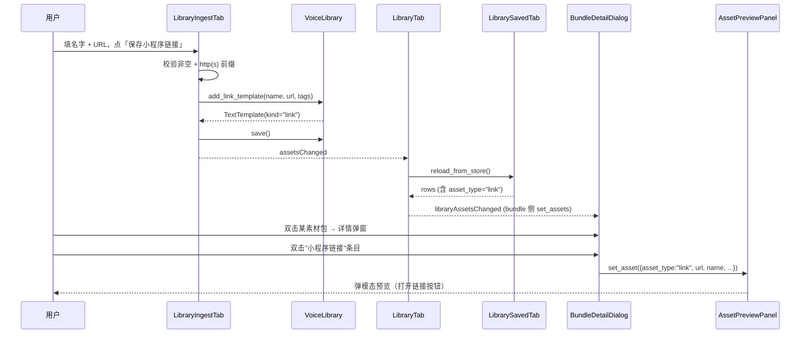

# Feature Implementation Plan — 增加素材：手工文字/链接 + 素材包详情预览

**Overall Progress:** `100%`（代码完成，待你按下方"手动测试清单"逐项走一遍真机 GUI 验收）

## TLDR

- 「增加素材」页新增两个手工入口：**增加文字**（TextTemplate + 变体）、**增加小程序链接**（TextTemplate + `kind="link"` + 单条 URL）。
- 「已保存的素材包」双击展开后，双击具体素材复用 `AssetPreviewPanel` 弹模态查看详情；右键新增「重命名」菜单，仍写回底层素材库（全局生效）。
- 保留现有 wxa legacy 采集 / 待确认两个按钮不动。
- 数据模型加最小一处改动：`TextTemplate.kind: Literal["text","link"]`（默认 `"text"`），向前兼容既有 `text_templates.json`。发送侧完全复用 text 通道，不新增 sender。

## Critical Decisions

| # | 决策 | 第一性原理依据 |
| --- | --- | --- |
| 1 | **链接不建新类型/新 store，只在 `TextTemplate` 上加 `kind` 字段** | 用户已明确"链接和文字本质是一种"。新建独立 store 会引入并行的 CRUD/加载/删除/命名管线，是无必要的重复。加一个默认值 `"text"` 的字段是**最小侵入**——Pydantic 反序列化老 JSON 时自动补默认值，读写路径不变，只在 GUI 展示层做分派。 |
| 2 | **`kind="link"` 在 saved_tab 里映射成 `asset_type="link"`；bundle/plan_composer 里把 link 转换为 `text` step 发送** | `asset_type="link"` 在 `gui/i18n.py`、`ASSET_TYPE_FILTER_OPTIONS`、`AssetPreviewPanel` 都已经打通"小程序链接"的显示分支——**复用远比新增便宜**。而 runner 里 wxa 是 `NotImplementedError`，唯一可运行路径就是把 link 当 text 发；此选择让 UI 有类型区分、发送侧零改动，风险最低。 |
| 3 | **UI 加在 `LibraryIngestTab` 现有分组之后，两块并排的手工分组，不弹 dialog** | 「增加素材」页目前只承担"抓取"语义，缺"手工"入口。用侧栏浮层或子对话框会增加导航深度；就地嵌入两个分组符合"一个页面完成一类事"的既有模式（对齐 duration/按钮/已捕获表格的布局风格）。 |
| 4 | **保存后走既有 `assetsChanged` → `libraryChanged` → `libraryAssetsChanged` 信号链，其他 Tab 零改动** | 现有信号已经串起 saved/bundle/plan_composer 的联动，`_to_text_row → active_assets → set_library_assets` 全通。手工新建只是往 `TextTemplate` 里加数据 + emit 一次信号，无需新增任何跨 Tab 通信。 |
| 5 | **`BundleDetailDialog` 双击改为弹 `AssetPreviewPanel` 模态；右键菜单只加「重命名」** | 用户明确要"双击看详情、右键改名"。`AssetPreviewPanel` 已经覆盖 voice/image/video/text/oa/link 全部渲染分支，直接复用就能得到"一次接线，六种素材都能预览"的效果，避免为每种类型重写视图。 |
| 6 | **`LibraryBundleTab` 通过构造函数注入 `preview_service_provider`（可选）** | 让 `BundleDetailDialog` 拿到与 `LibrarySavedTab` 同一个 `PreviewService`，避免 GUI 内部反向查主窗口/单例。测试环境注入 `None` 时降级为"无预览面板"，保留右键改名功能，不阻断测试。 |
| 7 | **执行顺序：先 model → 再 saved/bundle/plan_composer 联动兼容 → 再 ingest UI → 最后 bundle 详情弹窗** | 依赖关系倒推：model 改动是所有 UI 的前置；saved_tab 的 `_to_text_row` 决定 asset_type 派发是否正确；plan/bundle 的 `link→text` 分支决定用户创建后能否加进 sequence；这些底盘验证完再叠 UI，才能在每一步 `python -m gui.main` 手动 smoke 时看到确定性变化。bundle 详情预览是纯 UI 增强，最后做，隔离性最好。 |

## Architecture

### 模块关系（新增/修改/复用）

```mermaid
flowchart LR
    subgraph GUI["gui/tabs"]
        Ingest["LibraryIngestTab<br/>library_ingest_tab.py"]:::changed
        Saved["LibrarySavedTab<br/>library_saved_tab.py"]:::changed
        Bundle["LibraryBundleTab<br/>library_bundle_tab.py"]:::changed
        BundleDlg["BundleDetailDialog"]:::changed
        Composer["PlanComposerPanel<br/>plan_composer.py"]:::changed
        LibRoot["LibraryTab<br/>library_tab.py"]:::changed
    end

    subgraph Widgets["gui/widgets"]
        Preview["AssetPreviewPanel<br/>asset_preview.py"]:::reuse
    end

    subgraph Model["app/broadcast"]
        Lib["VoiceLibrary + TextTemplate<br/>library.py"]:::changed
    end

    Ingest -->|add_text_template / add_link_template| Lib
    Ingest -->|assetsChanged| LibRoot
    LibRoot -->|reload_from_store| Saved
    Saved -->|_to_text_row(kind→asset_type)| LibRoot
    LibRoot -->|libraryAssetsChanged| Bundle
    LibRoot -->|libraryAssetsChanged| Composer
    Bundle -->|open detail| BundleDlg
    BundleDlg -->|double-click item| Preview
    BundleDlg -->|right-click rename| Lib
    Composer -->|asset_type==link → text step| Lib

    classDef new fill:#DCFCE7,stroke:#16A34A,color:#064E3B;
    classDef changed fill:#FEF3C7,stroke:#D97706,color:#78350F;
    classDef reuse fill:#E5E7EB,stroke:#6B7280,color:#111827;
```

- `TextTemplate.kind` 是这次唯一新增的字段；其余节点都在既有信号/回调链上打补丁。
- `AssetPreviewPanel` 一处都不动，靠 `BundleDetailDialog` 传对齐 `set_asset` mapping 复用。

### 交互流：新建"小程序链接"→ 出现在素材包详情预览



## Tasks

**执行顺序依据：**
1. **Model 前置**（Step 1）——所有 GUI 分派都要依赖 `kind` 字段存在；不先加它后面每一步都会踩空。
2. **底盘联动兼容**（Step 2–3）——`saved_tab._to_text_row` 派发 `asset_type` 决定"小程序链接"能不能被 bundle/composer 识别；`bundle_tab.rename_underlying_asset` 里 `"link"` 分支现在写错在 `wxa_templates`，必须先修再让用户能触发它。
3. **手工创建 UI**（Step 4）——上述底盘就绪后，用户第一次点"保存文字/链接"，才能立刻在"已保存的素材/制作素材包/编辑和发送消息"三处都看到（每一步都可即时验证）。
4. **素材包详情预览 + 右键菜单**（Step 5）——纯 UI 增强，不改数据结构，放最后隔离风险；改坏了也只影响这个对话框。
5. **回归与最小测试**（Step 6）——所有 UI 稳定后一次性跑；避免中途来回。

---

- [x] 🟩 **Step 1: TextTemplate 引入 `kind` 字段 + `add_link_template` 便捷 API**
  - [x] 🟩 `TextTemplate` 增加 `kind: Literal["text", "link"] = "text"`（Pydantic 默认值保证老 JSON 兼容）
  - [x] 🟩 `VoiceLibrary.add_text_template` 增加可选参数 `kind="text"`
  - [x] 🟩 `VoiceLibrary.add_link_template(name, url, tags=None) → TextTemplate`：内部 `add_text_template(name, [url], tags, kind="link")`
  - [x] 🟩 `VoiceLibrary.update_text_template` 允许可选传 `kind`（不传则保持不变，防止误清）

- [x] 🟩 **Step 2: LibrarySavedTab 按 kind 派发 asset_type**
  - [x] 🟩 `_to_text_row`：读取 `item.kind`，`"link"` → `asset_type="link"` + `payload={"url": variants[0]}`；`"text"` 走原路径
  - [x] 🟩 详情面板已经支持 `asset_type=="link"`，无需改 `AssetPreviewPanel`

- [x] 🟩 **Step 3: BundleTab 和 PlanComposer 对 asset_type="link" 打通**
  - [x] 🟩 `library_bundle_tab.rename_underlying_asset`：`"link"` 分支优先 `VoiceLibrary.update_text_template`，找不到再回退 wxa 模块（兼容 legacy 数据）
  - [x] 🟩 `library_bundle_tab._bundle_item_to_step`：新增 `"link"` → `{type: "text", template_id, variant_pick: "random"}`
  - [x] 🟩 `plan_composer._add_selected_asset_step`：新增 `asset_type=="link"` 分支，产出同上 text step

- [x] 🟩 **Step 4: LibraryIngestTab 新增两块手工创建分组**
  - [x] 🟩 在"本轮已捕获"表下方加横向并列的两个 `QGroupBox`（文字 / 小程序链接）
  - [x] 🟩 **增加文字**：名字 + 变体 + 标签 + 保存按钮（必填字段空时 disabled）
  - [x] 🟩 **增加小程序链接**：名字 + URL + 标签 + 保存按钮；URL `urlparse` 校验 scheme ∈ {http, https} 且 netloc 非空
  - [x] 🟩 保存回调：`add_text_template` / `add_link_template` → `save()` → 清空输入 → `assetsChanged.emit()`
  - [x] 🟩 `_KIND_ZH` 新增 `"text"`、`"link"`；`_extra_desc` 处理两种预览摘要
  - [x] 🟩 `_append_captured_row(kind, ...)` 使其出现在"本轮已捕获"面板
  - [x] 🟩 `_rename_asset` 增加 `text`/`link` 分支，让面板内改名也能写回 `TextTemplate`

- [x] 🟩 **Step 5: BundleDetailDialog 双击预览 + 右键改名**
  - [x] 🟩 `LibraryTab.__init__` 把 `preview_service_provider` 传给 `LibraryBundleTab`
  - [x] 🟩 `LibraryBundleTab.__init__` 存 provider，传给 `BundleDetailDialog`
  - [x] 🟩 双击信号从 `_rename_selected_material` 改为 `_open_material_preview`
  - [x] 🟩 `_open_material_preview` 组装 `AssetPreviewPanel.set_asset(...)` 弹模态 `QDialog`（provider=None 时降级 `QMessageBox.information`）
  - [x] 🟩 `customContextMenuRequested` → 单项菜单「重命名」→ 复用 `_rename_selected_material`
  - [x] 🟩 底部原「重命名素材」/「移除选中」按钮保留

- [x] 🟩 **Step 6: 自动化验证**
  - [x] 🟩 `pytest tests -q` → 573 tests passed
  - [x] 🟩 `TextTemplate` 老 JSON（无 `kind` 字段）反序列化自动补 `"text"`（round-trip 手动验过）
  - [x] 🟩 offscreen 下 `LibraryTab` 构造成功，三个子 Tab 都能加载

---

## 详细改动清单

### 1. `app/broadcast/library.py`（TextTemplate 模型）

| 位置 | 改前 | 改后 | 文件 |
| --- | --- | --- | --- |
| `TextTemplate` 类 | 只有 `id / name / variants / tags / is_archived / created_at / updated_at` | 新增 `kind: Literal["text","link"] = "text"`（默认值兼容旧数据） | `app/broadcast/library.py` |
| `VoiceLibrary.add_text_template` | 参数 `name / variants / tags / template_id / is_archived` | 增加 `kind: Literal["text","link"]="text"`，透传给 `TextTemplate` | `app/broadcast/library.py` |
| 新增方法 `VoiceLibrary.add_link_template` | 无 | 便捷入口：`add_link_template(name, url, tags=None)` → 内部调 `add_text_template(name, [url], tags, kind="link")` | `app/broadcast/library.py` |
| `VoiceLibrary.update_text_template` | 可改 `name / variants / tags` | 增加可选 `kind` 参数（None 表示不改） | `app/broadcast/library.py` |

### 2. `gui/tabs/library_saved_tab.py`

| 位置 | 改动 | 文件 |
| --- | --- | --- |
| `_to_text_row` | 按 `item.kind` 派发：`"link"` → `asset_type="link"` + `payload={"url": item.variants[0] if item.variants else ""}`；`"text"` 保持原样 | `gui/tabs/library_saved_tab.py` |

### 3. `gui/tabs/library_bundle_tab.py`

| 位置 | 改前 | 改后 | 文件 |
| --- | --- | --- | --- |
| `rename_underlying_asset` 里 `"link"` 分支 | 走 `wxa_templates.load_template / save_template`（对手工链接会 FileNotFound） | 走 `VoiceLibrary.update_text_template(item_id, name=...)` + `save()` | `gui/tabs/library_bundle_tab.py` |
| `_bundle_item_to_step` | 只处理 `voice/text/oa/image/video`，`"link"` 落空返回 `None` | 增加 `"link"` → `{"type": "text", "template_id": item_id, "variant_pick": "random"}` | `gui/tabs/library_bundle_tab.py` |
| `LibraryBundleTab.__init__` | 无参数 | 增加 `preview_service_provider: Callable[[], PreviewService] \| None = None` 参数，存字段 | `gui/tabs/library_bundle_tab.py` |
| `_open_bundle_detail` | 直接构造 `BundleDetailDialog(bundle, asset_map, self)` | 追加传 `preview_service_provider=self._preview_service_provider` | `gui/tabs/library_bundle_tab.py` |
| `BundleDetailDialog.__init__` | 无 preview 参数 | 增加 `preview_service_provider` 参数，存字段；`self._items.itemDoubleClicked` 从 `_rename_selected_material` 改为 `_open_material_preview` | `gui/tabs/library_bundle_tab.py` |
| `BundleDetailDialog._open_material_preview` | 无 | 从 QListWidgetItem 拿 UserRole → 用 `asset_map` 找完整 row → 构造 mapping 送 `AssetPreviewPanel.set_asset(...)`，装进临时 `QDialog` 显示；provider 为 None 时降级为 `QMessageBox` 显示纯信息 | `gui/tabs/library_bundle_tab.py` |
| `BundleDetailDialog._on_context_menu` | 无 | `customContextMenuRequested` → 弹菜单，只有一项「重命名」，触发 `_rename_selected_material` | `gui/tabs/library_bundle_tab.py` |
| `BundleDetailDialog.__init__` 末尾 | 无 context menu 绑定 | `self._items.setContextMenuPolicy(Qt.ContextMenuPolicy.CustomContextMenu)`、`customContextMenuRequested` 接 `_on_context_menu` | `gui/tabs/library_bundle_tab.py` |
| `BundleDetailDialog` 内部 `asset_map` 保存 | 目前作为构造参数只在初始化时用一次 | 存为 `self._asset_map` 供双击预览时二次查询 | `gui/tabs/library_bundle_tab.py` |

### 4. `gui/tabs/library_tab.py`

| 位置 | 改动 | 文件 |
| --- | --- | --- |
| `LibraryTab.__init__` 里构造 `LibraryBundleTab()` | 追加 `preview_service_provider=preview_service_provider` | `gui/tabs/library_tab.py` |

### 5. `gui/tabs/plan_composer.py`

| 位置 | 改前 | 改后 | 文件 |
| --- | --- | --- | --- |
| `_add_selected_asset_step` | `voice/text/image/oa/video/bundle` 分支，其它落"暂不支持" | 增加 `asset_type == "link"`：`payload = {"type": "text", "template_id": item_id, "variant_pick": "random"}` | `gui/tabs/plan_composer.py` |

### 6. `gui/tabs/library_ingest_tab.py`

| 位置 | 改动 | 文件 |
| --- | --- | --- |
| `_KIND_ZH` | 新增 `"text": "文字"`、`"link": "小程序链接"` | `gui/tabs/library_ingest_tab.py` |
| `_build_ui` | 在 `wxa 采集` 工具条**之前**、`_captured_table` 之后，加"手工创建"分组：并排两个 `QGroupBox`（文字 / 小程序链接），各含名字/内容/标签/保存按钮 | `gui/tabs/library_ingest_tab.py` |
| `_on_text_input_changed` / `_on_link_input_changed` 槽 | 新增：根据必填字段状态启停对应保存按钮 | `gui/tabs/library_ingest_tab.py` |
| `_save_text_material()` | 新增：切分变体 → `VoiceLibrary.add_text_template(name, variants, tags, kind="text")` → `save()` → `_append_captured_row("text", {...})` → 清空输入 → `assetsChanged.emit()` | `gui/tabs/library_ingest_tab.py` |
| `_save_link_material()` | 新增：`urlparse` 校验 scheme ∈ {http, https} → 失败弹 warning；成功后 `VoiceLibrary.add_link_template(name, url, tags)` → 后续同上 | `gui/tabs/library_ingest_tab.py` |
| `_extra_desc` | 增加 `text`（首条变体前 20 字）、`link`（URL 前 40 字） | `gui/tabs/library_ingest_tab.py` |

### 7. 自动化测试（本轮不新增）

> 现有 `tests/test_text_variants.py` 覆盖 TextTemplate 基础操作；`kind` 字段有 Pydantic 默认值，反序列化老 JSON 自动补 `"text"`，向后兼容不破测试。本轮以手动烟测为准，不为纯 UI 改动新增单测。

---

## 手动测试清单（供你逐项勾选）

### A. 增加文字素材

- [ ] **A1** 打开「增加素材」→ 手工创建区可见「增加文字」子分组（名字、变体、标签、保存按钮）
- [ ] **A2** 名字或变体任一为空时，「保存文字」按钮 disabled
- [ ] **A3** 填 `名字=测试文字A`、`变体=你好\n早上好` → 点保存 → 输入框清空、「本轮已捕获」面板出现一行 `文字 · 测试文字A · 你好...`
- [ ] **A4** 切到「已保存的素材」Tab → 类型选「文字」→ 能看到 `测试文字A`，双击行打开详情浮层能看到两条变体
- [ ] **A5** 切到「制作素材包」→ 左侧「可选素材」类型选「文字」→ 有 `测试文字A`；加入右侧 → 保存素材包 OK
- [ ] **A6** 切到「编辑和发送消息」→ 类型「文字」→ 下拉能选到 `测试文字A` → 加进序列 OK

### B. 增加小程序链接

- [ ] **B1** 手工创建区可见「增加小程序链接」子分组（名字、URL、标签、保存按钮）
- [ ] **B2** 名字或 URL 任一为空 → 保存按钮 disabled
- [ ] **B3** URL 填 `abc123` 点保存 → 弹「URL 必须以 http:// 或 https:// 开头」提示，不落库
- [ ] **B4** 填 `名字=示例链接`、`URL=https://example.com` → 点保存 → 面板出现 `小程序链接 · 示例链接 · https://example.com`
- [ ] **B5** 「已保存的素材」类型选「小程序链接」→ 能看到 `示例链接`；双击行看到详情面板显示 URL、有「打开链接」按钮可点
- [ ] **B6** 「制作素材包」类型选「小程序链接」→ 加入素材包 → 保存 OK
- [ ] **B7** 「编辑和发送消息」类型选「小程序链接」→ 下拉选到 `示例链接` → 加进序列，序列显示 `文字（模板）: <template_id>`（因为发送侧当 text 发）

### C. 素材包详情：双击预览 + 右键改名

- [ ] **C1** 「制作素材包」→ 右侧「已保存素材包」双击一个已有素材包 → 打开 `BundleDetailDialog`
- [ ] **C2** 详情列表里**双击一条 voice** → 弹出预览模态，能看到语音播放按钮
- [ ] **C3** 详情列表里**双击一条 text** → 弹出预览模态，能看到变体清单
- [ ] **C4** 详情列表里**双击一条 link（示例链接）** → 弹出预览模态，显示 URL + 打开链接按钮
- [ ] **C5** 详情列表里**双击一条 image / video** → 预览模态显示缩略图或播放器
- [ ] **C6** 详情列表**右键任一条目** → 弹菜单「重命名」→ 输入新名字 → 保存素材包
- [ ] **C7** 保存后回「已保存的素材」检查底层素材名字**已被全局改名**（对 text/link 走 `TextTemplate.name`）
- [ ] **C8** 详情底部「重命名素材」按钮仍能正常触发（键盘无鼠标场景）

### D. 兼容性 / 回归

- [ ] **D1** 首次启动无 `text_templates.json` → 新建文字/链接后能正确落盘
- [ ] **D2** 有既有 `text_templates.json`（无 `kind` 字段）→ 启动不报错，全部按 `kind=text` 显示为「文字」
- [ ] **D3** 现有 wxa legacy 采集按钮（"wxa 采集"独立子进程）能启动、能停（未删）
- [ ] **D4** "立即检查待确认" 按钮仍能弹 `PendingTemplateDialog`（未删）
- [ ] **D5** 语音/图片/视频/公众号卡片的抓取（`fta_capture_lite`）不受本次改动影响，仍能录到「本轮已捕获」
- [ ] **D6** 素材包 `_bundle_item_to_step` 对 `voice/text/oa/image/video/link` 六种都能生成合法 step；素材包发送 dry-run 不报 schema 错

