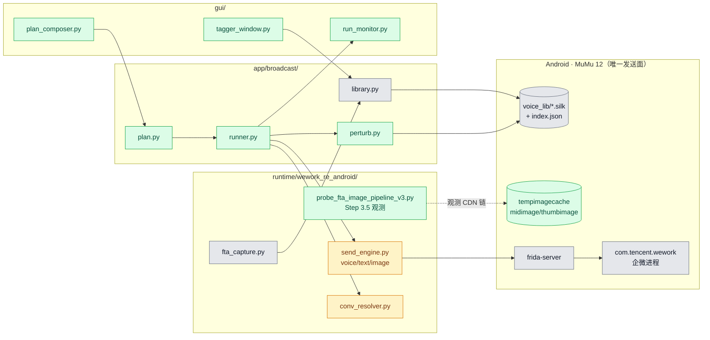
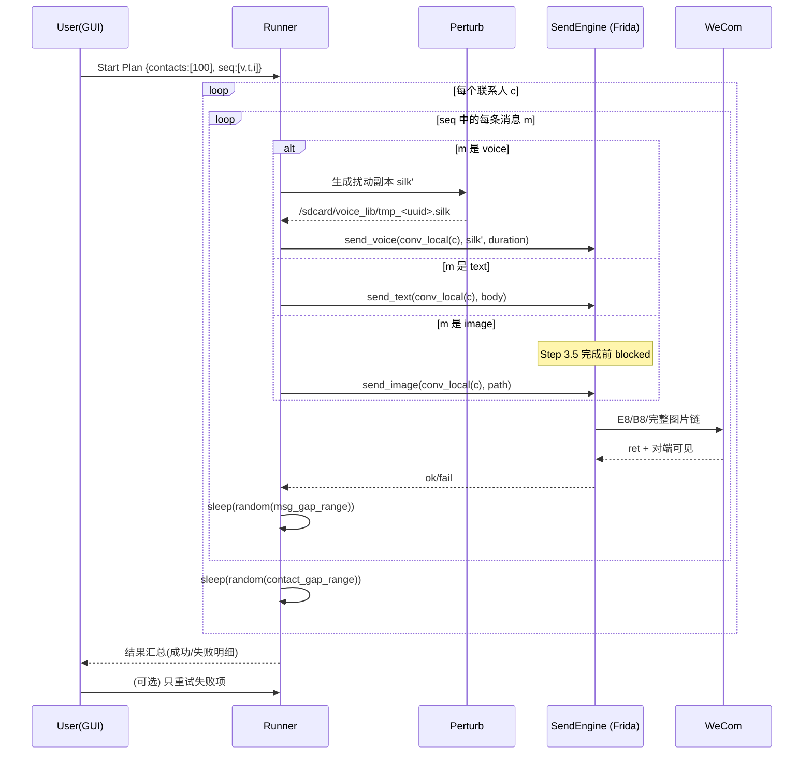
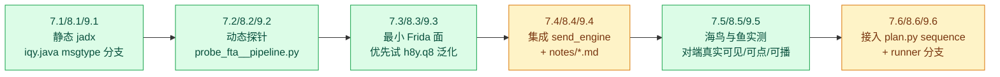

# 语音历史库 + 混合消息批量群发 实施计划

**Overall Progress:** `94%`（Phase A ✅ / Phase B ✅ 除 Step 8/10 / **Phase C Step 11 ✅ + Step 12 代码完成（待真机验收）+ Step 13 ✅ + Step 14 ✅ + Step 15 ✅ + Step 16 ✅ + Step 17（17.1/17.3/17.5 代码完成）+ Step 18 代码完成（待真机验收）+ Step 19 代码完成（待长跑验收）+ Step 20 ✅**）

**文档版本**：2026-09-16 v3.6（Step 17 首轮落地：新增 onefile spec `build/build_exe.spec`、一键出包脚本 `build/release.ps1`、GUI 启动自检自动 `adb connect` + push/拉起 frida-server，并兼容打包态子进程 `__send_engine__` 转发）
**上游 handoff**：见 [`ANDROID_RE_HANDOFF.md`](ANDROID_RE_HANDOFF.md) §14–§15（其中 **§15.5 = 部署形态、双账号模型、素材接收器澄清、真机迁移门槛**）。
**姊妹文档**：[`PLAN_GUI_DESIGN.md`](PLAN_GUI_DESIGN.md) = GUI 设计与交互实施计划（本文档只写程序/逆向侧）。
**责任 agent**：Phase A/B 主链已完成；Phase C Step 11、13、14、15、16 已回填，Step 12 待真机切号验收；Step 17 已完成 17.1/17.3/17.5 代码落地；**下一步 = 补齐 Step 17.2 资源并执行 17.6 干净机验收**。
**部署前置**：员工个人主号在真机、**营销号在 PC MuMu**（两个不同账号，服务端多端规则不冲突）；素材录制必须在 **Android 企微对 FTA** 进行（PC 对 FTA 发消息不会触发入库）。

---

## TLDR

POC 已验证从任意页面用 `h8y.U1 + h8y.X4().E8()` 主动向外部微信联系人发送 silk 语音成功。本计划把它扩展为一个**面向"1 段 silk 群发 100 个外部客户 + 混合文字/图片消息"**的批量运营工具。

**架构决策（2026-09-15 敲定）**：

- **全 Android**：voice / text / image 全部走 MuMu 企微 + Frida 直调；**不走 PC 混合方案**（PC 端图片/视频无主动发送 API，只能 UIA 长按转发，与用户弃 Android UIA 的风控立场矛盾）。
- **Phase A MVP**：voice + text + **image** 三种消息类型 + Plan/Runner + GUI + 反风控灰度。
- **Phase B（v1.1）**：**公众号图文卡片 → 小程序 → 视频**（复杂度递增，逐个逆向后接入 Plan `sequence`）；**视频号搁置**（用户明确暂不做）。此处"公众号"特指微信公众号文章分享出来的可点击图文卡片（`appmsg` 结构），不是外链/网页链接、不是纯 URL 文本。
- **当前状态**：Step 3.5 图片主链已切换到 `V1 -> V8 -> q8(msgtype=7)` + `tempimagecache` 预落盘，外部联系人「海鸟与鱼」双次可见验收通过，image 阻塞解除；**下一步 = Step 4 Plan/Runner**，Phase B 可与 Step 4/5 并行推进。

核心能力：

1. **语音素材来源**：只用**用户真人在企微里发给 FTA 的语音**（A 方案）。
2. **历史库**：程序自动监听 FTA 送出的 silk，抓一条紧跟的"备注文字"作为初始识别键，落库到设备端独立目录；用户后续在 GUI 里手打话术标签。
3. **混合消息（Phase A）**：voice / text / image 三种；video 等归入 Phase B。
4. **反风控**：silk 无感扰动（尾静音帧） + 消息间/联系人间随机时序打散；速率上限试探得出。
5. **失败策略**：单条失败继续，整条序列跑完后向用户汇报，由用户决定是否重试。
6. **GUI**：本地 GUI 用于打标签、编排 Plan、调发送顺序/间隔、观察执行结果。

---

## Critical Decisions

> **范式（必须遵循）：** 本板块须基于第一性原理深度思考，论证出**可维护性最强、最精简、最佳的代码架构**与**最佳执行顺序**。

| # | 决策 | 第一性原理依据 |
| --- | --- | --- |
| 1 | **发送引擎 = 已跑通的 `h8y` 簇 Frida 直调，一层 Python 封装即可**，不再引入 UI 自动化、不再回头改 PC 协议层 | POC 已证明 Android 路径可达；UIA 有风控记录（小规模测试已触发警告）。最小可行调用面 = 最小攻击面。 |
| 2 | **素材唯一来源 = 用户对 FTA 的真人录音**（A 方案） | 用户敲定；避免"外来 silk 变体不兼容"的未验证风险；也让后续风控排查责任边界清晰（每条素材都有真人来源）。 |
| 3 | **库存储位置 = Android 设备本地独立目录**（`/sdcard/Test-Voice/voice_lib/`），不放 Windows | 发送必须以 Android 上的文件路径为参数；放 Windows 每次都要 push，多一个环节且 push 失败会污染 report；放设备本地零传输开销，还能天然复用相同的路径给 `E8`。**技术前提**：wework 进程读得到该路径（Step 1 已验证）。 |
| 4 | **入库触发 = hook `h8y.U1` 且仅当 conv=FTA 时**，随后异步等待"下一条同会话 text"作为备注 | 已有 U1 hook 是最低侵入面；FTA 是安全边界（不会误入库客户对话）；文字备注是最便宜的"程序可识别的初始 key"。FTA remote id 实测为 **10006**（非 10004）。 |
| 5 | **元数据存 JSON 索引 `voice_lib_index.json`**，不引入 SQLite | 库规模是"人手录制"量级（数十–数百条），JSON 足够；无并发写入需求；GUI 直接读写；零依赖。 |
| 6 | **Plan 模型 = 广播式**：`{contacts:[N], sequence:[msg_1, msg_2, ...]}` 一份 sequence 应用到所有联系人 | 用户明确选前者；每人独立 sequence 是 CRM 需求，现阶段不做，避免过度设计。 |
| 7 | **反风控 = 静音帧扰动 + 双层随机 sleep**（消息间 & 联系人间） | Step 6 灰度结论：5 个内部同事号分三档压测，`L3(msg=[8,24], contact=[48,120])` 触发 1 次风险提示，按 `-20%` 速度余量回写默认常量为 `msg=[10,30]`、`contact=[60,150]`；证据见 `runtime/reports/step6_risk_tuning_report_20260916.json`。 |
| 8 | **执行器单线程串行 + 显式 sleep**，不做并发/协程 | Frida 主线程 `scheduleOnMainThread` 本就串行；100 联系人 × 有意等待，QPS 天然低；引入并发反而更容易被风控识别。 |
| 9 | **GUI = 本地 PySide6 单窗口**（3 tab），只做 3 件事：打标签、编 Plan、看结果 | 用户明确"标签在 GUI 手打、发送顺序/间隔在 GUI 调"；不需要多窗口/多标签页/服务化；单文件工具最易维护。 |
| 10 | **Phase A 执行顺序 = Step 1–3（已完成）→ Step 3.5 图片 P0 → Step 4 Runner → Step 5 GUI → Step 6 反风控** | 图片不通则 Plan 里 image 节点无意义，必须先修；Runner/GUI 依赖可用的发送引擎三件套；反风控试探必须有真实 Plan 打真实号，放最后。 |
| 11 | **全 Android，拒绝 PC 混合方案** | 语音结构性只能 Android；PC 端图片/视频**无主动发送 API**（§47.16.24 静态穷举），所谓"PC 已逆好图片"实为 UIA 长按转发已有素材——与用户明确拒绝 UIA 的立场矛盾。混合方案还引入双端 conv_id 映射与双 Frida 进程，复杂度 ×2 收益为负。 |
| 12 | **MVP 消息类型零 UIA** | 用户选定：任何 UIA（含 PC `forward_executor` 长按转发）均不接受。Phase A 只交付 Frida 直调可达的 voice/text/image；image 在 Step 3.5 完成前 Plan 中标记 `blocked`。 |
| 13 | **Phase A / Phase B 分两阶段上线** | Phase A 先跑通 voice+text+image 真实业务；video 无先例、逆向风险高，若与 Phase A 捆绑会阻塞已可用能力上线。Phase B 单独里程碑。 |
| 14 | **图片发送验收 = 对端真实收到可打开图片**，不接受 `return=true` 假阳性 | Step 3 已证：`f8 return=true` + `SendMessage mType=7` 仍可能对端不可见；验收必须以外部联系人「海鸟与鱼」实测为准。 |
| 15 | **Phase B 复用 Step 3.5 方法论**：静态 `iqy.java` → 动态探针（v4/v5/v6，attach-only 低侵入）→ 最小 Frida 调用面 → 集成 `send_engine` → 外部联系人实测 | Step 3.5 已把这套流程跑通并产出 `V1 -> V8 -> q8(msgtype=7)`；卡片/小程序/视频只是 msgtype 与 FileMessage 变体不同，方法论零变化，不引入新工具链，边际成本最低。 |
| 16 | **Phase B 执行顺序 = 公众号 → 小程序 → 视频**（复杂度递增 + 新未知轴逐个解耦） | 公众号图文卡片=`appmsg` 结构化字段，thumb 通常引用远端 URL 或走极轻缓存，接近零 CDN；小程序=在公众号基础上**只**新增本地 thumb 上传子链 + `WxaAppInfo`；视频=组合"图片媒体 CDN 主链 + 小程序 thumb 子链"，全部未知轴已被前置步骤独立验证。每步只引入一个新变量，风险最小、可独立验收。 |
| 17 | **视频号（channels/finder）搁置**，Phase B 不做 | 用户明确指示；视频号分享结构与 wxa 差异大、且非核心业务场景。`send_engine` 保留 `channel` 子命令占位为 Phase C 入口，避免后续再改 CLI。 |
| 18 | **公众号/小程序模板来源 = 用户手动 FTA 分享一次**，探针抓取字段快照与调用栈作为构造模板 | 与 Step 2 "voice 素材 = 用户对 FTA 真人录制" 同源第一性原理：**从零合法构造 appmsg/wxa 分享结构** 需要 appid 签名/scene/ticket 等未知字段，逆向面无穷；用真人一次分享抓模板则把逆向面收敛到「透传已有字段 + 换 conv_local」。公众号文章模板尤其稳定——一份 template（url/appid/thumburl/title/desc）可复用无数次。 |
| 19 | **Phase B 三类主入口均先试 `h8y.q8` 泛化**，失败再回退到 `iqy.xxx` 特化路径 | Step 3.5 证明 `q8(msgtype=7)` 是通用 SendMessage builder；公众号/小程序/视频若共用 q8，只需换 msgtype + FileMessage payload，攻击面最小。 |
| 20 | **"公众号"严格定义 = 微信公众号文章分享出来的可点击图文卡片**（`appmsg` type=5，含 title/desc/url/thumburl/sourcename/appid） | 用户澄清：不是外链 URL、不是网页快照、不是纯文本链接。这决定了 Step 7 探针必须让用户"从公众号文章右上角 → 分享 → 企微 FTA"这一确切路径抓栈，而不是简单粘贴一个 URL。 |

---

## Architecture

### 模块关系图



- **绿色**：Step 3.5 及后续新增。
- **黄色**：已有骨架，Step 3.5 完成后需改（`send_engine.send_image` 换完整链入口）。
- **灰色**：Step 1–3 已完成，复用不改。
- **PC 端**（`app/pc_wecom/`）：Phase A **不参与发送**；仅作历史参考，见 [`REVERSE_ENGINEERING_HANDOFF.md`](REVERSE_ENGINEERING_HANDOFF.md)。

### 群发执行时序图



### Phase B 通用逆向流水线（Step 7/8/9 均按此走）



- **同一条流水线跑三次**（公众号 / 小程序 / 视频），每次只换 msgtype 与 FileMessage 变体；如果 `q8` 泛化假设成立，`.3` 会非常快。
- **每步独立可验收**，不阻塞 Phase A 上线（Runner 里未接入的 type 报 `not_implemented` 跳过即可）。

---

## Tasks

**执行顺序依据**：Step 1–3 已完成 voice/text 与素材库骨架；**Step 3.5 是 Phase A 唯一阻塞项**——图片 CDN 链不通则 Step 4 Plan 里 image 节点只能标 blocked；Step 4 Runner 可先支持 voice+text，但完整 MVP 验收依赖 3.5；Step 5 GUI 依赖 Step 2+4 数据模型；Step 6 反风控必须最后（要真实 Plan 打真实号）。Phase B（video）在 Phase A 上线后单独启动。

### Phase A（v1.0 MVP）

- [x] 🟩 **Step 1: 技术前置验证 — 自建目录可读性**
  - [x] 🟩 1.1 已创建 `/sdcard/Test-Voice/voice_lib/`，并 push 已知可用样本 `sample_known_good.silk`
  - [x] 🟩 1.2 已验证新目录可读且可发：`E8 return=true`
  - [x] 🟩 1.3 已执行回退路径复测：沙箱内路径 `E8 return=true`
  - [x] 🟩 1.4 最终常量：`VOICE_LIB_ROOT="/sdcard/Test-Voice/voice_lib"`

- [x] 🟩 **Step 2: 语音素材库（VoiceLibrary）**
  > **注**：Step 2.1 的采集实现已由 [`PLAN_FTA_CAPTURE_REFACTOR.md`](PLAN_FTA_CAPTURE_REFACTOR.md) 接管。
  > 旧 `fta_capture.py` 已删除（F1.6），改为 `fta_capture_lite.py`（hook 零 I/O + Python 异步 cp + 全类型观察）。
  > 2.3 的"30s 内 text 备注 → note 字段"逻辑已废弃（决策 F8：备注改由 GUI 双击命名）；schema 中 `note`/`label` 字段保留，仅不再由采集脚本写入。
  - [x] 🟩 2.1 已新增 `fta_capture_lite.py`：hook `h8y.U1` + SendMessage，FTA 过滤触发入库
  - [x] 🟩 2.2 设备侧复制入库，文件名 `<yyyymmdd_HHMMSS>_<duration>s.silk`
  - [~] ⚪ 2.3 ~~30 秒窗口内同会话 text 备注监听 → `note` 字段~~（F1.4 废弃，改 GUI 双击命名）
  - [x] 🟩 2.4 已新增 `app/broadcast/library.py` + `voice_lib_index.json` schema
  - [x] 🟩 2.5 已提供 `add / list / update_label / stats`（+ `update_note`、`bump_usage`）

- [x] 🟩 **Step 3: 发送引擎 — voice / text**（image 部分未完成，见 Step 3.5）
  - [x] 🟩 3.1 voice：`h8y.U1 + h8y.X4().E8()` — 对端可播放 ✅
  - [x] 🟩 3.2 text：`h8y.B8(Context, long, CharSequence, boolean)` — 对端可见 ✅
  - [x] 🟩 3.3 已新增 `send_engine.py`：统一入口 + activity 获取 + main-thread 调度
  - [x] 🟩 3.4 CLI：`python -m runtime.wework_re_android.send_engine <voice|text|image> ...`
  - [x] 🟩 3.5 image 主链已切换：`V1 -> V8 -> q8(msgtype=7)`（保留 `f8` fallback，待 3.5.5 对端可见性验收）

- [x] 🟩 **Step 3.5: 图片主动发送链逆向（P0 阻塞项）**

  > **背景**：直调 `h8y.f8` 只完成本地 SendMessage 构建，缺 CDN 上传全链路（§14.7–14.8）。企微发图走 `压缩 → 中图 → 缩略图 → CDN`，非原样读本地 PNG。

  - [x] 🟩 **3.5.1 静态：读 `iqy.java` 图片发送链**
    - 目标链：`iqy.w8` → `W1(path, w, h, 0, z2)` → `G8(context, conv, FileMessage, msgtype, ...)`（约 3482 行）
    - 产出：方法签名表 + msgtype 枚举值 + FileMessage 图片字段 layout 笔记
    - 文件：记录到 `runtime/wework_re_android/notes/image_send_chain.md`（新建）

  - [x] 🟩 **3.5.2 动态观测：用户手动 FTA 发图时的完整调用栈**
    - 基于 `probe_fta_image_pipeline_v2.py` 迭代为 v3：低侵入 attach-only
    - Hook 候选：`h8y.w8` / `h8y.W1` / `h8y.G8` / CDN upload 相关类；**禁止** `probe_msgmgr_scheme_b.py`（会崩进程）
    - 同步监听文件系统：`tempimagecache/*_compress.png`、`uploadTempMidbimage/*.midimage`、`uploadTempThumbimage/*.thumbimage` 生成时序
    - 产出：ndjson 调用时序 + 各阶段参数 dump

  - [x] 🟩 **3.5.3 定位最小 Frida 主动调用面**
    - 比照 voice 方法论：找到等价于「构建 FileMessage + CDN 上传 + SendMessage」的最小入口
    - 若 `f8` 只是半成品，找完整链上的上游方法（可能是 `w8` 或 `G8` 带 FileMessage）
    - 产出：`send_image_full_chain()` 函数草稿 + 所需参数清单（path、width、height、convLocal、activity）

  - [x] 🟩 **3.5.4 集成到 `send_engine.py`**
    - 替换现有 `send_image`（`f8` 直调）为完整链调用
    - CLI 不变：`send_engine image --conv-local ... --image-path ...`
    - 图片 push 到 `/sdcard/Test-Voice/voice_lib/` 后再发

  - [x] 🟩 **3.5.5 验收**
    - 外部联系人「海鸟与鱼」（conv-local=`7685582584742596232`）**真实收到可打开图片**
    - 拒绝仅 `return=true` / `SendMessage mType=7` 作为通过标准

  **死路清单（勿重复尝试）**：

  | 路径 | 结论 | 出处 |
  | --- | --- | --- |
  | 直调 `h8y.f8` 喂本地 PNG | ❌ 假阳性，对端不可见 | §14.7 |
  | FTA 入库 + UIA 长按转发 | ❌ `INJECT_EVENTS permission` + 风控 | §14.10 |
  | PC `forward_executor` UIA 转发 | ❌ 非主动发送；用户拒绝 UIA | 架构决策 #11–12 |
  | `probe_msgmgr_scheme_b.py` 下游 hook | ❌ 进程崩溃/掉线 | §14.10 |

- [x] 🟩 **Step 4: Plan 编排 + 反风控 + Runner**
  - [x] 🟩 4.1 `app/broadcast/plan.py`：Plan JSON schema（image 已随 Step 3.5 解除 blocked；oa/wxa/channel 标 `not_implemented`；video 已在 Step 9 接入 ready）
        ```
        {
          "contacts": ["海鸟与鱼", ...],
          "sequence": [
            {"type":"voice", "voice_id":"<uuid>"},
            {"type":"text",  "body":"你好，方便聊聊吗？"},
            {"type":"image", "path":"<device png>"}
          ],
          "msg_gap_seconds":  [10, 30],
          "contact_gap_seconds":[60, 150],
          "perturb": true
        }
        ```
  - [x] 🟩 4.2 `app/broadcast/perturb.py`：silk 尾部随机追加 1–3 个 SILK 静音帧
  - [x] 🟩 4.3 `app/broadcast/runner.py`：串行执行 + 双层 sleep + 失败汇总；`not_implemented` 类型记 `blocked` 并继续
  - [x] 🟩 4.4 `conv_resolver.py`：从 `list_conversations_with_names.py` 抽 `resolve(name)` → `conv_local`

- [x] 🟩 **Step 5: GUI（PySide6 单窗口，3 tab）**
  - [x] 🟩 5.1 Tab A "素材库"：列表 + 行内编辑 `label`
  - [x] 🟩 5.2 Tab B "编 Plan"：选联系人 + 构造 sequence + 调 gap 滑块
  - [x] 🟩 5.3 Tab C "执行与结果"：启动 Runner + 进度 + 失败重试
  - [x] 🟩 5.4 入口：`python -m gui.main`

- [x] 🟩 **Step 6: 反风控参数试探（真实号灰度）**
  - [x] 🟩 6.1 从 5 个内部同事号开始，观察风控提示（观测文件：`runtime/reports/step6_risk_tuning_observations_20260916.json`）
  - [x] 🟩 6.2 逐档放宽速率，-20% 写入 `plan.py` 默认常量（`DEFAULT_MSG_GAP=(10,30)`、`DEFAULT_CONTACT_GAP=(60,150)`）
  - [x] 🟩 6.3 更新 Critical Decisions #7 默认速率并标注实测证据（报告：`runtime/reports/step6_risk_tuning_report_20260916.json`）

### Phase B（v1.1）— 公众号图文卡片 / 小程序 / 视频

**执行顺序依据**：复杂度递增 + 未知轴逐个解耦。公众号卡片近乎零 CDN（`appmsg` 结构 + 远端 thumburl）、小程序仅新增本地 thumb 上传、视频 = 图片媒体主链 + 小程序 thumb 子链的组合。每步只引入一个新未知，且都能独立用外部联系人「海鸟与鱼」验收。三步与 Phase A Step 4/5 无强依赖，可与 Step 4 并行推进（Runner 只需为 Plan `sequence` 增加对应 `type` 分支）。

**通用子步骤模板（三步均按此展开，复用 Step 3.5 方法论）**：

1. `.1` 静态：jadx 定位 `iqy.java` 中该类型的发送入口、msgtype 常量、FileMessage/结构体 layout
2. `.2` 动态：新增 `probe_fta_<type>_pipeline.py`（基于 v3 迭代，attach-only、禁用崩溃 hook），捕捉用户手动 FTA 分享该类型时的完整调用栈 + 关键字段 dump
3. `.3` 定位最小 Frida 主动调用面（优先试 `h8y.q8(..., msgtype=X, FileMessage=Y)` 泛化路径）
4. `.4` 集成到 `send_engine.py`（新增子命令）+ `notes/<type>_send_chain.md` 落笔记
5. `.5` 外部联系人「海鸟与鱼」实测验收（**对端真实可见/可点击/可播放**，拒绝 `return=true` 假阳性）
6. `.6` 接入 `plan.py` `sequence` type + `runner.py` 分支

---

- [x] 🟩 **Step 7: 公众号图文卡片（`appmsg`）发送逆向** — 最小 CDN 依赖，先跑通验证 q8 泛化性

  > **本质**：公众号文章分享 = 结构化 `appmsg`（`title` + `desc` + `url`（`mp.weixin.qq.com/...`）+ `thumburl` + `sourcename`（公众号名）+ `appid` + `appMsgType=5`），**不需要**上传本地媒体本体；`thumburl` 通常是公众号封面图的远端 URL（企微客户端会自动异步拉取渲染），也可能落一份本地 thumb 缓存。是三类中最简单、最能独立验证"`q8` 是否为多 msgtype 通用入口"的场景。
  >
  > **模板来源约束**：探针阶段必须让用户从 **公众号文章页面 → 右上角 → 分享给朋友 → 选择企微 FTA** 这条真实路径操作，抓下完整 `appmsg` 字段作为模板。**禁止**用"复制文章链接粘贴到聊天框"这种降级路径，因为那会走 `msgtype=1` 纯文本或 `msgtype=3` 通用链接，不是我们要的公众号卡片。

  - [x] 🟩 7.1 静态：jadx 搜 `sendAppMessage` / `AppMsgFileMessage` / `iqy` 家族 `appMsgType=5` 分支；产出字段清单（补充发现：运行时公众号链路命中 `mType=13` + `h8y.f2(...)`）
  - [x] 🟩 7.2 动态：新增 `probe_fta_oa_pipeline.py`（基于 v3 迭代），hook 候选 `h8y.q8` / `iqy.app*` / `SendMessage(mType∈{3,5})`；用户按上述真实路径分享一次公众号文章到 FTA，抓：
    - 完整调用栈
    - 完整模板字段快照（当前以 `h8y.f2(link,title,desc,imgUrl,...)` 原始参数为主，落 `app/broadcast/oa_templates/11a3bca9-f3a1-441d-a5d2-0cabf8d8b018.json`）
    - thumb 是否落 `tempimagecache` / 或仅记录远端 URL（决定 Step 7.4 是否需要预落盘 thumb）
  - [x] 🟩 7.3 定位最小面：优先验证 `h8y.q8(context, convLocal, AppMsgFileMessage, <appMsgType>, ..., callback)` 直调可用（运行时修正：采用 `h8y.f2(...) -> h8y.j2(13, linkMsg) -> h8y.s8(context, conv, msg, ...)` 最小面）
  - [x] 🟩 7.4 集成：`send_engine.py` 新增 `oa` 子命令 `send_engine oa --conv-local ... --template <id>`（`template` 引用 7.2 抓到的 JSON 模板；MVP 阶段不做 CLI 直接拼字段，避免用错导致降级）；笔记落 `notes/oa_send_chain.md`
  - [x] 🟩 7.5 验收：外部联系人「海鸟与鱼」收到**可点击打开、显示公众号封面图和标题**的图文卡片（不是纯文本 URL、不是普通链接卡片、不是"[链接]"占位）
  - [x] 🟩 7.6 接入 Plan：`sequence` 支持 `{"type":"oa", "template_id":"<uuid>"}`

- [ ] ⏭️ **Step 8: 小程序（wxa card）发送逆向（按业务口径降级跳过）** — 当前以“可转发链接”替代

  > **当前决策（2026-09-16）**：用户接受“长按转发链接”作为业务可交付能力；该路径属于 text/link，不是 wxa card。故 Step 8 原目标（小程序卡片发送链）不再作为 Phase B 阻塞项。

  - [ ] ⏭️ 8.1~8.6 原任务整体降级为可选探索项（仅在未来恢复“必须小程序卡片”目标时重启）
  - [x] 🟩 8.X 已具备探索脚手架：`probe_fta_wxa_pipeline.py` / `wxa_templates.py` / `notes/wxa_send_chain.md`

- [x] 🟩 **Step 9: 视频发送逆向** — 主链打通并完成批量稳定性验收

  > **本质**：视频消息 = `mType=23` + `VideoMessage(url/rawUrl/size/videoWidth/videoHeight/videoDuration/previewImgUrl)` + **两条上传链**（mp4 本体 + 首帧 thumb）。视频号（channels/finder）**不做**（决策 #17）。

  - [x] 🟩 9.1 静态：已定位 `iqy.T8 -> x2 -> E8` 视频链；`x2` 构造 `VideoMessage(url/rawUrl/size/videoWidth/videoHeight/videoDuration/previewImgUrl)`，`E8` 发送 `contentType=5`
  - [x] 🟩 9.2 动态：`probe_fta_video_pipeline.py` 已执行真人 FTA 短视频抓取，确认：
    - 命中 `send_message mType=23`（目标会话 remote=10006，convLocal=`7685582580447628882`）
    - 视频本体路径：`filecache/<conv>/.../*.mp4`
    - 首帧 thumb 路径：`tempimagecache/<conv>/video_thumb/*_thumb.wwdata`（确认复用 `tempimagecache`）
    - 备注：当前证据链以 `send_message(mType=23)` + 文件时序为主；上游方法栈作为增强项保留
  - [x] 🟩 9.3 定位最小面：视频主发送已切到 `h8y.D8(Activity,long,videoPath,?,thumbPath,boolean)`；`q8(FileMessage)` 降为 fallback
  - [x] 🟩 9.4 集成：`send_engine.py` 已支持 `video` 子命令、`adb` 预落盘、自动首帧 thumb 生成；笔记已落 `notes/video_send_chain.md`
  - [x] 🟩 9.5 验收：外部联系人「海鸟与鱼」已收到**可播放视频**（当前轮通过）
  - [x] 🟩 9.6 接入 Plan：`sequence` 已支持 `{"type":"video", "path":..., "thumb_path":..., "duration":...}`

- [ ] 🟥 **Step 10: 视频号 / 其他消息类型**（Phase C，暂搁置）
  - 视频号（channels/finder 分享）、群直播卡片、位置消息等；用户明确 Phase B 不做
  - `send_engine` 保留 `channel` 子命令占位（stub 返回 `not_implemented`）避免后续改 CLI

---

## 详细改动清单

### 1. 目录与常量（Step 1 ✅）

| 位置 | 改前 | 改后 | 文件 |
| --- | --- | --- | --- |
| 库根路径 | 无 | `VOICE_LIB_ROOT = "/sdcard/Test-Voice/voice_lib"` | `app/broadcast/paths.py` ✅ |

### 2. Runtime 层 — 已完成（Step 1–3）

| 位置 | 改动 | 文件 | 状态 |
| --- | --- | --- | --- |
| FTA 监听入库 | hook U1 + FTA guard + 备注 | `fta_capture.py` | ✅ |
| 发送引擎 | voice/text/image CLI | `send_engine.py` | ✅（image 待 3.5 改） |
| 会话解析 | 待抽函数 | `conv_resolver.py` | Step 4.4 |

### 3. Runtime 层 — Step 3.5 新增/修改

| 位置 | 改动 | 文件 |
| --- | --- | --- |
| 图片链静态笔记 | `iqy.w8/W1/G8` 签名 + msgtype | `runtime/wework_re_android/notes/image_send_chain.md`（新建） |
| FTA 发图观测 v3 | 低侵入 hook + 文件系统时序 | `probe_fta_image_pipeline_v3.py`（新建，基于 v2 迭代） |
| send_image 完整链 | 替换 `f8` 直调 | `send_engine.py`（修改） |

### 4. 业务层（Step 4）

| 位置 | 改动 | 文件 |
| --- | --- | --- |
| Plan 模型 | dataclass + JSON 校验 + image blocked 标记 | `app/broadcast/plan.py`（新建） |
| Runner | 串行执行 + sleep + 失败汇总 | `app/broadcast/runner.py`（新建） |
| silk 扰动 | 尾静音帧追加 | `app/broadcast/perturb.py`（新建） |
| 会话解析 | `resolve_name(keyword)` → `conv_local` | `runtime/wework_re_android/conv_resolver.py`（新建） |

### 5. GUI（Step 5）

| 位置 | 改动 | 文件 |
| --- | --- | --- |
| 单窗口 3 tab | 素材库 / Plan / 执行 | `gui/main.py`, `gui/tagger_window.py`, `gui/plan_composer.py`, `gui/run_monitor.py`（新建） |

### 6. Phase B 新增/修改（Step 7 公众号 / Step 8 小程序 / Step 9 视频）

| 位置 | 改动 | 文件 |
| --- | --- | --- |
| 公众号链笔记 | `appMsgType=5` 字段清单 + q8 泛化验证结果 | `runtime/wework_re_android/notes/oa_send_chain.md`（新建） |
| 公众号探针 | attach-only hook + 用户 FTA 分享公众号文章抓栈 + `AppMsgFileMessage` 字段快照 | `runtime/wework_re_android/probe_fta_oa_pipeline.py`（新建） |
| 公众号模板库 | 存储用户手动分享抓到的 `AppMsgFileMessage` 快照（title/desc/url/thumburl/sourcename/appid），供后续复用 | `app/broadcast/oa_templates/*.json`（新建目录） |
| 小程序链笔记 | wxa msgtype + WxaAppInfo layout + 本地 thumb 上传子链 | `runtime/wework_re_android/notes/wxa_send_chain.md`（新建） |
| 小程序探针 | 抓 wxa 分享调用栈 + 字段快照模板 | `runtime/wework_re_android/probe_fta_wxa_pipeline.py`（新建） |
| 小程序模板库 | 存储 `WxaAppInfo` 快照 | `app/broadcast/wxa_templates/*.json`（新建目录） |
| 视频链笔记 | msgtype=6 + VideoFileMessage layout + 双 CDN 上传时序 | `runtime/wework_re_android/notes/video_send_chain.md`（新建） |
| 视频探针 | 抓视频完整链（含首帧 thumb 生成） | `runtime/wework_re_android/probe_fta_video_pipeline.py`（新建） |
| send_engine 扩展 | 新增 `oa` / `wxa` / `video` 子命令；`channel` 占位 stub（视频号 Phase C） | `runtime/wework_re_android/send_engine.py`（修改） |
| Plan 扩展 | `sequence` 增加 `oa` / `wxa` / `video` 三种 type schema | `app/broadcast/plan.py`（Step 4 已建，此处追加字段） |
| Runner 分支 | 三种新 type 的调度分支 + 失败降级 | `app/broadcast/runner.py`（Step 4 已建，此处追加分支） |

### 7. 文档

| 位置 | 改前 | 改后 | 文件 |
| --- | --- | --- | --- |
| 架构决策 | §14 停点 handoff | 追加 §15 全 Android 决策 + 指向本 plan v2.0 | `docs/ANDROID_RE_HANDOFF.md` |
| 本 plan | v1.3 · 50% · 6 Step | v2.0 · 35% · Phase A/B + Step 3.5 | 本文档 |

### 8. 自动化测试（最小集）

| 测试文件 | 断言/覆盖 | 状态 |
| --- | --- | --- |
| `tests/test_library.py` | add/list/update_label、归档、gc_unnamed、TextTemplate 往返 | ✅ 5/5 |
| `tests/test_plan_schema.py` | 合法/缺字段/非法类型；text template_id；image ready；Phase B `not_implemented` | ✅ 9/9 |
| `tests/test_perturb.py` | SILK_V3 头合法；hash 不同 | ✅ |
| `tests/test_broadcast_runner.py` | 串行执行 / blocked 跳过 / resolve_failed / 变体 / 归档过滤 | ✅ 6/6 |
| `tests/test_text_variants.py` | 变体 random/index 分布、归档模板不可选 | ✅ 2/2 |
| `tests/test_report_store.py` | append / 尾读 / resume 游标 / gc / csv | ✅ 2/2 |
| `tests/test_account_isolation.py` | 两个 account_id 路径互不干扰 | ✅ |

> Runner / GUI / Frida 侧不做自动化测试，由手动测试清单覆盖。

---

## 手动测试清单

### A. 素材库入库

- [ ] **A1** 用户对 FTA 录 3s 语音 → `voice_lib_index.json` 新增条目
- [ ] **A2** 录完立刻发文字"开场问候" → `note="开场问候"`
- [ ] **A3** 对非 FTA 联系人录语音 → 不入库
- [ ] **A4** 30 秒内未发备注 → 条目仍入库，`note=""`
- [ ] **A5** `fta_capture.py` 使用 `--fta-remote-id 10006`（非 10004）

### B. Step 3.5 图片 P0（Phase A 阻塞验收）

- [ ] **B1** 用户手动向 FTA 发图 → v3 探针抓到 `w8/W1/G8` 或等价 builder 调用栈
- [ ] **B2** 观测到 `tempimagecache → midimage → thumbimage` 三阶段文件生成时序
- [x] **B3** `send_engine image` 完整链调用 → 外部联系人「海鸟与鱼」**收到可打开图片**
- [x] **B4** 连续发 2 次同一张图 → 两次对端均可见（排除偶发）
- [ ] **B5** 企微进程 attach 期间未崩溃/掉线

### C. GUI 打标签 & 编 Plan

- [ ] **C1** Tab A 编辑 `label` → `index.json` 更新
- [ ] **C2** Tab B 构造 voice + text + image sequence → JSON 预览正确
- [ ] **C3** Step 3.5 未完成时，Plan 含 image 节点应显示 blocked 警告

### D. 执行 & 反风控

- [ ] **D1** 3 联系人 Plan（voice + text + image）→ 对端均收到三种消息
- [ ] **D2** 语音可播放，时长正确
- [ ] **D3** 消息间/联系人间隔落在配置范围内
- [ ] **D4** `perturb=true` 时多次跑同 Plan，silk hash 各不相同、听感一致

### E. 失败与重试

- [ ] **E1** 不存在联系人 → `resolve_failed`，其他人不受影响
- [ ] **E2** "重试失败项" 只重跑失败联系人

### F. 回归

- [ ] **F1** `send_voice_poc_h8y.py` 仍能独立发送
- [ ] **F2** `list_conversations_with_names.py` 独立跑仍正常
- [ ] **F3** voice/text 发送未因 Step 3.5 改动而回归
- [ ] **F4** 三类新 type 加入 Runner 后，Phase A 三件套（voice/text/image）在同一 Plan 里仍成功

### G. Phase B — 公众号图文卡片（Step 7）

- [ ] **G1** 用户从 **公众号文章右上角 → 分享给朋友 → 选择企微 FTA** → `probe_fta_oa_pipeline.py` 抓到 `q8(mType∈{3,5})` 或等价入口 + 完整 `AppMsgFileMessage` 字段快照
- [ ] **G2** 抓到的字段快照落 `app/broadcast/oa_templates/<uuid>.json`，包含 title / desc / url / thumburl / sourcename / appid / appMsgType
- [ ] **G3** `send_engine oa --conv-local ... --template <uuid>` 返回 `ok`
- [ ] **G4** 外部联系人「海鸟与鱼」收到**可点击打开、显示公众号封面图和标题**的图文卡片（不是纯文本 URL、不是普通链接卡片、不是 `[链接]` 占位）
- [ ] **G5** 点击卡片后能在企微内置浏览器/微信里正确打开原文（url 未被截断/转义）
- [ ] **G6** 同一模板连续发 2 次 → 两次对端均正常渲染（排除偶发）

### H. Phase B — 小程序（Step 8，降级跳过）

- [x] **H0** 业务口径确认：接受“长按转发链接”作为可交付，不再强求 wxa card
- [x] **H1** 将 Step 8 从阻塞验收降为可选探索（不影响 Step 9 主链推进）
- [ ] **H2** 若未来恢复 wxa 目标：沿现有脚手架重启 8.1~8.6

> 说明：当前锁定企微 `5.0.10` 存在“小程序打开需升级”门槛；继续死磕 Step 8 会把环境问题混入发送链路判断，性价比低。

### I. Phase B — 视频（Step 9）

- [x] **I1** 用户手动向 FTA 发一条 ≤10s 短视频（已抓到 `mType=23` 与目标会话）
- [x] **I2** 已观测到 mp4 本体 + 首帧 thumb 双路径（`filecache` + `tempimagecache/.../video_thumb`）
- [x] **I3** `send_engine video --conv-local ... --video-path ... --duration ...` 返回 `ok`（含 `adb` 预落盘）
- [x] **I4** 外部联系人「海鸟与鱼」收到**可播放视频**：首帧 thumb 正确、时长正确、点击可播
- [x] **I5** 连续发送同一媒体链路至多目标（海鸟与鱼 / 笑看人生 / 外部群）均成功，视频可播
- [x] **I6** 批量执行期间 attach 发送链未出现进程崩溃/掉线

---

## Open Questions

| # | 问题 | 回填时机 |
| --- | --- | --- |
| Q1 | 反风控默认速率具体值 | Step 6 ✅ `msg=[10,30]`，`contact=[60,150]` |
| Q2 | 静音帧扰动是否足够 | Step 6 ✅ 灰度档位 `perturb=true` 连续 2 轮未新增失败 |
| Q3 | wework 沙箱外路径可读性 | Step 1 ✅ 已确认 |
| Q4 | send_text 签名 | Step 3 ✅ `h8y.B8` |
| Q5 | 图片完整发送链最小调用面 | Step 3.5 ✅ `V1 -> V8 -> q8(msgtype=7)` |
| Q6 | `h8y.q8` 是否为多 msgtype 通用 SendMessage builder（决策 #19 待验证） | Step 7.3 |
| Q7 | 公众号 `appMsgType` 常量与 `AppMsgFileMessage` 字段清单（特别是 thumburl 是远端 URL 还是必须本地上传） | Step 7 ✅ 运行时命中 `mType=13`，模板来自 `h8y.f2(link,title,desc,imgUrl,...)`，thumb 走远端 URL |
| Q8 | （可选）小程序 thumb 上传子链是否与 image `V1/V8` 完全一致 | 若重启 Step 8 |
| Q9 | （可选）小程序 `WxaAppInfo` 是否必须携带 appid 签名/ticket 之类的动态字段 | 若重启 Step 8 |
| Q10 | 视频链 msgtype 与 VideoFileMessage layout | Step 9 ✅ 动态 `mType=23`；静态 `iqy.T8 -> x2(VideoMessage) -> E8(contentType=5)` |
| Q11 | 视频首帧 thumb 是否与 image `tempimagecache` 目录复用（决定是否需要新增 `tempvideocache/` 预落盘） | Step 9.2 ✅ 复用 `tempimagecache/<conv>/video_thumb` |

---

## PC 端调查结论（架构决策依据，不再实施）

> 详见 [`REVERSE_ENGINEERING_HANDOFF.md`](REVERSE_ENGINEERING_HANDOFF.md) §37–§47.16。以下为决策摘要。

| PC 能力 | 实际状态 | Phase A 是否采用 |
| --- | --- | --- |
| NativeRouter 文字 body 覆写 | ✅ 已产品化（§47.14） | ❌ 全 Android，不走 PC |
| BubbleAnchor + NativeReadMsgId | ✅ 读 msgid | ❌ 不参与发送 |
| forward_executor UIA 长按转发 | ⚠️ 可用但是 UIA | ❌ 用户拒绝 UIA |
| 图片/视频主动发送 API | ❌ 静态穷举不存在（§47.16.24） | ❌ |
| M3 file→voice 内存 patch | ❌ 证伪（§45） | ❌ |

**结论**：PC 35+ 轮逆向的真正落地 = 文字 hijack + msgid 读取 + UIA 转发基建。**不能**作为 Phase A 图片/视频发送方案。

### J. Step 9 启动记录（2026-09-16）

- [x] **J1** 已新增视频探针：`runtime/wework_re_android/probe_fta_video_pipeline.py`
- [x] **J2** 已新增视频链笔记骨架：`runtime/wework_re_android/notes/video_send_chain.md`
- [x] **J2.1** 已完成首轮静态回填：`iqy.T8 -> x2 -> E8`，其中 `x2` 构造 `VideoMessage(url/rawUrl/size/videoWidth/videoHeight/videoDuration/previewImgUrl)`，`E8` 发送 `contentType=5`
- [x] **J2.2** 已完成探针烟测：`h8y` 可稳定 hook 到 `U1/V1/V8/q8`，当前 `T8` 仅见 `T8(List)`，`E8` 为语音签名（与 `iqy.T8/E8` 不一一对应）
- [x] **J3** `send_engine.py` 已接入 `video` 子命令与 `adb` 预落盘 `tempvideocache/testvoice`
- [x] **J3.1** 动态回填后已修正视频 fallback `q8` 参数：`msgType=23`（原先验 `6`）
- [x] **J3.2** 已修复红色感叹号问题：视频主发链从 `q8(FileMessage)` 切到 `h8y.D8(Activity,long,videoPath,?,thumbPath,boolean)`，并新增自动首帧 thumb 生成
- [x] **J4** `app/broadcast/plan.py` + `app/broadcast/runner.py` 已将 `video` 从 blocked 升级为可执行
- [x] **J5** 已完成真人探针：FTA 视频发送命中 `mType=23`，产物已落 `runtime/wework_re_android/artifacts/video_pipeline.ndjson`
- [x] **J6** 已完成批量顺序测试：`文字 -> 图片 -> 视频 -> 小程序(链接替代) -> 公众号`，按“海鸟与鱼 -> 笑看人生 -> 外部群聊”全量发送成功

---

## Phase C（v1.0 产品化）— 程序侧继续验证/逆向 + 基础设施

> **本 Phase 只写程序/逆向/基础设施**；GUI 相关全部在 [`PLAN_GUI_DESIGN.md`](PLAN_GUI_DESIGN.md)。
>
> **触发条件**：Phase A/B 主发送链已全部跑通（voice / text / image / video / oa 卡片；小程序以 link 降级；视频号搁置）。Phase C 的目标 = 把已验证的发送能力**产品化交付到运营手中**。

### C.0 Phase C Critical Decisions

| # | 决策 | 第一性原理依据 |
| --- | --- | --- |
| C1 | **客户标签采用 α+β 混合**（先逆向企微原生"客户标签"字段，2 天不通即降级 β 用户手打） | α 若通，运营零重复劳动；β 是必然可用的兜底；给 α 定时间盒避免无底洞。 |
| C2 | **多账号数据隔离 = 按 `account_id` 建立独立命名空间**（`data/<account_id>/{voice_lib,plans,contacts_cache,reports}/`），不共享任何数据 | 单 MuMu 多账号切换必然需要，避免任何串数据风险；改动收敛在文件路径层，业务代码零感知。 |
| C3 | **账号切换 = 手动登录**（不做 `/data/data/` 备份恢复） | 备份恢复触及企微私有存储 + 设备指纹检测风险；手动登录一次 30s，切换频率低，安全性 >> 便利性。 |
| C4 | **发送状态持久化 = 每步 flush `runtime/reports/plan_<uuid>.json`**（append-only jsonl）；重启即续跑 | 断电/崩溃后可恢复；jsonl 天然增量；不引入 SQLite；GUI 直接尾读即可。 |
| C5 | **定时调度 = GUI 进程内 APScheduler，关机跳过**（不做系统级唤醒） | 无人值守 = 系统级唤醒 = 数十行 Windows 计划任务 + MuMu 冷启 60s，收益远低于成本；(a) 方案对运营已够用。 |
| C6 | **本地加密 = Windows DPAPI 自动生成密钥**（`voice_lib_index.json`、`contacts_cache.json`、`reports/*.json` 三类含敏感信息文件加密） | 防"拷 U 盘就能看客户名单"这一档次；DPAPI 零 UI、绑定当前 Windows 用户；换机重建即可，不影响使用。 |
| C7 | **打包 = 单 exe（PyInstaller onefile）+ 内嵌 `frida-tools` + `frida-server` + `adb`；MuMu / 企微 APK 靠引导文档单独装** | 用户端零 Python 环境；MuMu 有独立安装器 + 授权问题不能内嵌；企微 APK 侧载后必须锁 5.0.10。 |
| C8 | **热更新 = 双通道**：主 exe 走 GitHub Releases 手动提示；**Frida hook JS 脚本走 `adapter_manifest.json`** 自动 pull | 应对企微升级破坏 R8 类名——只需换 JS 不重装 exe；主 exe 更新频率极低。 |
| C9 | **文字变体 = 用户手写多条**（不做 AI 改写），运行时随机抽 1 条 | AI 改写有语义漂移和事实错误风险；手写变体 3–5 条已够绕开服务端内容 hash。 |
| C10 | **单 MuMu + 多账号切换先做；多 MuMu 并行推迟 v1.1** | 数据隔离层（C2）为多 MuMu 铺好路，v1.1 只需把"1 个 Frida session"升级为 "session pool"；v1 保持最小活动部件。 |
| C11 | **Frida attach 稳定性 = 心跳 + 断线自动重连 + Runner 暂停等待恢复**（不重启企微，不重启 MuMu） | §14.10 教训：随意 force-stop 企微会掉登录；心跳失败时暂停 Runner + 尝试 `frida.attach` 重连 = 最小侵入。 |
| C12 | **执行顺序 Step 11 → 12 → 13 → 14 → 15 → 16 → 17 → 18 → 19** | 逆向先行（Step 11 有失败风险且限时 2 天，必须尽早）→ 数据模型（12/13）→ 运行时能力（14/15）→ 交付层（16/17/18/19）；每步可独立验证。 |

### C.1 Phase C Tasks（10 个 Step）

- [x] 🟩 **Step 11: 客户标签逆向（P0，2 天时间盒）— 结论：α 已取证、β 落地可用**
  - [x] 🟩 11.1 静态：完成关键类/关键词摸排（`Label` / `CustomerLabel` / `TagInfo` / `getLabelList` 路径）
  - [x] 🟩 11.2 动态：完成 attach-only 探针；确认标签主链不稳定出现在 Conversation 快照，主要经标签页/UI + RPC 流程暴露
  - [x] 🟩 11.3 完成 α+β 分流：  
    α 侧通过 `probe_customer_labels_rpc.py` 命中 `CustomerTagMarkSettingActivity` + `UserLabelService`，已抓到  
    `个人标签` / `测试4` / `测试5a`、`nativeAddOrModifyLabel`、`AddOrModifyLabel`、标签 ID；  
    β 侧已落地 `app/broadcast/labels.py` 本地映射存储（可直接用于业务）
  - [x] 🟩 11.4 `conv_resolver.py` 已扩展 `resolve_by_label(tag)`：α 命中 + β 本地映射去重合并；Frida 查询失败时仍走 β
  - [x] 🟩 11.5 笔记已落 `runtime/wework_re_android/notes/customer_labels.md`
  - [x] 🟩 11.6 验收拆分（本 Step 可交付项已闭环）：  
    - α 取证验收：已通过（标签文本 / 标签 ID / 目标集合 ID，见 notes §11.6）  
    - α 直出 `conv_local` 数量对齐：明确阻塞为 `mTagFriendsHasSet`（`140737…`）与 `conv_local`/`remoteId` 零交集，移交 Step 12（K3）  
    - β 业务可用验收：已通过（CLI 手打标签并反查；`resolve_by_label` 在 Frida 失败时仍可用）

- [~] 🟨 **Step 12: 多账号身份 & 数据隔离（代码完成，待真机验收）**
  - [x] 🟩 12.1 新增 `runtime/wework_re_android/probe_account_identity.py`：读取当前登录 vid / gid 并输出 `account_id`（`--once` 模式）
  - [x] 🟩 12.2 新增 `app/broadcast/account.py`：`get_current_account_id()` + `resolve_account_id()` + `data_root_for(account_id) -> Path`
  - [x] 🟩 12.3 迁移 `paths.py`：`voice_lib / plans / contacts_cache / reports` 路径改为 `data/<account_id>/...`；旧路径按 `default` account_id 兼容
  - [x] 🟩 12.4 `send_engine.py` / `library.py` / `runner.py` 增加 `--account-id` 参数（默认走当前登录）
  - [x] 🟩 12.5 单测：`tests/test_account_isolation.py` + `tests/test_broadcast_runner.py` 已覆盖并通过
  - [ ] 🟥 12.6 验收：切换账号后 GUI 显示的库/联系人/记录随之切换
  - [x] 🟩 12.T 自动化回归：`pytest tests/test_account_isolation.py tests/test_broadcast_runner.py tests/test_library.py tests/test_conv_resolver_android.py tests/test_plan_schema.py` = **27 passed**

- [x] 🟩 **Step 13: 文字变体 & 素材扩展**
  - [x] 🟩 13.1 扩展 `app/broadcast/library.py`：`TextTemplate { id, name, variants, tags, is_archived }`；索引落 `data/<account_id>/voice_lib/text_templates.json`；`oa_templates.save_template()` 已补齐 `name/tags` 规范化
  - [x] 🟩 13.2 扩展 `plan.py`：`{"type":"text", "template_id":"...", "variant_pick":"random"|"index:N"}`；旧 `body` 字段保留兼容（`body` 与 `template_id` 二选一）
  - [x] 🟩 13.3 `runner.py`：text 分发时按 `variant_pick` 抽变体，写入 `RunRecord.variant_used`（格式 `tpl-id#N` 或 `inline`）；jsonl 报告同步携带 `variant_used`
  - [x] 🟩 13.4 `perturb.py`：保持仅 voice 扰动；不为其他类型加扰动（未改代码，行为不变）
  - [x] 🟩 13.5 未命名素材 30 分钟 TTL：`library.gc_unnamed(ttl=1800)` 已落地；GUI 定时/启动触发见 [`PLAN_GUI_DESIGN.md`](PLAN_GUI_DESIGN.md) §3.7
  - [x] 🟩 13.6 素材归档态：语音 `is_archived` + `archive/unarchive/list_active`；文本模板 `archive_text_template/unarchive_text_template`；Runner 语音/文本选择器均过滤已归档
  - [x] 🟩 13.7 单测：变体随机/index 选取、归档素材不可选；`tests/test_text_variants.py` + 扩展 `test_library/test_plan_schema/test_broadcast_runner`
  - [x] 🟩 13.T 自动化回归：`pytest tests/test_library.py tests/test_plan_schema.py tests/test_broadcast_runner.py tests/test_text_variants.py` = **22 passed**

- [x] 🟩 **Step 14: 状态持久化 & 断点续跑**
  - [x] 🟩 14.1 `runner.py`：每条消息发送前后 append 到 `data/<account_id>/reports/plan_<uuid>.jsonl`（step_index / contact / type / status / ts / error / variant_used，含 retry 轨迹）
  - [x] 🟩 14.2 新增 `app/broadcast/report_store.py`：`load_report(uuid) -> ReportView`，供 GUI 尾读
  - [x] 🟩 14.3 `runner.resume(uuid)`：从 jsonl 找到最后完成的 step_index，从下一条续跑
  - [x] 🟩 14.4 失败重试策略：立即重试 1 次 → 60s 后重试 1 次 → 挂起等用户操作
  - [x] 🟩 14.5 90 天自动清理：`report_store.gc(days=90)`（Runner 初始化触发）
  - [x] 🟩 14.6 CSV 导出：`report_store.export_csv(uuid, out_path)`（Runner 运行后自动导出同名 CSV）
  - [x] 🟩 14.7 单测：resume 游标 / gc / csv 往返；`tests/test_report_store.py` = **2 passed**

- [x] 🟩 **Step 15: 定时调度器**
  - [x] 🟩 15.1 新增 `app/broadcast/scheduler.py`：基于 APScheduler `BackgroundScheduler`（支持依赖缺失时的明确报错）
  - [x] 🟩 15.2 支持触发：`immediate` / `after(interval)` / `at(datetime)` / `cron(daily@HH:MM | weekly@DOW/HH:MM)`，并提供 `parse_cron_expr()`
  - [x] 🟩 15.3 调度作业持久化：`data/<account_id>/schedules.json`（重启后自动 restore active job）
  - [x] 🟩 15.4 关机跳过语义：一次性任务若开机时已过 `run_at`，按 `missed_grace_time=0` 语义 skip，并写入 `data/<account_id>/reports/missed_<ts>.json`
  - [x] 🟩 15.5 单测：三类触发时序 / 持久化恢复 / 错过后 skip；`tests/test_scheduler.py` = **4 passed**

- [x] 🟩 **Step 16: 本地加密存储（DPAPI）**
  - [x] 🟩 16.1 已新增 `app/security/dpapi_store.py`：封装 `pywin32` 的 `win32crypt.CryptProtectData/CryptUnprotectData`
  - [x] 🟩 16.2 已接入敏感文件加密写入：`voice_lib_index.json` / `reports/*.jsonl` / `reports/missed_*.json` / `schedules.json` / `oa_templates/*.json`（`contacts_cache.json` 暂无现存写入点，迁移脚本已覆盖）
  - [x] 🟩 16.3 已提供 `EncryptedJsonStore` 并装饰现有 IO 层（`library.py` / `report_store.py` / `scheduler.py` / `oa_templates.py` / `fta_capture.py`）
  - [x] 🟩 16.4 已新增并执行迁移工具：`tools/migrate_encrypt.py`，支持 `--dry-run`；本次执行结果 `scanned=319 changed=319`
  - [x] 🟩 16.5 自动化测试通过：`tests/test_dpapi_store.py`（含“写入 -> 换进程读取”）

- [~] 🟨 **Step 17: 打包（PyInstaller onefile）**
  - [x] 🟩 17.1 新增 `build/build_exe.spec`：入口 = `gui/main.py`；隐藏导入 = PySide6 / frida / pywin32 / apscheduler
  - [ ] 🟥 17.2 打包资源：`vendor/frida-server-16.7.19-android-x86_64` / `vendor/adb.exe` / `vendor/scrcpy`（可选；`build/release.ps1` 已加缺失校验，清单见 `vendor/STEP17_REQUIRED_ASSETS.md`）
  - [x] 🟩 17.3 启动时自动 push frida-server + `adb connect 127.0.0.1:16384`（`gui/main.py` 启动引导 + `app/bootstrap/runtime_bootstrap.py`）
  - [ ] 🟥 17.4 版本信息 + 图标 + 数字签名（可选，先不做）
  - [x] 🟩 17.5 CI 或本地脚本 `build/release.ps1` 一键出包
  - [ ] 🟥 17.6 验收：干净 Windows 10 虚拟机装完 MuMu + 侧载企微 5.0.10 后，双击 exe 能拉起 GUI 并成功发一条 text

- [~] 🟨 **Step 18: 更新通道（主 exe + Frida 脚本双通道）**
  - [x] 🟩 18.1 新增 `app/updater/version_check.py`：启动时 GET `https://github.com/<org>/Test-Voice/releases/latest`（走 JSON API），有新版则弹提示 + 打开 Releases 页
  - [x] 🟩 18.2 新增 `runtime/wework_re_android/adapter_manifest.json`：记录当前 hook JS 适配的企微版本 + 类名映射
  - [x] 🟩 18.3 新增 `app/updater/frida_script_puller.py`：启动时对比本地 `adapter_manifest.json` 与远端 `manifest.json`，若远端更新则拉新的 `send_engine_hooks.js`
  - [x] 🟩 18.4 远端目录结构约定（写进 README）：`https://github.com/<org>/Test-Voice/raw/main/dist/adapter/<wework_version>/{manifest.json, send_engine_hooks.js}`
  - [x] 🟩 18.5 回滚开关：`--no-auto-adapter` 强制用打包内嵌版本
  - [ ] 🟥 18.6 手动测试：模拟远端 bump 版本号 → 用户端下次启动能拉到新脚本

- [~] 🟨 **Step 19: Frida 稳定性（心跳 + 断线重连）**
  - [x] 🟩 19.1 新增 `runtime/wework_re_android/frida_session.py`：封装 `attach() / heartbeat() / reconnect()`；心跳 10s 一次调用 `Java.perform` 空回调
  - [x] 🟩 19.2 `send_engine` / `runner` 统一走 `frida_session`；心跳失败时 Runner 暂停 → 尝试 3 次重连 → 仍失败则弹 GUI 提示
  - [ ] 🟥 19.3 长跑压测：100 联系人 × 3 条消息一次跑完不掉线
  - [ ] 🟥 19.4 掉线恢复验收：手动杀 frida-server 后自动重连并续跑

- [x] 🟩 **Step 20: 素材预览后端接口（供 GUI 调用）**
  - [x] 🟩 20.1 复验 `app/audio/silk_decoder.py` 接口并在 GUI 预览链路接入：voice 预览自动走 silk → wav（缺少解码依赖时降级为仅显示原文件）
  - [x] 🟩 20.2 新增 `app/broadcast/preview.py`：`PreviewService.pull_preview(payload) -> local_path`；image/video 按需 `adb pull` 到 `%APPDATA%/TestVoice/preview_cache/` 并做 LRU 200MB 清理
  - [x] 🟩 20.3 单测：新增 `tests/test_preview.py` 覆盖 Android 素材拉取、voice 预览解码路径、缓存 LRU 淘汰

### C.2 详细改动清单（Phase C）

#### 1. 逆向 & 探针

| 位置 | 改动 | 文件 | 关联 Step |
| --- | --- | --- | --- |
| 客户标签探针 | attach-only + 字段快照 | `runtime/wework_re_android/probe_customer_labels.py`（新建） | 11 |
| 客户标签笔记 | 结论 + 死路 | `runtime/wework_re_android/notes/customer_labels.md`（新建） | 11 |
| 账号身份探针 | 读 vid/gid | `runtime/wework_re_android/probe_account_identity.py`（新建） | 12 |
| 发送引擎账号参数 | 新增 `--account-id`，默认回退当前登录账号 | `runtime/wework_re_android/send_engine.py`（修改） | 12 |
| Frida 会话封装 | attach/heartbeat/reconnect | `runtime/wework_re_android/frida_session.py`（新建） | 19 |
| 会话解析扩展 | `resolve_by_label` | `runtime/wework_re_android/conv_resolver.py`（修改） | 11 |
| 会话枚举扩展 | 追加 labels 字段 | `runtime/wework_re_android/list_conversations_with_names.py`（修改） | 11 |

#### 2. 业务层（`app/broadcast/`）

| 位置 | 改动 | 文件 | 关联 Step |
| --- | --- | --- | --- |
| 账号身份 | `get_current_account_id / data_root_for` | `app/broadcast/account.py`（新建） | 12 |
| 路径迁移 | 支持 `data/<account_id>/...` | `app/broadcast/paths.py`（修改） | 12 |
| 素材库命名空间 | `VoiceLibrary.load(..., account_id=...)` 按账号读取索引 | `app/broadcast/library.py`（修改） | 12 |
| 执行器透传账号 | `BroadcastRunner/SubprocessSendClient` 透传 `account_id` | `app/broadcast/runner.py`（修改） | 12 |
| 文字模板 | `TextTemplate` + 变体 | `app/broadcast/library.py`（修改） | 13 |
| 标签管理（β 分支） | 用户手打标签存储（按 account_id 隔离 + DPAPI 加密） | `app/broadcast/labels.py` + `runtime/wework_re_android/label_store_cli.py` | 11/12/16 |
| SOP 存储 | `SopTemplate` CRUD + `resolve_contacts_by_labels`（合并 α 快照与 β 标签） | `app/broadcast/sop_store.py`（新建） | 架构迭代 Step 5 |
| Plan schema | 加 `template_id / variant_pick` | `app/broadcast/plan.py`（修改） | 13 |
| Runner | 变体抽取 + 状态 flush + resume + 重试 | `app/broadcast/runner.py`（修改） | 13/14 |
| 报告存储 | jsonl append + 尾读 + gc + csv | `app/broadcast/report_store.py`（新建） | 14 |
| 定时调度 | APScheduler 封装 + `schedules.json` 持久化 + missed 报告输出 | `app/broadcast/scheduler.py`（新建） | 15 |
| 素材预览 | 按需 pull + LRU | `app/broadcast/preview.py`（新建） | 20 |
| 未命名 gc | `gc_unnamed(ttl)` | `app/broadcast/library.py`（修改） | 13 |
| 归档态 | `is_archived` + 过滤 | `app/broadcast/library.py`（修改） | 13 |

#### 3. 安全层

| 位置 | 改动 | 文件 | 关联 Step |
| --- | --- | --- | --- |
| DPAPI 加密 | 封装 Win32 API | `app/security/dpapi_store.py`（新建） | 16 |
| 加密 JSON IO | 装饰 load/save | `app/security/encrypted_json_store.py`（新建） | 16 |
| 明文迁移 | 一次性转换（含 `--dry-run`） | `tools/migrate_encrypt.py`（新建） | 16 |

#### 4. 更新 & 打包

| 位置 | 改动 | 文件 | 关联 Step |
| --- | --- | --- | --- |
| 主 exe 版本检查 | GitHub Releases API | `app/updater/version_check.py`（新建） | 18 |
| Frida 脚本拉取 | 对比 manifest 后 pull | `app/updater/frida_script_puller.py`（新建） | 18 |
| 适配清单 | 版本 + 类名映射 | `runtime/wework_re_android/adapter_manifest.json`（新建） + `runtime/wework_re_android/send_engine_hooks.js` | 18 |
| PyInstaller 规格 | onefile + 隐藏导入 | `build/build_exe.spec`（新建） | 17 |
| 打包脚本 | 一键出包 | `build/release.ps1`（新建） | 17 |
| 启动自检引导 | GUI 启动自动 `adb connect` + push/拉起 frida-server | `app/bootstrap/runtime_bootstrap.py`（新建）+ `gui/main.py`（修改） | 17 |
| 打包态发送透传 | onefile exe 支持 `__send_engine__` 子命令，Runner 子进程兼容冻结态（入口分发收敛到 `frozen_dispatch`） | `app/bootstrap/frozen_dispatch.py`（新建） / `gui/main.py` / `app/broadcast/runner.py` / `runtime/wework_re_android/send_engine.py`（修改） | 17 + 架构迭代 Step 6 |
| 内嵌资源 | frida-server / adb | `vendor/`（补齐） | 17 |

#### 5. 自动化测试

| 测试文件 | 断言/覆盖 | 状态 | 关联 Step |
| --- | --- | --- | --- |
| `tests/test_account_isolation.py` | 两个 account_id 路径互不干扰 | ✅ | 12 |
| `tests/test_text_variants.py` | 变体 random/index 分布、归档模板不可选 | ✅ 2/2 | 13 |
| `tests/test_report_store.py` | append / 尾读 / resume 游标 / gc / csv | ✅ 2/2 | 14 |
| `tests/test_scheduler.py` | immediate/after/cron 时序 + 持久化恢复 + 错过 skip | ✅ 4/4 | 15 |
| `tests/test_dpapi_store.py` | 加密往返 / 换进程解密 | ✅ 2/2 | 16 |
| `tests/test_preview.py` | 预览拉取（adb pull）/ voice 解码路径 / 缓存 LRU | ✅ 3/3 | 20 |
| `tests/test_frida_script_puller.py` | 远端 manifest/hooks 更新与禁用开关 | ✅ 2/2 | 18 |
| `tests/test_frida_session.py` | attach / heartbeat / reconnect mock | ✅ 2/2 | 19 |

### C.3 Phase C 手动测试清单

#### K. 客户标签（Step 11）

- [x] **K1** 企微标签页操作（详情 → 标签 → 保存）可命中探针事件与标签分组信息（含 `个人标签`）
- [x] **K2** RPC 路径可抓到标签文本与保存调用（示例：`测试4` / `测试5a` + `AddOrModifyLabel`）
- [~] **K3** `resolve_by_label("新客")` 的 **α 直连 conv_local 数量对齐**待补（需统一联系人标识映射）
- [x] **K4** β 分支可用：本地标签存储 `app/broadcast/labels.py` 已可落地（含解析兜底）

#### L. 多账号隔离（Step 12）

- [ ] **L1** 首次登录营销号 A → 数据落 `data/<vid_A>/`
- [ ] **L2** MuMu 内切换到营销号 B → 数据落 `data/<vid_B>/`，A 的库不出现在 B
- [ ] **L3** 切回 A → 之前的素材/联系人/报告全部还在

#### M. 变体 & 断点续跑（Step 13/14）

- [ ] **M1** 文字模板配 3 条变体，发给 10 人 → 报告 `variant_used` 分布近似 3/3/4
- [ ] **M2** 100 人跑到第 30 个中途 kill → 重启后 `runner.resume(uuid)` 从第 31 个续跑
- [ ] **M3** 单条发送失败 → 立即重试 1 次 → 60s 后再试 1 次 → 仍失败挂起提示
- [ ] **M4** 90 天之前的 report 启动时自动清理，导出 CSV 内容正确

#### N. 定时（Step 15）

- [ ] **N1** "5 分钟后执行" 到点触发（待真机/真实 GUI 验收）
- [ ] **N2** "每天 09:00 循环" 连跑 3 天各触发一次（待真机/真实 GUI 验收）
- [ ] **N3** 到点时电脑关机 → 开机后不补发 → `reports/missed_*.json` 有记录（待真机/真实 GUI 验收）
- [x] **N.T** 自动化回归：`pytest tests/test_scheduler.py` = **4 passed**

#### O. 加密（Step 16）

- [ ] **O1** `voice_lib_index.json` 用记事本打开是密文
- [ ] **O2** 同一 Windows 用户下重启程序能正常解密读回
- [ ] **O3** 复制 `data/` 到另一台电脑同用户 → 解密失败（DPAPI 绑机器/用户）

#### P. 打包 & 更新（Step 17/18）

- [ ] **P1** 干净 Win10 虚拟机双击 exe → 自动 push frida-server → GUI 拉起
- [ ] **P2** 侧载企微 5.0.10 后能成功发一条 text 到 FTA
- [ ] **P3** 模拟 GitHub 有新版 → GUI 启动时弹提示
- [ ] **P4** 修改远端 `adapter/manifest.json` 版本号 → 下次启动自动 pull 新 hook JS
- [x] **P.T** 自动化回归：`pytest tests/test_frida_script_puller.py tests/test_version_check.py` 通过

#### Q. Frida 稳定性（Step 19）

- [ ] **Q1** 100 联系人 × 3 条消息一次跑完，attach 不掉线
- [ ] **Q2** 中途 `killall frida-server` → 心跳失败 → Runner 暂停 → 自动重连 → 续跑
- [x] **Q.T** 自动化回归：`pytest tests/test_frida_session.py tests/test_broadcast_runner.py` 通过

#### R. 预览（Step 20）

- [ ] **R1** silk 素材在 GUI 里点击播放，能听到声音
- [ ] **R2** image / video 首次预览触发 adb pull，二次立即命中缓存
- [ ] **R3** 缓存超过 200MB 自动 LRU 淘汰

### C.4 Phase C Open Questions

| # | 问题 | 回填时机 |
| --- | --- | --- |
| C-Q1 | （已回填）客户标签主要经 lazy fetch / 标签页 UI + RPC 暴露；Conversation 快照非稳定来源 | Step 11.2（已完成） |
| C-Q2 | `account_id` 用 vid 还是 gid 还是 corpid+vid 组合 | Step 12.1 |
| C-Q3 | APScheduler 在 PyInstaller onefile 下的兼容性 | Step 15.5 / 17.6 |
| C-Q4 | DPAPI 在 Windows Server / 域账号下的行为 | Step 16.5（如遇企业域用户再评估） |
| C-Q5 | GitHub Releases API 在国内网络的访问成功率 | Step 18.1（若 <70% 需换 CDN） |
